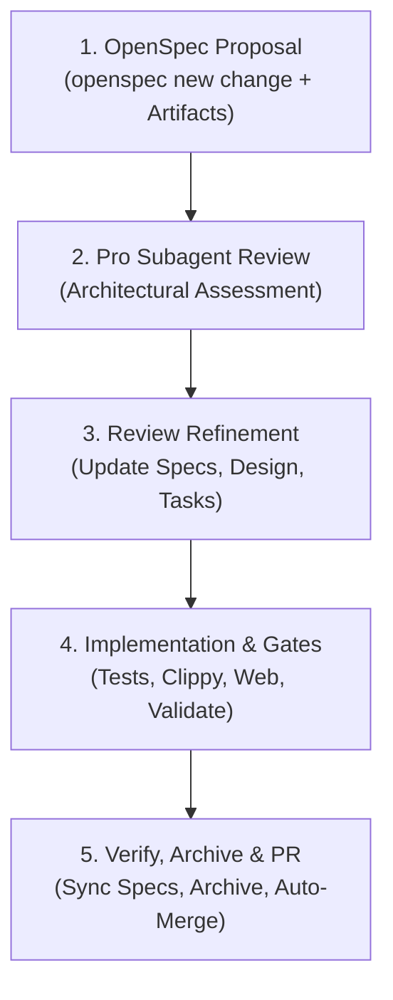

# OpenSpec 2.0 + Pro Architectural Review Workflow

This skill codifies the standard engineering process used for major architectural changes, concurrency improvements, security hardening, and infrastructure upgrades in the MMO server codebase.

> **Note for Implementation Agents**: If an active change already exists under `openspec/changes/<change-name>/`, use the [`openspec-apply-change`](../openspec-apply-change/SKILL.md) skill to proceed directly to Stage 4 & Stage 5 using the existing `design.md` and `tasks.md` blueprint.

---

## The 5-Stage Cadence



---

### Stage 1: OpenSpec Change Proposal

1. Scaffold the change using the OpenSpec 2.0 CLI (never create directories manually by hand):
   ```bash
   openspec new change "<change-name>"
   ```
2. Populate all required artifacts under `openspec/changes/<change-name>/`:
   - `proposal.md`: Context, motivation, scope, and non-goals.
   - `specs/<capability-domain>/<feature>/spec.md`: Formal delta spec (`## Purpose` for new capabilities, `## ADDED/MODIFIED/REMOVED/RENAMED Requirements`, `### Requirement: <Name>` with `SHALL`/`MUST`, and `#### Scenario: <Name>` with GIVEN/WHEN/THEN).
   - `design.md`: Technical architecture, data structures, concurrency models, and failure modes.
   - `tasks.md`: Numbered, granular `- [ ]` implementation tasks with concrete verification steps.
3. Validate the drafted change with the CLI:
   ```bash
   openspec validate "<change-name>"
   ```

---

### Stage 2: Pro Subagent Architectural Review

1. Spawn an independent architecture reviewer subagent using `invoke_subagent`:
   ```json
   {
     "TypeName": "self",
     "Role": "Architecture Reviewer",
     "Model": "pro",
     "Prompt": "Please conduct a rigorous architectural and code review of the newly drafted OpenSpec change for <change-name>.\n\nChange directory: openspec/changes/<change-name>\nFiles to examine:\n- proposal.md\n- specs/.../spec.md\n- design.md\n- tasks.md\n\nRelevant codebase files: ...\n\nEvaluate:\n1. Genre-Agnostic Core & Zero Server Pollution Invariants\n2. Concurrency, Lock Ordering, Race Conditions & Deadlocks\n3. Security, Server-Authoritative Anti-Cheat & Malformed Input Bounds\n4. Edge Cases, Failover & Task Verification Feasibility\n\nProvide a structured report with:\n- Summary of Findings\n- Critical Architectural Assessment\n- Concrete Recommendations / Adjustments\n- Final Verdict (APPROVED or APPROVED WITH MINOR ADJUSTMENTS)"
   }
   ```
2. Wait for the subagent to report its findings without polling.

---

### Stage 3: Review Incorporation & Artifact Refinement

1. Carefully analyze the review recommendations.
2. Update `design.md`, `specs/`, and `tasks.md` to incorporate all critical findings (e.g., lock ordering rules, test-safe static initializers, edge case handling, missing metrics or probes).
3. Re-run `openspec validate "<change-name>"` to confirm artifact validity before writing code.

---

### Stage 4: Granular Implementation & Quality Gates

1. Implement tasks sequentially according to `tasks.md` (or via [`openspec-apply-change`](../openspec-apply-change/SKILL.md)).
2. Keep edits focused and delegate self-contained boilerplate, codecs, SQL queries, and unit tests to subagents where appropriate.
3. Verify every module incrementally:
   - Unit & integration tests: `cargo test -p <crate-name>`
   - Property tests: `cargo test -p <crate-name> --test <test_name>`
   - Web frontend tests (if `web/` or `crates/client-wasm` touched): `npm --prefix web test -- --run` and `npm --prefix web run build`
4. Run full workspace quality gates:
   - Formatting: `cargo fmt --all -- --check`
   - Strict linter checks: `cargo clippy --workspace --all-targets -- -D warnings`
   - Full test suite: `cargo test --workspace`
5. Mark completed tasks `- [x]` in `tasks.md`.

---

### Stage 5: Verification, Spec Sync, Archive & PR Auto-Merge

1. Verify implementation coherence against the change artifacts (see [`openspec-verify-change`](../openspec-verify-change/SKILL.md)).
2. Sync delta specs into `openspec/specs/` and archive the completed change into `openspec/changes/archive/YYYY-MM-DD-<change-name>/` (using [`openspec-archive-change`](../openspec-archive-change/SKILL.md)), then verify all specs:
   ```bash
   openspec validate --all
   ```
3. For infrastructure or Kubernetes changes, optionally validate on the local cluster:
   - `./scripts/cluster.sh all` or `kubectl kustomize k8s/overlays/cloud`
4. Commit and push on a dedicated feature branch (`feat/<change-name>` or `fix/<change-name>`):
   ```bash
   git add -A
   git commit -m "feat(<scope>): <description>"
   git push -u origin feat/<change-name>
   ```
5. Create Pull Request and enable Auto-Merge:
   - `main` strictly requires PRs and green CI before merging. **Never push directly to `main`**.
   - Create PR and enable squash auto-merge:
     ```bash
     gh pr create --title "feat(<scope>): <description>" --body "<summary>" --base main
     gh pr merge <pr_number> --auto --squash
     ```
6. Report the completion summary with clickable file links and PR merge status.
