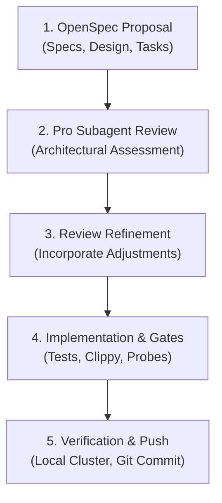

# OpenSpec + Pro Architectural Review Workflow

This skill codifies the standard engineering process used for major architectural changes, concurrency improvements, security hardening, and infrastructure upgrades in the MMO server codebase.

---

## The 5-Stage Cadence



---

### Stage 1: OpenSpec Change Proposal

1. Create a dedicated directory under `openspec/changes/<change-name>/`:
   - `.openspec.yaml`: Workflow schema and change metadata.
   - `proposal.md`: Context, motivation, scope, and non-goals.
   - `specs/<capability-domain>/<feature>/spec.md`: Formal GIVEN/WHEN/THEN requirements.
   - `design.md`: Technical architecture, data structures, concurrency models, and failure modes.
   - `tasks.md`: Numbered, granular implementation tasks with concrete verification steps.
2. Ensure backward compatibility and zero assumptions: read existing codebase interfaces first.

---

### Stage 2: Pro Subagent Architectural Review

1. Spawn an independent architecture reviewer subagent using `invoke_subagent`:
   ```json
   {
     "TypeName": "self",
     "Role": "Architecture Reviewer",
     "Model": "pro",
     "Prompt": "Please conduct a rigorous architectural and code review of the newly drafted OpenSpec change for <change-name>.\n\nChange directory: openspec/changes/<change-name>\nFiles to examine:\n- proposal.md\n- specs/.../spec.md\n- design.md\n- tasks.md\n\nRelevant codebase files: ...\n\nEvaluate:\n1. Concurrency, Race Conditions & Deadlocks\n2. Security, Anti-Cheat & Malformed Input Handling\n3. Edge Cases & Blackout Scenarios\n4. Task Granularity & Verification Feasibility\n\nProvide a structured report with:\n- Summary of Findings\n- Critical Architectural Assessment\n- Concrete Recommendations / Adjustments\n- Final Verdict (APPROVED or APPROVED WITH MINOR ADJUSTMENTS)"
   }
   ```
2. Wait for the subagent to report its findings without polling.

---

### Stage 3: Review Incorporation & Artifact Refinement

1. Carefully analyze the review recommendations.
2. Update `design.md`, `specs/`, and `tasks.md` to incorporate all critical findings (e.g., lock ordering rules, test-safe static initializers, edge case handling, missing metrics or probes).
3. Do not proceed to code implementation until the architectural plan is reconciled.

---

### Stage 4: Granular Implementation & Quality Gates

1. Implement tasks sequentially according to `tasks.md`.
2. Keep edits focused and maintain documentation integrity.
3. Verify every module incrementally:
   - Unit tests: `cargo test -p <crate-name>`
   - Property tests: `cargo test -p <crate-name> --test <test_name>`
4. Run full workspace quality gates:
   - Full test suite: `cargo test --workspace`
   - Strict linter checks: `cargo clippy --workspace --all-targets -- -D warnings`
5. Mark completed tasks `[x]` in `tasks.md`.

---

### Stage 5: Verification, PR Creation & Auto-Merge

1. For infrastructure or network changes:
   - Build image: `./scripts/cluster.sh build`
   - Import image: `./scripts/cluster.sh import`
   - Deploy manifests: `./scripts/cluster.sh deploy`
   - Verify pod readiness, logs, and telemetry scraping.
2. Run mandatory local quality gates:
   - Formatting: `cargo fmt --all -- --check`
   - Clippy linter: `cargo clippy --workspace --all-targets -- -D warnings`
   - Test suite: `cargo test --workspace`
3. Commit and push on the feature branch (`feat/<change-name>`):
   ```bash
   git add -A
   git commit -m "feat(<scope>): <description>"
   git push -u origin feat/<change-name>
   ```
4. Create Pull Request and enable Auto-Merge:
   - `main` strictly requires PRs and green CI before merging. **Never push directly to `main`**.
   - Create PR:
     ```bash
     gh pr create --title "feat(<scope>): <description>" --body "<summary>" --base main
     ```
   - Enable auto-merge with squash:
     ```bash
     gh pr merge <pr_number> --auto --squash
     ```
5. Delegate CI monitoring:
   - Spawn a lightweight `flash` subagent to monitor the PR check suite (`Lint, Test & Verify`) until merged, and fast-forward local `main`.
6. Report the completion summary with clickable file links and PR merge status.
