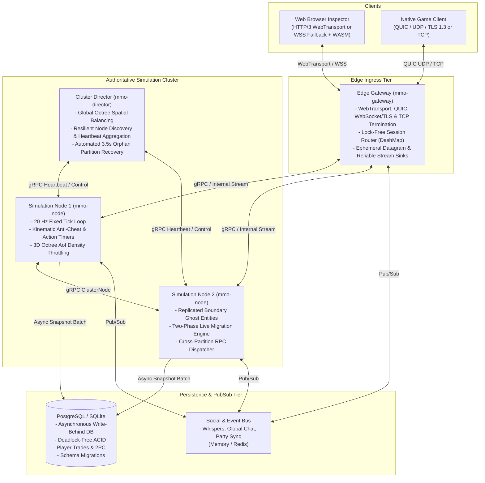
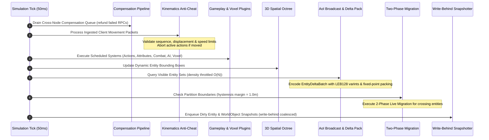
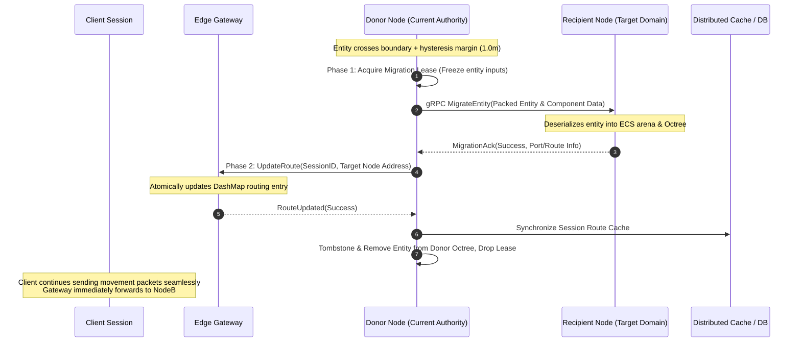
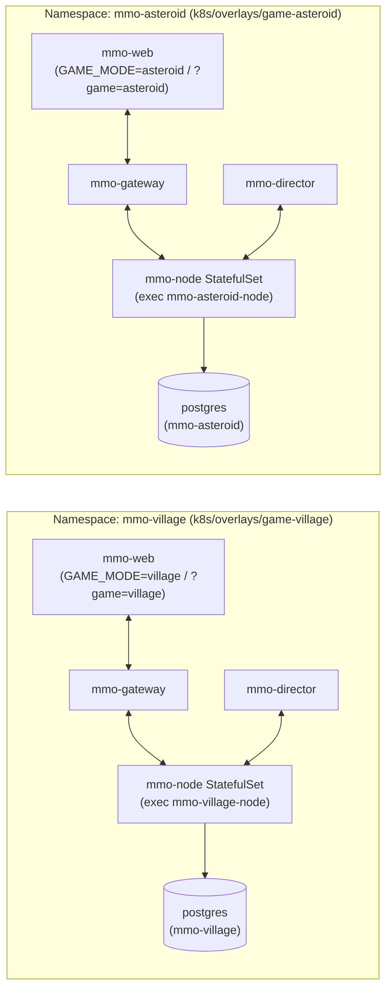

# Cluster Architecture & System Design

This document details the architectural invariants, distributed synchronization protocols, and subsystem interactions of the distributed Rust MMO server platform.

---

## 1. High-Level Cluster Topology

The system separates edge connection termination, authoritative spatial simulation, global cluster coordination, and persistent state storage into dedicated tiers:

---

## 2. Authoritative Simulation Loop (20 Hz)

Each simulation node executes a fixed 50ms tick ($20\text{ Hz}$) driven by a monotonic high-resolution clock:

### Tick Overrun Protection
If a tick's execution time exceeds $50\text{ms}$ due to temporary computational bursts, the tick accumulator is strictly clamped to a maximum of $150\text{ms}$ (3 ticks) to eliminate the "spiral of death" CPU starvation cycle.

---

## 3. Two-Phase Live Entity Migration Protocol

When an entity crosses a spatial partition boundary into a neighboring node's domain, authority is transferred without disconnecting the client:

### Invariants:
1. **Zero Duplication**: Authority belongs exclusively to Node A until Node B acknowledges ingestion and the Gateway updates the routing table.
2. **Input Freeze**: During transit, incoming actions from the client are queued or buffered rather than discarded.
3. **Rollback on Failure**: If Node B fails during Phase 1, Node A aborts the migration, releases the lease, and retains simulation authority.

---

## 4. Network Wire Protocol & Compression

The network protocol operates across four transport mechanisms sharing the same `0x4D4D` binary framing (documented in [`docs/WIRE_PROTOCOL_AND_CLIENT_SDK.md`](docs/WIRE_PROTOCOL_AND_CLIENT_SDK.md)):
1. **HTTP/3 WebTransport (Browser Primary, `4433/udp`)**: Multiplexes unreliable datagrams (movement, deltas) and reliable streams (actions, trades) with SHA-256 certificate digest pinning via `/cert-hash`.
2. **WebSocket / TLS over TCP (`ws://` / `wss://` Browser & Engine Fallback, `8443/tcp`)**: Automatic fallback for restricted networks blocking UDP/HTTP/3, multiplexing biased `SessionSink` channels over binary WebSocket frames.
3. **Native QUIC UDP (Client, `8080/udp`)**: TLS 1.3 encryption with sub-millisecond datagram delivery.
4. **Framed TCP (Bot Swarm & External Clients, `8080/tcp`)**: 8-byte header (`[0x4D, 0x4D]`, opcode `u16` LE, payload length `u32` LE).

For connecting third-party engines such as Godot 4, see [`docs/GODOT_CLIENT_INTEGRATION.md`](docs/GODOT_CLIENT_INTEGRATION.md).

### Bit-Packing & Quantization
To minimize network egress bandwidth:
- **LEB128 Varints**: Entity IDs and field masks encoded with 7-bit variable-length chunks.
- **Fixed-Point Coordinates**: Delta positions quantized to $1/128\text{m}$ resolution ($\approx 7.8\text{mm}$ error).
- **8-Bit Angles**: Yaw ($\approx 1.41^\circ$) and Pitch quantized into single bytes.
- **Baseline Acknowledgement Protocol**: The server tracks per-client baseline ticks. Unchanged fields are suppressed via bitmasks, achieving **88.05% bandwidth reduction**.

---

## 5. Subsystem Crate Architecture

| Crate | Responsibility | Key Abstractions |
| :--- | :--- | :--- |
| **`mmo-core`** | Fundamental primitives & math | `Guid`, `ComponentStore`, `SparseOctree`, `CollisionWorld`, `HookDispatcher`, `EventQueue`, `TelemetryServer` |
| **`mmo-schema`** | Wire serialization & RPCs | `ClientPacket`, `BitWriter`, `BitReader`, `EntityDeltaState`, `ClusterNode`, `GatewayService` |
| **`mmo-node`** | Authoritative 20 Hz simulation | `TickSimulation`, `KinematicsValidator`, `AoiManager`, `MigrationCoordinator`, `CrossNodeDispatcher` |
| **`mmo-director`** | Cluster topology & health | `ClusterDirector`, `SpatialRegistry`, `HeartbeatTracker`, `OrphanRecoveryCoordinator` |
| **`mmo-gateway`** | Edge connection ingress | `GatewayServer`, `SessionRouter`, `WebTransportServer`, `WebSocketServer`, `SessionSink`, `SessionDropGuard` |
| **`mmo-storage`** | Distributed SQL persistence | `StorageEngine`, `PostgresRepository`, `SqliteRepository`, `TransactionCoordinator`, `TradeCoordinator`, `SocialBus` |
| **`mmo-gameplay`** | Pluggable game rules & binaries | `CombatPlugin`, `ThreatPlugin`, `InventoryPlugin`, `TradePlugin`, `VillagePlugin`, `AsteroidMiningPlugin`, `NpcMovementPlugin`, `MonsterAiPlugin`, `WasmScriptPlugin` |
| **`mmo-plugin-voxel`** | Volumetric 3D voxel terrain | `VoxelTerrainPlugin`, `VoxelWorld`, `PaletteChunk`, `VoxelPacketHandler`, `VoxelWriteBehindService` |
| **`mmo-client-wasm`** | Zero-duplication browser WASM | `WasmClientWorld`, `InterpolationBuffer`, `ClientEntityReplica`, `decode_voxel_chunk_mesh` |
| **`mmo-loadtest`** | Scale & chaos load harness | `BotSwarm`, `BotSession`, `MovementProfile`, `MetricsCollector` |

---

## 6. Dual-Game Architecture & Plugin Composition

The platform proves strict engine decoupling by composing two radically different games—**Game A: Medieval Village & Barter RPG** (`mmo-village-node`) and **Game B: Competitive 6DoF Voxel Asteroid Miners** (`mmo-asteroid-node`)—out of the identical `mmo-core`, `mmo-node`, `mmo-director`, `mmo-gateway`, `mmo-storage`, `mmo-schema`, and `mmo-client-wasm` substrate.

### Plugin Composition Matrix

| Subsystem / Plugin | Ownership | Game A: Medieval Village & Barter RPG (`mmo-village-node`) | Game B: Competitive 6DoF Voxel Asteroid Miners (`mmo-asteroid-node`) |
| :--- | :--- | :--- | :--- |
| **`mmo-core`, `mmo-node`, `mmo-director`, `mmo-gateway`, `mmo-storage`** | **Shared Core** | Identical runtime crates & container binaries (`mmo-director`, `mmo-gateway`) | Identical runtime crates & container binaries (`mmo-director`, `mmo-gateway`) |
| **Kinematic Physics Mode (`crates/node/src/kinematics.rs`)** | **Configured per Node** | `MotionMode::DiscreteGround` (2D XZ surface movement) | `MotionMode::Newtonian6DoF` (3D XYZ zero-G thrusters with damping) |
| **`InventoryPlugin` (`crates/gameplay/src/inventory.rs`)** | **Shared Plugin** | Coin purse & village item bags (`InventoryComponent`, encumbrance) | Ship cargo hold (`InventoryComponent`, weight & slot limits for ore) |
| **`TradePlugin` (`crates/gameplay/src/trade.rs`)** | **Shared Plugin** | Atomic two-player village trading via `TradeManager` | Atomic two-player docked pilot ore/credit trading via `TradeManager` |
| **`VillagePlugin` (`module_id = 0x02`) + `NpcMovementPlugin`** | **Game A Exclusive** | NPC artisans, barter recipes, patrol waypoints, starter kits | Not installed |
| **`VoxelTerrainPlugin` (`module_id = 0x00A0`)** | **Game B Exclusive** | Not installed | `16×16×16` `PaletteChunk` RLE asteroids (`Crust=1`, `Titanium=2`, `Gold=3`, `Void Crystal=4`), emits `VoxelChangeEvent` |
| **`CombatPlugin` (`crates/gameplay/src/combat.rs`)** | **Game B Exclusive** | Not installed | Hull integrity (`HealthComponent`), PvP damage & `EntityDiedEvent` |
| **`AsteroidMiningPlugin` (`module_id = 0x03`)** | **Game B Exclusive** | Not installed | Harvests `VoxelChangeEvent` ore, encodes `state_flags` bits `16..23` shininess, PvP full-loot transfer & Home Station Vault (`StationVaultComponent`) |
| **Browser Cartridge (`web/src/`)** | **Shared Transport + Game UI** | `village` mode (`?game=village` / default) over `transport.js` & `protocol.js` | `asteroid` mode (`?game=asteroid` / `VITE_GAME_MODE=asteroid`) over `transport.js` & `protocol.js` |

### Cross-Plugin Decoupling & Zero-Protocol-Change Visual Replication

In Game B (`mmo-asteroid-node`), plugins remain completely decoupled from each other and from core crates:
1. **Event-Mediated Voxel Harvesting**: `VoxelTerrainPlugin` (`mmo-plugin-voxel`) has zero dependency on `InventoryPlugin`. Instead, `VoxelTickSystem` pushes `VoxelChangeEvent` into `TickContext::events`, and `AsteroidMiningTickSystem` consumes those events on the same 20 Hz tick to grant ore `ItemStack`s into `InventoryComponent`.
2. **Zero-Schema-Change Ship Shininess**: `AsteroidMiningPlugin` encodes each ship's unbanked cargo value tier (`0..=255`) into `Entity::state_flags` bits `16..23`. `AoiManager` already delta-replicates `state_flags` changes at 20 Hz, allowing the browser renderer to scale metallic emissive/aura shaders without changing wire schemas (`mmo-schema`) or WASM bindings (`mmo-client-wasm`).
3. **Full-Loot PvP & Safe Station Vault**: Outside the Home Orbital Station safe ring (`(0, 0, 0)`, radius `15.0`), PvP laser shots (`module_id = 0x03`, `sub_opcode = 2`) trigger `CombatPlugin` hull damage and full-loot cargo transfer on `EntityDiedEvent`. Pilots docked inside the safe ring can deposit cargo into permanent `StationVaultComponent` storage (`sub_opcode = 3`) or trade safely via the shared `TradePlugin` (`sub_opcode = 4..=7`).

### Side-by-Side Dual-Game Kubernetes Topology

Both games are packaged in the unified `mmo-server` [`Dockerfile`](Dockerfile) (bundling `mmo-director`, `mmo-node`, `mmo-village-node`, `mmo-asteroid-node`, `mmo-gateway`, and `mmo-loadtest`) and deployed into isolated Kubernetes namespaces using Kustomize overlays:

---

## 7. Storage & Write-Behind Persistence

The storage tier separates high-frequency simulation state updates from relational database persistence:
- **Write-Behind Coalesced Snapshotting**: Dirty entity and world-object state changes are coalesced in memory during the tick and flushed asynchronously in batches using parameterized multi-row `INSERT ... ON CONFLICT DO UPDATE` queries.
- **Atomic Two-Player Item Trading & 2PC Containers**: Player-to-player item exchanges and cross-container 2PC transfers execute under strict ascending GUID-ordered row locking (`SELECT ... FOR UPDATE`), preventing deadlocks and guaranteeing zero item duplication even under network drops.
- **Session Caching**: Dynamic gateway route lookups fall back to a distributed cache layer with automatic TTL-based expiration.

---

## 8. Deployment Topologies & Operational Guides

| Environment | Entry Point | Topology & Services | Reference |
| :--- | :--- | :--- | :--- |
| **Local Single-Command Demo** | `docker compose up -d` | `director`, `node-1` (`mmo-village-node`), `node-2` (`mmo-node`), `gateway`, `web` (`:3000`), optional `storage` & `loadtest` profiles | [`docker-compose.yml`](docker-compose.yml) |
| **Native Local Dual-Game Dev** | `cargo run --bin mmo-asteroid-node` / `mmo-village-node` + `npm --prefix web run dev` | Local `mmo-director`, `mmo-gateway`, chosen game node binary, and Vite HMR (`?game=village` or `?game=asteroid`) | [`README.md`](README.md) |
| **Local Kubernetes (`k3d`)** | `./scripts/cluster.sh all` | `k8s/k3d.yaml` + `k8s/overlays/local/` (`mmo-director`, `mmo-gateway`, `mmo-node` StatefulSet, `postgres`, Prometheus `:9090`, Grafana `:3000`) | [`scripts/cluster.sh`](scripts/cluster.sh) |
| **Dual-Game K8s: Village RPG** | `kubectl kustomize k8s/overlays/game-village` / `kubectl apply -k ...` | Namespace `mmo-village`: shared `mmo-director`/`mmo-gateway`/`postgres`, `mmo-node` running `mmo-village-node`, `mmo-web` serving `village` mode | [`k8s/overlays/game-village/`](k8s/overlays/game-village/kustomization.yaml) |
| **Dual-Game K8s: Asteroid Miners** | `kubectl kustomize k8s/overlays/game-asteroid` / `kubectl apply -k ...` | Namespace `mmo-asteroid`: shared `mmo-director`/`mmo-gateway`/`postgres`, `mmo-node` running `mmo-asteroid-node`, `mmo-web` serving `asteroid` mode | [`k8s/overlays/game-asteroid/`](k8s/overlays/game-asteroid/kustomization.yaml) |
| **Cloud PoC & Flux GitOps** | `kubectl apply -k k8s/overlays/cloud` | `k8s/overlays/cloud/` + `k8s/flux-system/` with Let's Encrypt HTTPS ingress, `/cert-hash` routing, UDP `:4433`, WSS `:8443` | [`docs/CLOUD_POC_DEPLOYMENT.md`](docs/CLOUD_POC_DEPLOYMENT.md) |
| **External Client & Godot SDKs** | `0x4D4D` Binary Framing | Custom native/Godot client connectivity, auth handshake, and `EntityDeltaBatch` decoding | [`docs/WIRE_PROTOCOL_AND_CLIENT_SDK.md`](docs/WIRE_PROTOCOL_AND_CLIENT_SDK.md), [`docs/GODOT_CLIENT_INTEGRATION.md`](docs/GODOT_CLIENT_INTEGRATION.md) |
