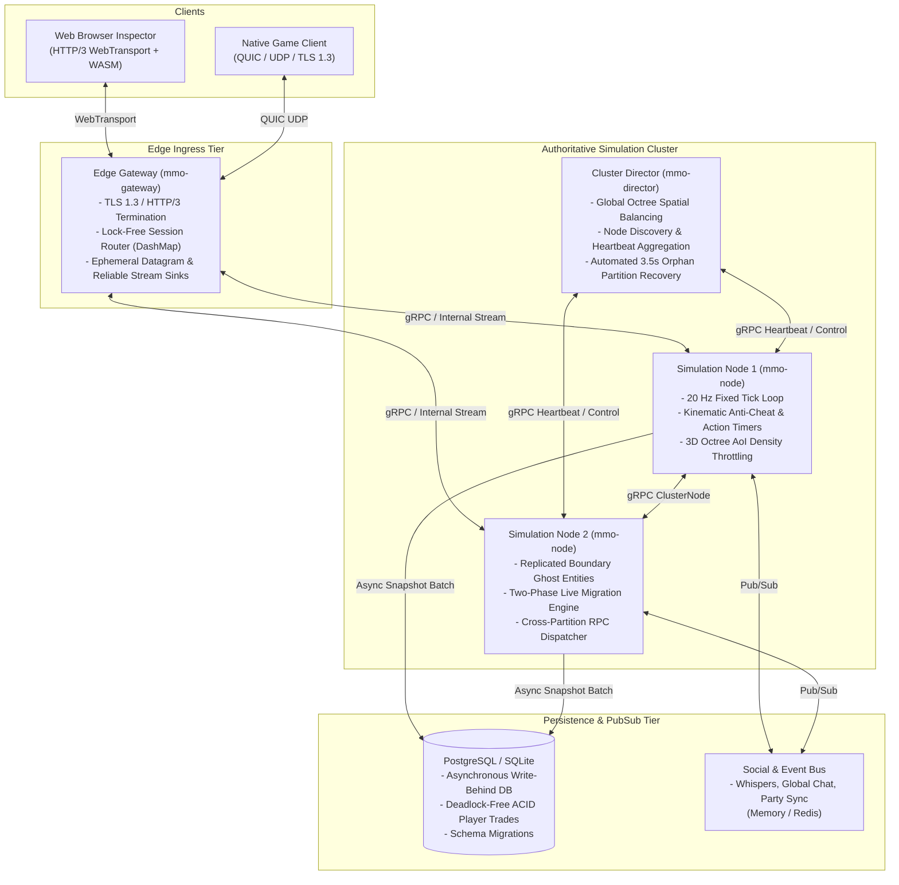
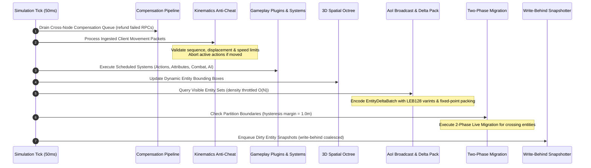
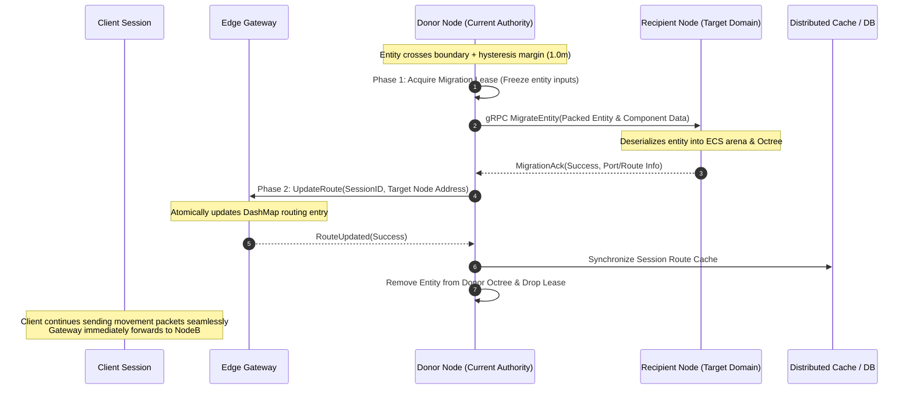

# Cluster Architecture & System Design

This document details the architectural invariants, distributed synchronization protocols, and subsystem interactions of the distributed Rust MMO server platform.

---

## 1. High-Level Cluster Topology

The system separates edge connection termination, authoritative spatial simulation, global cluster coordination, and persistent state storage into dedicated tiers:

---

## 2. Authoritative Simulation Loop (20 Hz)

Each simulation node executes a fixed 50ms tick ($20\text{ Hz}$) driven by a monotonic high-resolution clock:

### Tick Overrun Protection
If a tick's execution time exceeds $50\text{ms}$ due to temporary computational bursts, the tick accumulator is strictly clamped to a maximum of $150\text{ms}$ (3 ticks) to eliminate the "spiral of death" CPU starvation cycle.

---

## 3. Two-Phase Live Entity Migration Protocol

When an entity crosses a spatial partition boundary into a neighboring node's domain, authority is transferred without disconnecting the client:

### Invariants:
1. **Zero Duplication**: Authority belongs exclusively to Node A until Node B acknowledges ingestion and the Gateway updates the routing table.
2. **Input Freeze**: During transit, incoming actions from the client are queued or buffered rather than discarded.
3. **Rollback on Failure**: If Node B fails during Phase 1, Node A aborts the migration, releases the lease, and retains simulation authority.

---

## 4. Network Wire Protocol & Compression

The network protocol operates across three transport mechanisms:
1. **HTTP/3 WebTransport (Browser)**: Multiplexes datagrams (movement, deltas) and streams (reliable actions).
2. **Native QUIC UDP (Client)**: TLS 1.3 encryption with sub-millisecond datagram delivery.
3. **Framed TCP (Fallback)**: 8-byte header (`[0x4D, 0x4D]`, opcode `u16`, length `u32`).

### Bit-Packing & Quantization
To minimize network egress bandwidth:
- **LEB128 Varints**: Entity IDs and field masks encoded with 7-bit variable-length chunks.
- **Fixed-Point Coordinates**: Delta positions quantized to $1/128\text{m}$ resolution ($\approx 7.8\text{mm}$ error).
- **8-Bit Angles**: Yaw ($\approx 1.41^\circ$) and Pitch quantized into single bytes.
- **Baseline Acknowledgement Protocol**: The server tracks per-client baseline ticks. Unchanged fields are suppressed via bitmasks, achieving **88.05% bandwidth reduction**.

---

## 5. Subsystem Crate Architecture

| Crate | Responsibility | Key Abstractions |
| :--- | :--- | :--- |
| **`mmo-core`** | Fundamental primitives & math | `Guid`, `ComponentStore`, `SparseOctree`, `HookDispatcher`, `EventQueue`, `TelemetryServer` |
| **`mmo-schema`** | Wire serialization & RPCs | `ClientPacket`, `BitWriter`, `BitReader`, `EntityDeltaState`, `ClusterNode`, `GatewayService` |
| **`mmo-node`** | Authoritative 20 Hz simulation | `TickSimulation`, `KinematicsValidator`, `AoiManager`, `MigrationCoordinator`, `CrossNodeDispatcher` |
| **`mmo-director`** | Cluster topology & health | `ClusterDirector`, `SpatialRegistry`, `HeartbeatTracker`, `OrphanRecoveryCoordinator` |
| **`mmo-gateway`** | Edge connection ingress | `GatewayServer`, `SessionRouter`, `WebTransportServer`, `SessionSink`, `SessionDropGuard` |
| **`mmo-storage`** | Distributed SQL persistence | `StorageEngine`, `PostgresRepository`, `SqliteRepository`, `TradeCoordinator`, `SocialBus` |
| **`mmo-gameplay`** | Pluggable game rules | `CombatPlugin`, `ThreatPlugin`, `InventoryPlugin`, `TradePlugin`, `AbilityPlugin`, `MonsterAiPlugin` |
| **`mmo-client-wasm`** | Zero-duplication browser WASM | `WasmClientWorld`, `InterpolationBuffer`, `ClientEntityReplica` |
| **`mmo-loadtest`** | Scale & chaos load harness | `BotSwarm`, `BotSession`, `MovementProfile`, `MetricsCollector` |

---

## 6. Storage & Write-Behind Persistence

The storage tier separates high-frequency simulation state updates from relational database persistence:
- **Write-Behind Coalesced Snapshotting**: Dirty entity state changes are coalesced in memory during the tick and flushed asynchronously in batches using parameterized multi-row `INSERT ... ON CONFLICT DO UPDATE` queries.
- **Atomic Two-Player Item Trading**: Player-to-player item exchanges execute under strict GUID-ordered row locking (`SELECT ... FOR UPDATE`) in PostgreSQL, preventing deadlocks and guaranteeing zero item duplication even under network drops.
- **Session Caching**: Dynamic gateway route lookups fall back to a distributed cache layer with automatic TTL-based expiration.
