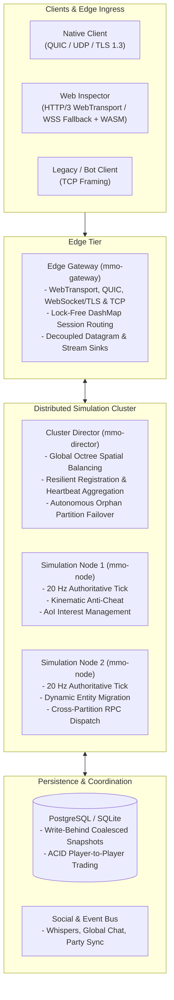

# Distributed Rust MMO Server Platform

[](LICENSE)
[](https://www.rust-lang.org)
[](https://github.com/Jakousa/rust-server/actions/workflows/rust.yml)

A high-performance, server-authoritative, spatially partitioned virtual world simulation engine and modular gameplay platform written in Rust.

---

## Core Philosophy & Design Principles

This project is a **genre-agnostic virtual world simulation engine**. It solves the hardest distributed systems challenges—elastic 3D spatial partitioning, authoritative state synchronization, zero-duplication live entity migration, high-throughput delta compression, ACID persistence, and browser-native HTTP/3 WebTransport + WebSocket fallback ingress—while isolating gameplay rules into decoupled plugins.

Whether the simulated universe is a fantasy MMORPG, a space trading simulation, a physics-driven survival sandbox, or a dense virtual meta-world, the engine substrate remains unchanged.



---

## 1. The Genre-Agnostic Substrate

The engine core (`crates/core`, `crates/node`, `crates/director`, `crates/gateway`, `crates/schema`, `crates/storage`) contains **zero assumptions** about specific game genres or RPG tropes. Instead, it provides generalized mathematical and spatial primitives:
- **Spatial Queries & Targeting**: 3D Octree point-range, cone/cleave arcs, spherical radial gathers, navgrid pathfinding, and raycast Line-of-Sight against AABB bounding volumes and pluggable `CollisionWorld` substrates.
- **Cancellable Timed Actions**: Generalized tasks with durations and interruption flags (movement displacement, damage events, stuns), powering ability cast bars, lockpicking, weapon reloading, or warp-drive spooling.
- **Dynamic Attribute Sets**: Indexed scalar properties with extensible `AttributeRegistry` aliases, modifiers, clamps, and passive regeneration tick curves.
- **Entity Identity & Components**: 64-bit generational GUIDs with type-erased dynamic ECS component stores.

## 2. Strict Server Authority & Anti-Cheat

Clients submit movement intentions and interaction requests; the server computes ground truth. The 20 Hz fixed-step loop validates kinematic boundaries, RFC 1982 sequence continuity, and jitter-tolerant elapsed time ($\Delta t$) to eliminate speed hacking, teleportation, and state desynchronization.

## 3. Elastic Spatial Distribution & Zero-Downtime Migration

Worlds are partitioned across multiple simulation nodes using a dynamic 3D Octree coordinated by the central Director. When an entity crosses partition boundaries, a Two-Phase Migration Protocol transfers authority with zero entity duplication, freezes local state during transit, and dynamically invalidates Edge Gateway routes without disconnecting the client.

## 4. Cross-Partition Interactions & Boundary Dispatches

Entities can target and interact with replicated ghost entities residing across spatial partition boundaries. Outbound RPC dispatchers automatically apply speculative cooldowns, re-validate ranges on authoritative recipient nodes ($1.2\times$ kinematic tolerance), and drain non-blocking compensation pipelines to refund resources if target nodes fail or timeout.

## 5. High-Throughput Delta Compression & Bit-Packing

Network bandwidth is minimized using LEB128 varints, sub-byte bit-packing, and fixed-point quantization ($1/128\text{m}$ resolution, 8-bit yaw/pitch, 16-bit velocity). A baseline acknowledgement protocol achieves **88.05% bandwidth egress reduction** under dense 1,000-entity clusters.

## 6. Zero-Install WebTransport, WebSocket Fallback & WebAssembly Ingress

Alongside native QUIC UDP and TCP, the Edge Gateway exposes an HTTP/3 WebTransport listener with self-signed certificate fingerprint pinning (`/cert-hash`) and a TCP/TLS WebSocket (`ws://` / `wss://`) fallback server. When UDP/HTTP/3 is blocked on restricted networks, the browser client automatically falls back to WebSocket using the identical `0x4D4D` binary framing. The companion browser client compiles pure Rust decoding and interpolation into WebAssembly (`crates/client-wasm`), powering an interactive 3D Web Inspector (`web/`) with zero duplicated serialization code.

---

## Workspace Architecture

```
rust-server/
├── crates/
│   ├── core/            # Generational GUIDs, dynamic ECS ComponentStore, Sparse 3D Octree, CollisionWorld, metrics
│   ├── schema/          # Wire protocols (0x4D4D framing), LEB128 varints, bitpack codecs, gRPC cluster schemas
│   ├── node/            # Authoritative 20 Hz simulation daemon, kinematics anti-cheat, AoI, live migration
│   ├── director/        # Global cluster orchestrator, node discovery, spatial domain balancing, orphan failover
│   ├── gateway/         # Edge ingress proxy: HTTP/3 WebTransport, QUIC UDP, WebSocket/WSS fallback, and TCP
│   ├── storage/         # Dual SQL engine (PostgreSQL & SQLite), 2PC containers, ACID trade/escrow, write-behind DB
│   ├── gameplay/        # Pluggable modules: Combat, Threat, Inventory, Trade, Barter, Quests, Guilds, NPC AI, WASM scripts
│   ├── plugins/
│   │   └── voxel/       # Modular volumetric 3D voxel & deformable terrain plugin (16³ palette chunks, RLE, CSG)
│   ├── loadtest/        # Scale & chaos test bot swarm generator (RandomWalk, HotspotClustering, CombatInteraction)
│   └── client-wasm/     # Pure Rust WebAssembly leaf crate: zero-copy Float32Array render buffer, delta & voxel decoding
├── web/                 # Interactive 3D Web Visual Inspector (Vite + Three.js), HUD, Vitest + Playwright E2E suites
├── k8s/                 # Kubernetes manifests (base, local k3d overlay, cloud overlay, and Flux v2 GitOps system)
├── docs/                # Cloud PoC deployment, wire protocol SDK, Godot client integration, and architecture audits
├── openspec/            # OpenSpec 2.0 capability specifications (openspec/specs/) and archived change history
└── scripts/             # Cluster lifecycle, chaos failover testing, and deployment automation scripts
```

---

## Key Platform Capabilities

- **Elastic 3D Spatial Partitioning**: Dynamic Sparse 3D Octree world partitioning coordinated by the Director, with Two-Phase Live Entity Migration transferring authority across partition boundaries with zero entity duplication, input freeze leases, and dynamic gateway route invalidation.
- **Strict Server Authority & Kinematic Anti-Cheat**: 20 Hz fixed-step simulation loop calculating elapsed time strictly via server monotonic clocks, enforcing sequence continuity, and validating kinematic boundaries to eliminate speed hacks, teleportation, and time banking.
- **Cross-Partition Interaction & Boundary Targeting**: Unified targeting across local entities and replicated boundary ghosts, cross-node ability RPC dispatch, anti-cheat range re-validation ($1.2\times$ kinematic tolerance), and non-blocking MPSC resource compensation pipelines.
- **High-Throughput Delta Compression & Bit-Packing**: LEB128 varints, sub-byte bit-packing, and fixed-point quantization ($1/128\text{m}$ position, 8-bit yaw/pitch, 16-bit velocity) paired with a baseline acknowledgement protocol delivering an **88.05% bandwidth egress reduction**.
- **Multi-Transport Edge Ingress**: Hybrid Edge Gateway supporting HTTP/3 WebTransport (browser), automatic WebSocket/TLS (`ws://`/`wss://`) fallback for UDP-restricted networks, native QUIC UDP with TLS 1.3 (client), and framed TCP with lock-free `DashMap` session routing and decoupled datagram/stream egress sinks.
- **Browser WebAssembly Client & 3D Inspector**: Zero-server-pollution Rust WebAssembly leaf crate (`crates/client-wasm`) compiled via `wasm-bindgen`, client-side Hermite/LERP temporal smoothing, and an interactive Three.js 3D Web Visual Inspector (`web/`) with live HUD telemetry, NPC barter, and player trading.
- **Pluggable ECS Gameplay, Voxel Terrain & WASM Scripting**: Decoupled plugin architecture implementing [`GameplayPlugin`](crates/core/src/plugin.rs) with open typed event queues, cancellable timed actions, fuel-metered Wasmtime scripting sandbox, autonomous FSM-driven NPC AI, and a volumetric 3D voxel plugin (`crates/plugins/voxel`).
- **Production Distributed Persistence**: Dual-engine SQL persistence supporting distributed PostgreSQL and hermetic SQLite, automated schema migrations, deadlock-free ACID item trading and 2PC container transfers, and asynchronous write-behind coalesced snapshots.
- **Cluster Resilience, Chaos Validation & GitOps Delivery**: Self-healing Director node registration, autonomous 3.5s dead-node detection and orphan partition failover, Flux v2 GitOps continuous delivery (`k8s/flux-system/`), headless bot swarm generator (10k bot capacity), and local/cloud Kubernetes overlays with Grafana observability.

---

## Playable Village & Barter Showcase

The repository ships an interactive **Village & Barter Vertical Slice** powered by [`mmo-village-node`](crates/gameplay/src/bin/mmo_village_node.rs), `mmo-gateway`, and the Three.js browser client in [`web/`](web/):

- **Auto-Discovery & Transport Fallback**: On load, the Web Visual Inspector resolves the gateway host, fetches `/cert-hash`, and connects over **HTTP/3 WebTransport** (`:4433/udp`), automatically falling back to **WebSocket** (`ws://`/`wss://` on `:8443/tcp`) when UDP is restricted. Live connection state (`Disconnected`, `Connecting...`, `Connected`) and active protocol (`HTTP/3`, `WebSocket`, `Offline`) appear in the **Edge Gateway** HUD header.
- **Controls & Multi-Tab Playtesting**:
  - `WASD` / `Arrow` keys: Move and turn (`Space` to trigger action/cast; keyboard movement is automatically ignored while typing into HUD inputs).
  - `Mouse Drag` / `Scroll Wheel`: Orbit pitch/yaw and zoom the 3D camera around your character.
  - `E` (within `5m`): Open the NPC Barter modal with village artisans (*Blacksmith Ilmari*, *Herbalist Aino*, *Elder Väinö*) or initiate atomic two-player gold/item trading with another browser tab (each tab receives an isolated `sessionStorage` guest identity).

---

## Quickstart & Local Development

### 1. Single-Command Docker Compose Stack (Fastest Local Demo)
Launch the full distributed showcase (`director`, `node-1` running `mmo-village-node`, `node-2` running `mmo-node`, `gateway`, and `web` Nginx frontend) from [`docker-compose.yml`](docker-compose.yml):

```bash
docker compose up -d
```

- **Web Visual Inspector**: [http://localhost:3000](http://localhost:3000)
- **Gateway Endpoints**: `4433/udp` (HTTP/3 WebTransport), `8080/tcp` (framed TCP), `9091/tcp` (admin `/cert-hash`, `/healthz`, `/ready`, `/metrics`)
- **Director gRPC**: `50051/tcp`
- **Optional Compose Profiles**:
  ```bash
  # Include PostgreSQL (:5432) and Redis (:6379)
  docker compose --profile storage up -d

  # Run the synthetic bot load generator against gateway:8080
  docker compose --profile loadtest up
  ```

### 2. Web Visual Inspector & Vite Dev Server (`web/`)
Run the frontend locally with hot module replacement (HMR) against either Docker Compose or native Rust daemons:

```bash
# Install dependencies (first time only)
npm --prefix web install

# Start Vite dev server at http://localhost:3000
npm --prefix web run dev

# Run Vitest unit tests and Vite production bundle build
npm --prefix web test -- --run
npm --prefix web run build

# Run headless WebGL Playwright E2E browser tests
npm --prefix web run test:e2e
```

To run the native Rust cluster locally alongside `npm --prefix web run dev` (in separate terminals):
```bash
cargo run -p mmo-director
cargo run -p mmo-gameplay --bin mmo-village-node
cargo run -p mmo-gateway
```

### 3. Local Kubernetes Cluster (`k3d`)
Cluster lifecycle, image builds, load testing, and chaos failover are automated via [`scripts/cluster.sh`](scripts/cluster.sh) using [`k8s/k3d.yaml`](k8s/k3d.yaml) and `k8s/overlays/local/`:

```bash
# Provision local k3d cluster, build mmo-server:local, import image, and deploy
./scripts/cluster.sh all

# Inspect pods, services, and statefulsets in the mmo namespace
./scripts/cluster.sh status

# Run bot swarm load test (1,000 bots, 10s duration, hotspot behavior)
./scripts/cluster.sh loadtest 1000 10 hotspot

# Run end-to-end chaos failover & recovery test
./scripts/cluster.sh chaos

# Fast iteration: rebuild image, re-import into k3d, and rolling restart
./scripts/cluster.sh reload
```

Local `k3d` forwards ports `4433/udp` (WebTransport), `8080/tcp+udp` (TCP/QUIC), `9091` (Gateway admin & `/cert-hash`), `50051` (Director), `9090` (Prometheus), and `3000` (Grafana, `admin`/`admin`).

### 4. Cloud PoC Deployment & GitOps
For public cloud VM sizing, firewall rules (`UDP 4433` WebTransport, `TCP 8443` WebSocket fallback, `TCP 8080` TCP ingress, `TCP 80/443/3000` web + `/cert-hash`), kernel UDP buffer tuning, `k8s/overlays/cloud/`, and Flux v2 GitOps (`k8s/flux-system/`), see:
- [`docs/CLOUD_POC_DEPLOYMENT.md`](docs/CLOUD_POC_DEPLOYMENT.md)

### 5. External Client SDK & Godot Integration
Build external native or engine clients using the shared `0x4D4D` binary wire protocol, LEB128 varint delta decoding, and WebAssembly/SDK bindings:
- **Wire Protocol & Client SDK Guide**: [`docs/WIRE_PROTOCOL_AND_CLIENT_SDK.md`](docs/WIRE_PROTOCOL_AND_CLIENT_SDK.md)
- **Godot Client Integration Guide**: [`docs/GODOT_CLIENT_INTEGRATION.md`](docs/GODOT_CLIENT_INTEGRATION.md)
- **Browser WebAssembly Adapter**: [`crates/client-wasm`](crates/client-wasm)

### 6. Rust Workspace Build, Lint & Quality Gates
```bash
# Check formatting and strict linter (zero warnings allowed)
cargo fmt --all -- --check
cargo clippy --workspace --all-targets -- -D warnings

# Run all unit, property, and integration tests across the workspace
cargo test --workspace

# Validate all OpenSpec 2.0 capability specifications
openspec validate --all
```

---

## Contributing

Contributions, feedback, and architectural discussions are welcome! Please check our [Contributing Guidelines](CONTRIBUTING.md), [Agent Engineering Guidelines](AGENTS.md), and [Architecture Guide](ARCHITECTURE.md) to get started.

---

## License

This project is open source and available under the [MIT License](LICENSE) — free for anyone to use, extend, modify, and build upon.
