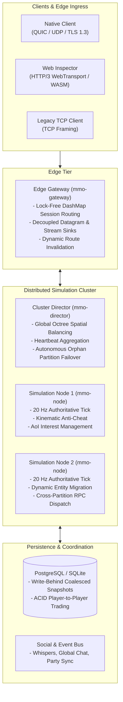

# Distributed Rust MMO Server Platform

[](LICENSE)
[](https://www.rust-lang.org)
[](https://github.com/Jakousa/rust-server/actions/workflows/rust.yml)

A high-performance, server-authoritative, spatially partitioned virtual world simulation engine and modular gameplay platform written in Rust.

---

## Core Philosophy & Design Principles

This project is a **genre-agnostic virtual world simulation engine**. It solves the hardest distributed systems challenges—elastic 3D spatial partitioning, authoritative state synchronization, zero-duplication live entity migration, high-throughput delta compression, ACID persistence, and browser-native HTTP/3 WebTransport ingress—while isolating gameplay rules into decoupled plugins.

Whether the simulated universe is a fantasy MMORPG, a space trading simulation, a physics-driven survival sandbox, or a dense virtual meta-world, the engine substrate remains unchanged.



---

## 1. The Genre-Agnostic Substrate

The engine core (`crates/core`, `crates/node`, `crates/director`, `crates/gateway`) contains **zero assumptions** about specific game genres or RPG tropes. Instead, it provides generalized mathematical and spatial primitives:
- **Spatial Queries & Targeting**: 3D Octree point-range, cone/cleave arcs, spherical radial gathers, and raycast Line-of-Sight against AABB bounding volumes.
- **Cancellable Timed Actions**: Generalized tasks with durations and interruption flags (movement displacement, damage events, stuns), powering ability cast bars, lockpicking, weapon reloading, or warp-drive spooling.
- **Dynamic Attribute Sets**: Keyed scalar properties with modifiers, clamps, and passive regeneration tick curves.
- **Entity Identity & Components**: 64-bit generational GUIDs with type-erased dynamic ECS component stores.

## 2. Strict Server Authority & Anti-Cheat

Clients submit movement intentions and interaction requests; the server computes ground truth. The 20 Hz fixed-step loop validates kinematic boundaries, sequence continuity, and jitter-tolerant elapsed time ($\Delta t$) to eliminate speed hacking, teleportation, and state desynchronization.

## 3. Elastic Spatial Distribution & Zero-Downtime Migration

Worlds are partitioned across multiple simulation nodes using a dynamic 3D Octree coordinated by the central Director. When an entity crosses partition boundaries, a Two-Phase Migration Protocol transfers authority with zero entity duplication, freezes local state during transit, and dynamically invalidates Edge Gateway routes without disconnecting the client.

## 4. Cross-Partition Interactions & Boundary Dispatches

Entities can target and interact with replicated ghost entities residing across spatial partition boundaries. Outbound RPC dispatchers automatically apply speculative cooldowns, re-validate ranges on authoritative recipient nodes ($1.2\times$ kinematic tolerance), and drain non-blocking compensation pipelines to refund resources if target nodes fail or timeout.

## 5. High-Throughput Delta Compression & Bit-Packing

Network bandwidth is minimized using LEB128 varints, sub-byte bit-packing, and fixed-point quantization ($1/128\text{m}$ resolution, 8-bit yaw/pitch, 16-bit velocity). A baseline acknowledgement protocol achieves **88.05% bandwidth egress reduction** under dense 1,000-entity clusters.

## 6. Zero-Install WebTransport & WebAssembly Ingress

Alongside native QUIC UDP and TCP, the Edge Gateway exposes an HTTP/3 WebTransport listener with self-signed certificate fingerprint pinning. The companion browser client compiles pure Rust decoding and interpolation into WebAssembly (`crates/client-wasm`), powering an interactive 3D Web Inspector (`web/`) with zero duplicated serialization code.

---

## Workspace Architecture

```
rust-server/
├── crates/
│   ├── core/         # Generational GUIDs, dynamic ECS ComponentStore, Sparse 3D Octree, veto hooks, Prometheus metrics
│   ├── schema/       # Wire protocols, LEB128 varints, bitpack codecs, and gRPC cluster coordination schemas
│   ├── node/         # Authoritative 20 Hz simulation daemon, kinematics anti-cheat, AoI management, live migration
│   ├── director/     # Global cluster orchestrator, node discovery, spatial domain balancing, orphan failover
│   ├── gateway/      # Edge ingress proxy, dual TCP / native QUIC / HTTP/3 WebTransport termination, lock-free routing
│   ├── storage/      # Dual SQL engine (PostgreSQL & SQLite), automated migrations, ACID trade transactions, write-behind DB
│   ├── gameplay/     # Pluggable modules: Combat, Threat, Inventory, Trade, Loot, Quests, Guilds, Parties, NPC AI
│   ├── loadtest/     # Scale & chaos test bot swarm generator (RandomWalk, HotspotClustering, CombatInteraction)
│   └── client-wasm/  # Pure Rust WebAssembly leaf crate: zero-copy Float32Array render buffer, delta decoding, interpolation
├── web/              # Interactive 3D Web Visual Inspector (Vite + Three.js), developer HUD, WASD controls
├── k8s/              # Kubernetes manifests (Director, Gateway, Nodes, PostgreSQL, Prometheus, Grafana)
├── openspec/         # Rigorous OpenSpec specifications, delta specs, proposals, and design documents
└── scripts/          # Cluster lifecycle, chaos failover testing, and deployment automation scripts
```

---

## Key Platform Capabilities

- **Elastic 3D Spatial Partitioning**: Dynamic Sparse 3D Octree world partitioning coordinated by the Director, with Two-Phase Live Entity Migration transferring authority across partition boundaries with zero entity duplication, input freeze leases, and dynamic gateway route invalidation.
- **Strict Server Authority & Kinematic Anti-Cheat**: 20 Hz fixed-step simulation loop calculating elapsed time strictly via server monotonic clocks, enforcing sequence continuity, and validating kinematic boundaries to eliminate speed hacks, teleportation, and time banking.
- **Cross-Partition Interaction & Boundary Targeting**: Unified targeting across local entities and replicated boundary ghosts, cross-node ability RPC dispatch, anti-cheat range re-validation ($1.2\times$ kinematic tolerance), and non-blocking MPSC resource compensation pipelines.
- **High-Throughput Delta Compression & Bit-Packing**: LEB128 varints, sub-byte bit-packing, and fixed-point quantization ($1/128\text{m}$ position, 8-bit yaw/pitch, 16-bit velocity) paired with a baseline acknowledgement protocol delivering an **88.05% bandwidth egress reduction**.
- **Multi-Transport Edge Ingress**: Hybrid Edge Gateway supporting HTTP/3 WebTransport (browser), native QUIC UDP with TLS 1.3 (client), and framed TCP with lock-free `DashMap` session routing and decoupled datagram/stream egress sinks.
- **Browser WebAssembly Client & 3D Inspector**: Zero-server-pollution Rust WebAssembly leaf crate (`crates/client-wasm`) compiled via `wasm-bindgen`, client-side Hermite/LERP temporal smoothing, and an interactive Three.js 3D Web Visual Inspector (`web/`) with live HUD telemetry.
- **Pluggable ECS Gameplay & AI**: Decoupled plugin architecture implementing [`GameplayPlugin`](crates/core/src/plugin.rs) with open typed event queues, dynamic component serialization codecs, cancellable timed actions, dynamic attribute sets, and autonomous FSM-driven NPC AI.
- **Production Distributed Persistence**: Dual-engine SQL persistence supporting distributed PostgreSQL and hermetic SQLite, automated schema migrations, deadlock-free ACID item trading, and asynchronous write-behind coalesced snapshots.
- **Cluster Resilience & Chaos Validation**: Autonomous 3.5s dead-node detection and orphan partition failover, headless bot swarm generator (10k bot capacity) with trajectory profiles, and local Kubernetes (`k3d`) deployment with Grafana observability.

---

## Quickstart & Local Development

### 1. Rust Workspace Build & Test
```bash
# Check formatting and strict linter
cargo fmt --all -- --check
cargo clippy --workspace --all-targets -- -D warnings

# Run all unit and integration tests across the workspace
cargo test --workspace
```

### 2. Launching the Web Visual Inspector Frontend
```bash
# Navigate to web application directory
cd web

# Install dependencies (first time only)
npm install

# Run Vite development server (hot-reloading at http://localhost:3000)
npm run dev

# Or build standalone production bundle
npm run build
```

### 3. Cluster Operations via Docker & Kubernetes
Cluster lifecycle and chaos testing are abstracted into single-step commands via [`scripts/cluster.sh`](scripts/cluster.sh):

```bash
# 1. Provision local Kubernetes cluster (k3d) via declarative config (k8s/k3d.yaml)
./scripts/cluster.sh up
# Or directly: k3d cluster create --config k8s/k3d.yaml

# 2. Build images and deploy cluster (Director, Gateway, Nodes, Postgres, Grafana)
./scripts/cluster.sh all

# 3. Check cluster status and node health
./scripts/cluster.sh status

# 4. Run bot swarm load test (e.g. 1,000 bots, 10s duration, hotspot behavior)
./scripts/cluster.sh loadtest 1000 10 hotspot

# 5. Run end-to-end chaos failover & recovery test
./scripts/cluster.sh chaos

# 6. Fast iteration: rebuild code, re-import image, and rolling restart
./scripts/cluster.sh reload
```

---

## Contributing

Contributions, feedback, and architectural discussions are welcome! Please check our [Contributing Guidelines](CONTRIBUTING.md) and [Architecture Guide](ARCHITECTURE.md) to get started.

---

## License

This project is open source and available under the [MIT License](LICENSE) — free for anyone to use, extend, modify, and build upon.
