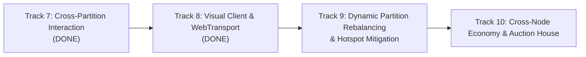

# MMO Cluster Architecture & Engineering Roadmap

This document outlines the architectural milestones, completed foundations, and scheduled engineering tracks for the distributed Rust MMO server cluster.

---

## Current Architecture Status (September 2026)

The cluster is built around an authoritative, distributed tick-based simulation architecture:
- **Director (`crates/director`)**: Global cluster orchestrator managing simulation node discovery, 3D Octree spatial domain coordination, heartbeat aggregation, and orphan partition recovery.
- **Simulation Nodes (`crates/node`)**: Authoritative 20 Hz fixed-tick simulation nodes executing kinematics validation, Area of Interest (AoI) interest management, hook pipelines, and asynchronous write-behind SQLite snapshotting.
- **Edge Gateway (`crates/gateway`)**: Dual TCP/QUIC edge ingress proxy handling client packet framing, session multiplexing, lock-free routing via `DashMap`, non-blocking downstream dispatch, and session cache coordination.
- **Shared Core & Schema (`crates/core`, `crates/schema`)**: Zero-copy packet framing, Entity-Component registry, math/octree primitives, and unified HTTP Prometheus/Health telemetry.
- **Local Kubernetes Orchestration (`k8s/`, `scripts/cluster.sh`)**: Local `k3d` multi-service deployment with native Kubernetes health/readiness probes, pod-level Prometheus metric scraping on uniform port 9091, and Grafana datasource integration.

---

## Completed Phases

- [x] **Phase 1 P0: Security & Concurrency Hardening**
  - Monotonic server-side timestamps preventing client speed hacks and time banking.
  - Command initiator authentication preventing cross-entity spoofing.
  - Lock-free `DashMap` session routing and `SessionDropGuard` RAII task cleanup.
  - Non-blocking downstream dispatch with slow-consumer backpressure.
- [x] **Phase 2 P1: Memory Optimization, Determinism & Storage Hardening**
  - Zero-copy interaction payload framing (`bytes::Bytes`).
  - Scratch buffer reuse and `select_nth_unstable_by` $O(N)$ density throttling in AoI.
  - Event-driven entity despawn cleanup across spawner and threat plugins.
  - Clamped simulation tick accumulator preventing CPU overrun death spirals.
  - SQLite WAL mode, `PRAGMA synchronous = NORMAL`, and chunked snapshot queue flush.
- [x] **Phase 3 P2: Cluster Resilience, Property Testing & CI Quality Gates**
  - Director orphan partition recovery reassigning spatial leaves on node blackout.
  - Strict hierarchical lock acquisition preventing deadlocks across registry and coordinator.
  - Comprehensive `proptest` suites for packet codecs and octree spatial queries.
  - GitHub Actions CI pipeline enforcing tests and clippy gates.
- [x] **Track 1: Production Observability, Metrics & Health Telemetry**
  - Unified `TelemetryServer` in `crates/core` with `/metrics`, `/healthz`, and `/ready`.
  - Prometheus metrics instrumentation across Node, Gateway, and Director.
  - Local `k3d` cluster deployment with Kubernetes probes and Prometheus pod discovery.
- [x] **Track 2: Dynamic Spatial Partitioning & Live Entity Migration**
  - Authoritative Two-Phase Entity Migration Protocol with strict state freeze leases.
  - Zero-duplication guarantee with donor-driven Gateway route commit and connection failure rollback.
  - Live Edge Gateway `GatewayService` gRPC server and lock-free `SessionRouter` updates.
  - Boundary crossing detection, hysteresis buffer margin ($\delta_{\text{hysteresis}} = 1.0$), and cooldown propagation.
  - Comprehensive unit, proptest, and multi-node live migration end-to-end integration tests.
- [x] **Track 3: Production Distributed Storage (PostgreSQL & Account/Inventory)**
  - Dual-backend SQL abstraction supporting distributed PostgreSQL (`postgres://`) and hermetic SQLite (`sqlite:`).
  - Cross-dialect automated schema migrations (`accounts`, `characters`, `entity_snapshots`, `inventories`, `items`, `trades`).
  - Deadlock-free ACID player-to-player item trade protocol with strict GUID lock ordering and full transaction rollback on capacity exhaustion.
  - Batched statement execution in `save_snapshot_batch` eliminating network round-trip overhead.
  - Live PostgreSQL deployment in Kubernetes (`k8s/base/postgres.yaml`) with connection health telemetry.

- [x] **Track 4: Kubernetes Scale & Chaos Testing (10k Bot Ingestion & Failover)**
  - Enhanced headless bot swarm generator in `crates/loadtest` with `RandomWalk`, `HotspotClustering`, and `CombatInteraction` profiles.
  - Jitter-tolerant movement kinematics validator in `crates/node` eliminating false-positive speed-hack snapbacks during high load bursts.
  - Multi-pod horizontal scale-out deployment in `k8s/base/loadtest.yaml` targeting `mmo-gateway:8080`.
  - Production Grafana overview dashboard (`k8s/overlays/local/dashboards/mmo-overview.json`) with live panels for 20 Hz tick percentiles (p50/p95/p99), tick overruns, CCU, packet throughput, drops, and persistence latency.
  - Automated chaos test suite (`scripts/chaos.sh`) verifying autonomous dead-node detection within 3.5s, orphaned spatial partition recovery, Edge Gateway route propagation (200 routes updated), and StatefulSet node resurrection.
  - Scaled benchmark with 1,000 bots delivering 15,967 packets/s, 0 snapback rejections, and p99 RTT latency of 1.58 ms.

- [x] **Track 5: Interaction Primitives & Pluggable Abilities**
  - Genre-agnostic cancellable timed action state machine (`TimedAction`, `ActionQueue`, `ActionTickSystem`).
  - Dynamic attribute and aura modifier container (`AttributeSet`, `AttributeTickSystem`, order-independent modifier stacking, bounds clamping, passive tick regen).
  - Authoritative 3D spatial target queries against `Octree`: Point range, Cone / Cleave arcs, Sphere radial gathering, and Raycast Line-of-Sight against AABB bounding volumes.
  - Kinematic movement validation automatically aborting active actions upon non-zero displacement when `cancel_on_movement` is enabled.
  - Pluggable `AbilityPlugin` with `CooldownTracker`, shared GCD timers, resource cost validation, and instant vs. casted activations.
  - Integration with `CombatPlugin` synchronizing damage events with `AttributeSet` health and action interruption on damage.

- [x] **Track 6: Network Delta Compression & Bandwidth Bit-Packing**
  - Variable-length LEB128 varint encoding and arbitrary-bit-width streaming codec (`BitWriter`, `BitReader`).
  - Fixed-point kinematic quantization: delta positions ($1/128\text{m}$ resolution, $\approx 7.8\text{mm}$ error), 8-bit yaw ($\approx 1.41^\circ$), 8-bit pitch, and 16-bit velocity.
  - Robust Baseline Acknowledgement protocol (`ClientAckPacket`, `EntityDeltaBatchPacket`) with anti-cheat future-tick spoofing protection and teleportation keyframe elevation ($> 255.0\text{m}$).
  - Non-blocking ACK ingress via unbounded MPSC channels drained in batch without lock contention.
  - Automated benchmark verifying **88.05% bandwidth egress reduction** under 1,000 entity density (dropping 3.4 MB to 0.39 MB) and bounded memory ($< 20\text{ MB}$ typical, $\le 252\text{ MB}$ worst-case 3s lag).

---

- [x] **Track 7: Cross-Partition Interaction & Boundary Ability Dispatch**
  - Unified `SpatialTargetCandidate` primitives and candidate partitioning (`partition_candidates_by_node`) across local entities and replicated boundary ghosts.
  - Protobuf RPCs (`DispatchAbility`, `DispatchBatchAbility`) and `RemoteAbilityErrorCode` in `crates/schema/proto/cluster.proto`.
  - Authoritative target-node execution in `NodeServiceImpl` with migration lease freeze checks, vitality verification, active action interruption, and anti-cheat authoritative range re-validation ($1.2\times$ kinematic tolerance).
  - Outbound `CrossNodeDispatcher` with proactive cooldown and GCD application preventing "boundary dance" spam exploits.
  - Non-blocking MPSC ability compensation pipeline on `TickSimulation` draining at tick start to cleanly refund resources and reset cooldowns upon RPC failure or timeout ($100\text{ms}$).
  - Boundary-crossing Area-of-Effect sphere and cone dispatch (`cast_boundary_sphere_aoe`, `resolve_boundary_sphere_aoe`) ensuring concurrent peer dispatch and zero duplicate hits.
  - Comprehensive end-to-end multi-node integration test suite (`tests/cross_partition_ability_e2e.rs`) verifying remote spells, boundary AoE cleaves, migration freeze vetoes, and out-of-range re-validation refunds.

---

- [x] **Track 8: Playable Visual Client Frontend & WebTransport Gateway Ingress**
  - High-performance HTTP/3 WebTransport ingress on `GatewayServer` (`crates/gateway/src/webtransport.rs`) running over QUIC/UDP with decoupled datagram and stream egress tasks.
  - Development self-signed ECDSA certificate generator with strict validity duration (< 14 days per W3C specification) and SHA-256 fingerprint extraction for browser certificate pinning.
  - Zero Server Pollution: Pure Rust WebAssembly leaf crate (`crates/client-wasm`) compiled for `wasm32-unknown-unknown` and native Linux, serving as the single source of truth for packet decoding, Track 6 delta decompression, and fixed-point dequantization.
  - Client-side temporal entity smoothing in `crates/client-wasm/src/interp.rs` featuring 100ms jitter buffer, shortest-arc spherical yaw LERP, 20m snapback threshold, and starvation velocity clamp.
  - Interactive 3D Web Visual Inspector (`web/`) built with Vite and Three.js, rendering coordinate ground grids, spatial partition boundary planes, AOI radius indicator (80m), local and remote player capsules, and hostile NPC cubes with floating health bars.
  - Full end-to-end integration test (`crates/gateway/tests/webtransport_e2e.rs`) verifying WebTransport handshake, datagram movement ingestion, delta batch broadcast egress, and reliable stream interactions.

---

## Next Engineering Roadmap

---

### Track 9: Dynamic Spatial Partition Rebalancing & Hotspot Mitigation

**Goal**: Implement adaptive cluster load balancing where overloaded spatial partitions split dynamically along octree bounds, migrating dense player hotspots to newly provisioned nodes without disconnecting sessions.

