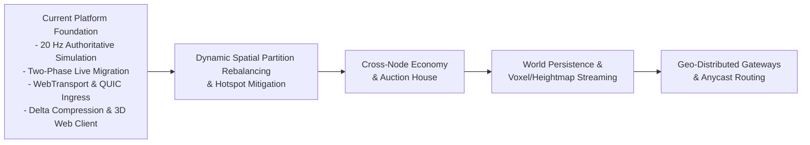

# Platform Capabilities & Engineering Roadmap

This document outlines the current architectural foundations and planned engineering milestones for the distributed Rust MMO server platform.

---

## Current Architecture & System Overview

The platform is an authoritative, distributed tick-based virtual world simulation cluster:
- **Director (`crates/director`)**: Global cluster orchestrator managing node discovery, 3D Octree spatial domain coordination, heartbeat aggregation, and autonomous 3.5s orphan partition failover.
- **Simulation Nodes (`crates/node`)**: Authoritative 20 Hz fixed-tick simulation nodes executing kinematics validation, Area of Interest (AoI) interest management, hook pipelines, pluggable gameplay systems, and asynchronous write-behind database persistence.
- **Edge Gateway (`crates/gateway`)**: Ingress proxy terminating TCP, native QUIC UDP (TLS 1.3), and HTTP/3 WebTransport with decoupled datagram/stream sinks, lock-free routing via `DashMap`, non-blocking downstream dispatch, and dynamic route handover.
- **Shared Core & Schema (`crates/core`, `crates/schema`)**: Zero-copy packet framing, 64-bit generational GUIDs, dynamic ECS ComponentStore, math/octree primitives, LEB128 varints, bitpack codecs, and unified Prometheus HTTP metrics.
- **WebAssembly Core & Visual Inspector (`crates/client-wasm`, `web/`)**: Zero-server-pollution Rust WebAssembly leaf crate providing client-side delta decompression, fixed-point dequantization, and temporal Hermite/LERP interpolation for an interactive 3D Web Inspector (Vite + Three.js).
- **Storage Tier (`crates/storage`)**: Dual-engine SQL persistence supporting distributed PostgreSQL (`postgres://`) and hermetic SQLite (`sqlite:`), automated schema migrations, and deadlock-free ACID item trading.
- **Kubernetes Orchestration (`k8s/`, `scripts/cluster.sh`)**: Local `k3d` multi-service deployment with native Kubernetes health/readiness probes, pod-level Prometheus metric scraping on port 9091, and Grafana datasource integration.

---

## Architectural Progression

---

## Production Platform Capabilities

### 1. Spatial Partitioning & Live Entity Migration
- **Sparse 3D Octree**: Dynamic spatial indexing with hierarchical neighbor queries and leaf boundary detection.
- **Two-Phase Live Migration Protocol**: Zero-duplication authority handoff across simulation nodes with strict state freeze leases, donor-driven gateway route commits, and connection failure rollbacks.
- **Boundary Hysteresis**: Multi-meter margin buffering ($\delta_{\text{hysteresis}} = 1.0\text{m}$) and cooldown propagation preventing boundary oscillation ("thrashing").
- **Dynamic Route Invalidation**: Edge Gateway updates lock-free routing tables on the fly without disconnecting the client session.

### 2. Simulation Authority & Anti-Cheat
- **Monotonic Server Time**: Server-calculated $\Delta t$ using high-resolution monotonic clocks, strictly rejecting client-supplied timestamps to prevent speed hacks and time banking.
- **Kinematic Boundaries**: Sequence-aware, jitter-tolerant velocity and position validation with anti-teleportation keyframing ($> 255.0\text{m}$).
- **Cancellable Timed Actions**: Generalized action state machines with duration timers and displacement interruption flags (`cancel_on_movement`), powering ability casting, channeling, and interactions.
- **Dynamic Attributes & Auras**: Keyed scalar property sets with order-independent modifier stacking, bounds clamping, and passive regeneration tick curves.

### 3. Cross-Partition Interactions & Boundary Dispatches
- **Spatial Ghost Targeting**: Unified candidate queries operating transparently across local entities and replicated boundary ghost replicas.
- **Cross-Node Ability RPCs**: Asynchronous gRPC dispatch (`DispatchAbility`, `DispatchBatchAbility`) with proactive cooldown and GCD application on the caster node.
- **Authoritative Range Re-Validation**: Authoritative verification on target nodes with $1.2\times$ kinematic tolerance.
- **Non-Blocking Compensation**: MPSC compensation pipeline draining at tick start to cleanly refund resources and reset cooldowns upon RPC failure or timeout ($100\text{ms}$).
- **Boundary AoE Multi-Target Dispatch**: Sphere and cone multi-node fan-out with deduplication guarantees.

### 4. High-Performance Network Compression & Edge Ingress
- **Variable-Length LEB128 Varints**: Sub-byte bit-packing for entity IDs and field masks.
- **Fixed-Point Quantization**: Kinematic coordinates quantized to $1/128\text{m}$ resolution ($\approx 7.8\text{mm}$ precision error), 8-bit yaw ($\approx 1.41^\circ$), 8-bit pitch, and 16-bit velocity.
- **Baseline Acknowledgement Replication**: Dynamic field suppression delivering an **88.05% bandwidth egress reduction** under 1,000 entity density.
- **Multi-Transport Termination**: Edge Gateway supporting HTTP/3 WebTransport (browser), native QUIC UDP (TLS 1.3), and framed TCP with lock-free `DashMap` session routing.
- **Decoupled Egress Sinks**: Independent bounded datagram channels (ephemeral movement/deltas, dropping on saturation) and unbounded stream channels (reliable actions/trades/auth) to prevent Head-of-Line blocking.

### 5. Pluggable ECS Gameplay & AI Systems
- **Decoupled Plugin Architecture**: Standalone plugin lifecycle via [`GameplayPlugin`](crates/core/src/plugin.rs) with open typed event queues, veto hooks, dynamic component serialization codecs, and modular packet routing.
- **Core Gameplay Implementations**: Combat/Damage mitigation, threat/hate tables, container inventories, equipment constraints, probability loot tables, quests, party sync, and guild rosters.
- **Autonomous NPC & Monster AI**: Sensory perception scanning, finite state machines (Idle, Patrol, Aggro, Flee, Return), and population-managed respawners.

### 6. Distributed Storage & Transactional Persistence
- **Dual-Engine SQL Abstraction**: Distributed PostgreSQL (`postgres://`) and hermetic SQLite (`sqlite:`) with automated schema migrations.
- **Deadlock-Free ACID Trading**: Strict GUID-ordered row locking (`SELECT ... FOR UPDATE`) and atomic multi-entity transaction rollbacks on capacity exhaustion.
- **Write-Behind Coalescing Persistence**: In-memory dirty state coalescing with asynchronous chunked batch flushes (`INSERT ... ON CONFLICT DO UPDATE`).

### 7. Browser WebAssembly Client & Visual Inspector
- **Pure Rust WebAssembly Core**: Zero-server-pollution leaf crate (`crates/client-wasm`) compiled for `wasm32-unknown-unknown` and native Linux, serving as the single source of truth for packet decoding and dequantization.
- **Temporal Entity Smoothing**: Client-side interpolation buffer with 100ms jitter window, shortest-arc spherical yaw LERP, 20m snapback threshold, and starvation velocity clamp.
- **Interactive 3D Web Inspector**: Three.js viewport rendering a 1000m coordinate grid, spatial partition boundary planes, AOI radius circle (80m), player capsules, and hostile NPC cubes with floating health bars.
- **Real-Time HUD Telemetry**: Live overlay displaying ping/RTT, server tick, baseline tick, entity count, bandwidth, and FPS.

### 8. Observability, Scale Testing & Cluster Resilience
- **Autonomous Orphan Recovery**: Director autonomously detects dead simulation nodes within 3.5 seconds and reassigns orphaned spatial partitions without cluster disruption.
- **Headless Bot Swarm Generator**: Simulates thousands of concurrent bot connections with configurable trajectory profiles (`RandomWalk`, `HotspotClustering`, `CombatInteraction`).
- **Production Observability**: Prometheus endpoints on port 9091 across all nodes, accompanied by Kubernetes probes and production Grafana dashboards.

---

## Upcoming Engineering Milestones

### Milestone: Dynamic Spatial Partition Rebalancing & Hotspot Mitigation

**Problem**: When hundreds of players congregate in a single spatial area (e.g. world boss arena, city marketplace), the responsible simulation node experiences CPU saturation while adjacent partition nodes remain idle.

**Technical Scope**:
1. **Octree Sub-Domain Splitting**: Enhance `ClusterDirector` to continuously monitor per-node tick execution duration and entity density. When a partition's density exceeds a saturation threshold (e.g., $> 500$ entities or $> 35\text{ms}$ tick duration), the director divides the octant into sub-octants.
2. **Dynamic Worker Node Provisioning**: Assign newly divided octants to available idle or scale-out simulation nodes.
3. **Continuous Boundary Smoothing**: Dynamically adjust partition boundary planes using an elastic centroid-repulsion algorithm to balance computational load while minimizing boundary-crossing rate.
4. **Zero-Disconnect Batch Handover**: Extend Two-Phase Migration to support concurrent batch handovers of up to 500 entities across partition splits.

---

### Milestone: Cross-Node Distributed Economy, Transactional Vaults & Auction House

**Problem**: Modern MMO economies require cross-node marketplace order matching, player-to-player escrow trades, and shared guild vaults without race conditions, currency duplication, or inventory loss during node failure.

**Technical Scope**:
1. **Distributed Two-Phase Commit (2PC) Coordinator**: Coordinate multi-entity, multi-node item and currency transfers with pre-commit reservation locks and automatic abort rollbacks.
2. **Asynchronous Auction House Engine**: Cluster-wide order book service (`AuctionService`) managing listings, bids, buyouts, and expiration timers.
3. **Escrow State Machine**: Immutable item and currency escrow states in PostgreSQL with strict lease timeouts.
4. **Real-Time Market Notifications**: Publish auction outbid, sold, and delivery events across `SocialBus` to notify players regardless of connected partition node.

---

### Milestone: Real-Time World Persistence & Streaming Voxel / Heightmap Terrain

**Problem**: Dynamic virtual worlds require authoritative terrain deformation, constructible fortifications, and persistent environmental state streamed on-demand within each player's Area of Interest.

**Technical Scope**:
1. **Sparse Voxel Octree Terrain Representation**: Efficient 3D chunked volumetric terrain storage supporting point digging, building, and destruction.
2. **Delta Chunk Streaming via AoI**: Integrate terrain chunk boundaries into `SpatialOctree` AoI queries, streaming compressed voxel deltas over WebTransport / QUIC datagrams.
3. **Asynchronous Chunk Write-Behind**: Persist modified terrain chunks to PostgreSQL using LZ4-compressed binary blobs with coalesced dirty-chunk queues.

---

### Milestone: Geo-Distributed Edge Gateways & Anycast Routing

**Problem**: Players distributed worldwide (Americas, Europe, Asia) experience high RTT when connecting directly to a centralized data center.

**Technical Scope**:
1. **Geo-Distributed Gateway Ingress**: Deploy edge gateways globally with Anycast DNS / BGP routing terminating TLS and WebTransport close to the user.
2. **Optimized Backhaul Forwarding**: Multiplex edge traffic to regional simulation clusters over persistent, high-bandwidth QUIC tunnels.
3. **Cross-Region Session Handover**: Seamlessly migrate player sessions across gateways during intercontinental travels without requiring game client re-authentication.
