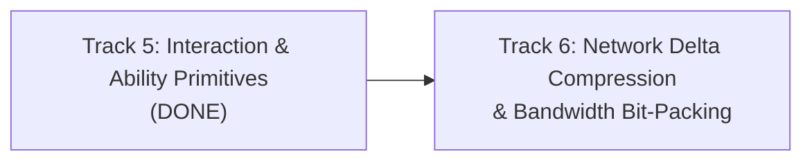

# MMO Cluster Architecture & Engineering Roadmap

This document outlines the architectural milestones, completed foundations, and scheduled engineering tracks for the distributed Rust MMO server cluster.

---

## Current Architecture Status (September 2026)

The cluster is built around an authoritative, distributed tick-based simulation architecture:
- **Director (`crates/director`)**: Global cluster orchestrator managing simulation node discovery, 3D Octree spatial domain coordination, heartbeat aggregation, and orphan partition recovery.
- **Simulation Nodes (`crates/node`)**: Authoritative 20 Hz fixed-tick simulation nodes executing kinematics validation, Area of Interest (AoI) interest management, hook pipelines, and asynchronous write-behind SQLite snapshotting.
- **Edge Gateway (`crates/gateway`)**: Dual TCP/QUIC edge ingress proxy handling client packet framing, session multiplexing, lock-free routing via `DashMap`, non-blocking downstream dispatch, and session cache coordination.
- **Shared Core & Schema (`crates/core`, `crates/schema`)**: Zero-copy packet framing, Entity-Component registry, math/octree primitives, and unified HTTP Prometheus/Health telemetry.
- **Local Kubernetes Orchestration (`k8s/`, `scripts/cluster.sh`)**: Local `k3d` multi-service deployment with native Kubernetes health/readiness probes, pod-level Prometheus metric scraping on uniform port 9091, and Grafana datasource integration.

---

## Completed Phases

- [x] **Phase 1 P0: Security & Concurrency Hardening**
  - Monotonic server-side timestamps preventing client speed hacks and time banking.
  - Command initiator authentication preventing cross-entity spoofing.
  - Lock-free `DashMap` session routing and `SessionDropGuard` RAII task cleanup.
  - Non-blocking downstream dispatch with slow-consumer backpressure.
- [x] **Phase 2 P1: Memory Optimization, Determinism & Storage Hardening**
  - Zero-copy interaction payload framing (`bytes::Bytes`).
  - Scratch buffer reuse and `select_nth_unstable_by` $O(N)$ density throttling in AoI.
  - Event-driven entity despawn cleanup across spawner and threat plugins.
  - Clamped simulation tick accumulator preventing CPU overrun death spirals.
  - SQLite WAL mode, `PRAGMA synchronous = NORMAL`, and chunked snapshot queue flush.
- [x] **Phase 3 P2: Cluster Resilience, Property Testing & CI Quality Gates**
  - Director orphan partition recovery reassigning spatial leaves on node blackout.
  - Strict hierarchical lock acquisition preventing deadlocks across registry and coordinator.
  - Comprehensive `proptest` suites for packet codecs and octree spatial queries.
  - GitHub Actions CI pipeline enforcing tests and clippy gates.
- [x] **Track 1: Production Observability, Metrics & Health Telemetry**
  - Unified `TelemetryServer` in `crates/core` with `/metrics`, `/healthz`, and `/ready`.
  - Prometheus metrics instrumentation across Node, Gateway, and Director.
  - Local `k3d` cluster deployment with Kubernetes probes and Prometheus pod discovery.
- [x] **Track 2: Dynamic Spatial Partitioning & Live Entity Migration**
  - Authoritative Two-Phase Entity Migration Protocol with strict state freeze leases.
  - Zero-duplication guarantee with donor-driven Gateway route commit and connection failure rollback.
  - Live Edge Gateway `GatewayService` gRPC server and lock-free `SessionRouter` updates.
  - Boundary crossing detection, hysteresis buffer margin ($\delta_{\text{hysteresis}} = 1.0$), and cooldown propagation.
  - Comprehensive unit, proptest, and multi-node live migration end-to-end integration tests.
- [x] **Track 3: Production Distributed Storage (PostgreSQL & Account/Inventory)**
  - Dual-backend SQL abstraction supporting distributed PostgreSQL (`postgres://`) and hermetic SQLite (`sqlite:`).
  - Cross-dialect automated schema migrations (`accounts`, `characters`, `entity_snapshots`, `inventories`, `items`, `trades`).
  - Deadlock-free ACID player-to-player item trade protocol with strict GUID lock ordering and full transaction rollback on capacity exhaustion.
  - Batched statement execution in `save_snapshot_batch` eliminating network round-trip overhead.
  - Live PostgreSQL deployment in Kubernetes (`k8s/base/postgres.yaml`) with connection health telemetry.

- [x] **Track 4: Kubernetes Scale & Chaos Testing (10k Bot Ingestion & Failover)**
  - Enhanced headless bot swarm generator in `crates/loadtest` with `RandomWalk`, `HotspotClustering`, and `CombatInteraction` profiles.
  - Jitter-tolerant movement kinematics validator in `crates/node` eliminating false-positive speed-hack snapbacks during high load bursts.
  - Multi-pod horizontal scale-out deployment in `k8s/base/loadtest.yaml` targeting `mmo-gateway:8080`.
  - Production Grafana overview dashboard (`k8s/overlays/local/dashboards/mmo-overview.json`) with live panels for 20 Hz tick percentiles (p50/p95/p99), tick overruns, CCU, packet throughput, drops, and persistence latency.
  - Automated chaos test suite (`scripts/chaos.sh`) verifying autonomous dead-node detection within 3.5s, orphaned spatial partition recovery, Edge Gateway route propagation (200 routes updated), and StatefulSet node resurrection.
  - Scaled benchmark with 1,000 bots delivering 15,967 packets/s, 0 snapback rejections, and p99 RTT latency of 1.58 ms.

- [x] **Track 5: Interaction Primitives & Pluggable Abilities**
  - Genre-agnostic cancellable timed action state machine (`TimedAction`, `ActionQueue`, `ActionTickSystem`).
  - Dynamic attribute and aura modifier container (`AttributeSet`, `AttributeTickSystem`, order-independent modifier stacking, bounds clamping, passive tick regen).
  - Authoritative 3D spatial target queries against `Octree`: Point range, Cone / Cleave arcs, Sphere radial gathering, and Raycast Line-of-Sight against AABB bounding volumes.
  - Kinematic movement validation automatically aborting active actions upon non-zero displacement when `cancel_on_movement` is enabled.
  - Pluggable `AbilityPlugin` with `CooldownTracker`, shared GCD timers, resource cost validation, and instant vs. casted activations.
  - Integration with `CombatPlugin` synchronizing damage events with `AttributeSet` health and action interruption on damage.

---

## Next Engineering Roadmap

---

### Track 5: Generalized Interaction Engine & Pluggable Ability System

**Goal**: Establish the engine's core interaction and temporal action primitives in `crates/core`, decoupling all game-specific mechanics (spells, combat, gathering, crafting) into modular plugins in `crates/gameplay`.

#### Key Deliverables:

1. **Engine Core: Cancellable Timed Actions (`crates/core`)**:
   - Generic `TimedAction` / `ActionQueue` component attached to entities.
   - Configurable action durations and interrupt flags: `CancelOnMovement`, `CancelOnDamage`, `CancelOnStun`, `CancelOnTargetLost`.
   - Tick-based execution emitting `ActionStartedEvent`, `ActionProgressEvent`, `ActionCompletedEvent`, and `ActionInterruptedEvent`.
   - Used by plugins for spell casts, weapon reload/windup, item crafting, gathering channels, or warp drive spooling.

2. **Engine Core: Dynamic Attribute & Modifier System (`crates/core`)**:
   - `AttributeSet` component supporting data-driven numeric properties (scalars, base values, flat/percent modifiers, min/max bounds).
   - Dynamic regeneration / decay rates evaluated during the 20 Hz simulation tick.
   - Periodic timed modifiers (Auras / Buffs / Debuffs / DoTs / HoTs) with expiration timers and tick intervals.

3. **Engine Core: Spatial Targeting & Interaction Queries (`crates/core`)**:
   - Authoritative geometric queries against the 3D Octree: Point-to-Point, Raycast / Line-of-Sight, Cone / Frontal Cleave, and Sphere / Radial AoE.
   - Validation pipeline: range checks, orientation/facing angle checks, and line-of-sight obstruction guards.
   - Cross-boundary interaction dispatch: when an action targets an entity on a neighbor simulation node, routing interaction events across nodes via gRPC.

4. **Gameplay Plugin Layer: Pluggable Ability & Combat Systems (`crates/gameplay`)**:
   - Refactor `CombatPlugin` to consume `AttributeSet` (e.g. `health`, `armor`) and `TimedAction` primitives.
   - Implement reference `AbilityPlugin`: cooldown tracking, resource costs, instant vs. casted abilities, and damage/heal event emission.
   - Integrate with existing `ThreatPlugin` and `MonsterAiPlugin`.

5. **Verification Gates**:
   - Unit and property tests for action interruption under kinematic movement and damage.
   - Attribute modifier stacking, clamping, and decay determinism tests.
   - Cross-partition spatial interaction tests between adjacent simulation nodes.

---

### Track 6: Network Delta Compression & Bandwidth Bit-Packing

**Goal**: Minimize egress bandwidth consumption by implementing bit-packed delta state compression for high-frequency AoI entity replication.

#### Key Deliverables:
1. **Bit-Packed Field Masks**: Variable-length encoding and bitmask flags transmitting only modified entity fields (position $\Delta$, velocity, active animation/action) per tick.
2. **Quantized Kinematics**: Fixed-point quantization for 3D coordinates and quaternion rotations reducing byte footprint per replicated entity.
3. **Bandwidth Profiling & Verification**: Benchmark bandwidth savings under 1,000+ bot density before and after delta compression.
