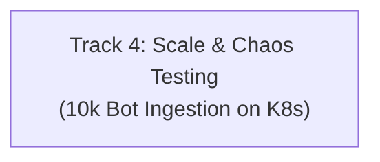

# MMO Cluster Architecture & Engineering Roadmap

This document outlines the architectural milestones, completed foundations, and scheduled engineering tracks for the distributed Rust MMO server cluster.

---

## Current Architecture Status (September 2026)

The cluster is built around an authoritative, distributed tick-based simulation architecture:
- **Director (`crates/director`)**: Global cluster orchestrator managing simulation node discovery, 3D Octree spatial domain coordination, heartbeat aggregation, and orphan partition recovery.
- **Simulation Nodes (`crates/node`)**: Authoritative 20 Hz fixed-tick simulation nodes executing kinematics validation, Area of Interest (AoI) interest management, hook pipelines, and asynchronous write-behind SQLite snapshotting.
- **Edge Gateway (`crates/gateway`)**: Dual TCP/QUIC edge ingress proxy handling client packet framing, session multiplexing, lock-free routing via `DashMap`, non-blocking downstream dispatch, and session cache coordination.
- **Shared Core & Schema (`crates/core`, `crates/schema`)**: Zero-copy packet framing, Entity-Component registry, math/octree primitives, and unified HTTP Prometheus/Health telemetry.
- **Local Kubernetes Orchestration (`k8s/`, `scripts/cluster.sh`)**: Local `k3d` multi-service deployment with native Kubernetes health/readiness probes, pod-level Prometheus metric scraping on uniform port 9091, and Grafana datasource integration.

---

## Completed Phases

- [x] **Phase 1 P0: Security & Concurrency Hardening**
  - Monotonic server-side timestamps preventing client speed hacks and time banking.
  - Command initiator authentication preventing cross-entity spoofing.
  - Lock-free `DashMap` session routing and `SessionDropGuard` RAII task cleanup.
  - Non-blocking downstream dispatch with slow-consumer backpressure.
- [x] **Phase 2 P1: Memory Optimization, Determinism & Storage Hardening**
  - Zero-copy interaction payload framing (`bytes::Bytes`).
  - Scratch buffer reuse and `select_nth_unstable_by` $O(N)$ density throttling in AoI.
  - Event-driven entity despawn cleanup across spawner and threat plugins.
  - Clamped simulation tick accumulator preventing CPU overrun death spirals.
  - SQLite WAL mode, `PRAGMA synchronous = NORMAL`, and chunked snapshot queue flush.
- [x] **Phase 3 P2: Cluster Resilience, Property Testing & CI Quality Gates**
  - Director orphan partition recovery reassigning spatial leaves on node blackout.
  - Strict hierarchical lock acquisition preventing deadlocks across registry and coordinator.
  - Comprehensive `proptest` suites for packet codecs and octree spatial queries.
  - GitHub Actions CI pipeline enforcing tests and clippy gates.
- [x] **Track 1: Production Observability, Metrics & Health Telemetry**
  - Unified `TelemetryServer` in `crates/core` with `/metrics`, `/healthz`, and `/ready`.
  - Prometheus metrics instrumentation across Node, Gateway, and Director.
  - Local `k3d` cluster deployment with Kubernetes probes and Prometheus pod discovery.
- [x] **Track 2: Dynamic Spatial Partitioning & Live Entity Migration**
  - Authoritative Two-Phase Entity Migration Protocol with strict state freeze leases.
  - Zero-duplication guarantee with donor-driven Gateway route commit and connection failure rollback.
  - Live Edge Gateway `GatewayService` gRPC server and lock-free `SessionRouter` updates.
  - Boundary crossing detection, hysteresis buffer margin ($\delta_{\text{hysteresis}} = 1.0$), and cooldown propagation.
  - Comprehensive unit, proptest, and multi-node live migration end-to-end integration tests.
- [x] **Track 3: Production Distributed Storage (PostgreSQL & Account/Inventory)**
  - Dual-backend SQL abstraction supporting distributed PostgreSQL (`postgres://`) and hermetic SQLite (`sqlite:`).
  - Cross-dialect automated schema migrations (`accounts`, `characters`, `entity_snapshots`, `inventories`, `items`, `trades`).
  - Deadlock-free ACID player-to-player item trade protocol with strict GUID lock ordering and full transaction rollback on capacity exhaustion.
  - Batched statement execution in `save_snapshot_batch` eliminating network round-trip overhead.
  - Live PostgreSQL deployment in Kubernetes (`k8s/base/postgres.yaml`) with connection health telemetry.

---

## Next Engineering Roadmap

---

### Track 2: Dynamic Spatial Partitioning & Live Entity Migration

**Goal**: Transform the spatial grid into a fully elastic, self-balancing cluster where simulation nodes autonomously split, merge, and migrate entities live without client disconnection or simulation stutter.

#### Key Deliverables:
1. **Automated Split & Merge Triggers**:
   - Simulation nodes monitor local entity density and tick duration metrics.
   - Director evaluates load reports against spatial thresholds and issues split/merge commands during the 20 Hz tick.
2. **Two-Phase Entity Migration Protocol**:
   - Inter-node gRPC streaming channel between donor and recipient nodes.
   - Phase 1: Donor serializes entity state, components, and kinematics history into a migration payload; marks entity in `Migrating` lease state (frozen movement).
   - Phase 2: Recipient inserts entity into its authoritative `EntityStore` and octree, acknowledges transfer; donor despawns local entity.
   - Zero-duplication guarantee: If network fails during transfer, donor retains authority.
3. **Dynamic Gateway Route Invalidation**:
   - Recipient node or Director notifies Edge Gateway of new entity ownership (`update_route`).
   - Edge Gateway updates internal `SessionRouter` lock-free routing table; subsequent client inputs route to the new node seamlessly.
4. **Verification Gates**:
   - Multi-node migration unit and integration tests under active movement.
   - Boundary oscillation (hysteresis) property testing to prevent thrashing when entities cross borders repeatedly.

---

### Track 3: Production Distributed Storage (PostgreSQL & Account/Inventory)

**Goal**: Upgrade persistence from local node-level SQLite to an enterprise-grade distributed relational database capable of multi-region replication, strict ACID item transactions, and scalable account/inventory management.

#### Key Deliverables:
1. **PostgreSQL / CockroachDB Engine**:
   - Add async PostgreSQL backend to `crates/storage` using `sqlx` connection pools.
   - Automated schema migrations via `sqlx-migrate` or versioned SQL scripts.
   - Connection pool health telemetry and query latency histograms.
2. **Relational MMO Data Model**:
   - `accounts`: Authentication credentials, account status, character slots.
   - `characters`: Level, experience, attributes, coordinates, rotation, bound nodes.
   - `inventories`: Item instances, bag slots, durability, enchantments, and stack counts.
   - `spellbook_cooldowns`: Active cooldown timers and ability ranks.
3. **Transactional Item Trade & Transfer Protocol**:
   - Multi-row atomic database transactions for player-to-player trading and bank deposits.
   - Rollback and audit logging preventing duplication exploits even during abrupt server termination.
4. **Distributed Cache Synchronization**:
   - Redis-backed cache layer for fast character lookup with write-through or write-behind semantics.
5. **Verification Gates**:
   - Concurrent item trade race condition tests.
   - Database connection failure and reconnection recovery tests.

---

### Track 4: Kubernetes Scale & Chaos Testing (10k Bot Ingestion & Failover)

**Goal**: Stress-test the entire distributed cluster under realistic MMO load (1,000 to 10,000 concurrent bot connections) within the local `k3d` environment, validating cluster stability, tick budgets, and chaos resilience.

#### Key Deliverables:
1. **Containerized Headless Bot Load Generator**:
   - Package `crates/loadtest` into a scalable Kubernetes Deployment / Job.
   - Configurable bot behaviors: random walk, clustering hotspots, chat spam, rapid movement input, and combat interaction.
2. **Scale Benchmark Scenarios (1k to 10k CCU)**:
   - High-throughput QUIC datagram ingestion stress.
   - AoI interest management benchmark measuring bandwidth and throttling efficiency under extreme hotspot density.
3. **Chaos Resiliency Verification**:
   - Automated chaos scripts simulating hard node crashes (`kill -9`, pod eviction, network partition).
   - Verify Director detects node death within 5 seconds, triggers partition reassignment, and surviving nodes adopt orphaned entities without client session termination.
4. **Comprehensive Grafana Dashboards**:
   - Pre-configured Grafana dashboards in `k8s/overlays/local/grafana.yaml` visualizing:
     - Cluster-wide 20 Hz tick duration percentiles (p50, p95, p99).
     - Gateway packet rates, bandwidth in/out, and buffer drop counters.
     - Active player CCU and entity counts per simulation node.
5. **Verification Gates**:
   - Sustained 10,000 bot simulation with p99 tick times $< 45\text{ ms}$.
   - Zero lost player sessions during node eviction and failover recovery.
