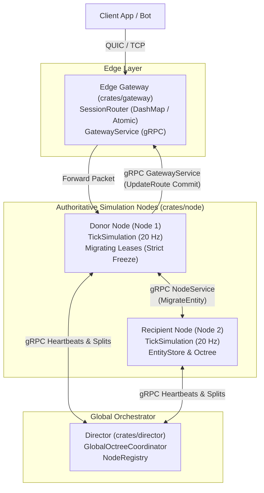
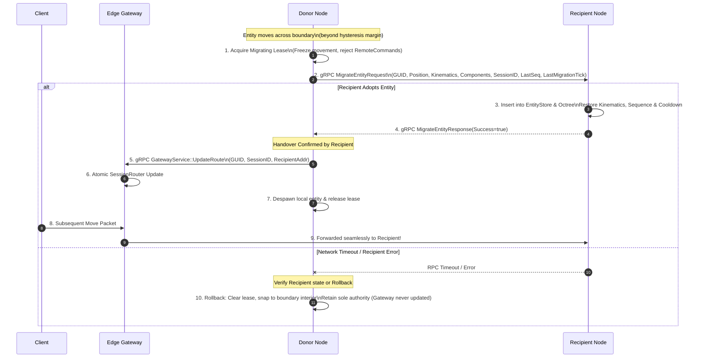

# Design Document: Dynamic Spatial Partitioning & Live Entity Migration

## Architecture Overview

Track 2 enables autonomous, load-balanced simulation scaling by coupling dynamic octree subdivision with a resilient, two-phase inter-node entity migration protocol and zero-stutter Edge Gateway route invalidation.



---

## 1. Two-Phase Entity Migration Protocol (Distributed Commit)

To guarantee **zero entity duplication** and eliminate the split-brain hazard (where Recipient adopts but Donor rolls back), the protocol ensures the Gateway route is only committed *after* acknowledgment between simulation nodes.

### 1.1 Sequence Flow



### 1.2 Protocol Buffer Schema Extensions (`crates/schema/proto/cluster.proto`)

```protobuf
// Entity Component Serialization
message SerializedComponent {
  uint32 component_id = 1;
  bytes data = 2;
}

// Inter-Node Migration
message MigrateEntityRequest {
  uint64 guid = 1;
  uint32 source_node_id = 2;
  uint32 target_node_id = 3;
  Vector3 position = 4;
  Vector3 velocity = 5;
  float yaw = 6;
  float pitch = 7;
  uint32 last_sequence = 8;
  uint64 session_id = 9;
  repeated SerializedComponent components = 10;
  uint64 topology_epoch = 11;
  uint64 last_migration_tick = 12;
}

message MigrateEntityResponse {
  bool success = 1;
  uint32 error_code = 2;
  string error_message = 3;
  uint64 acknowledged_guid = 4;
}

// Gateway Ingress Route Update
message RouteUpdateRequest {
  uint64 guid = 1;
  uint64 session_id = 2;
  string node_address = 3;
}

message RouteUpdateResponse {
  bool success = 1;
  string error_message = 2;
}

service GatewayService {
  rpc UpdateRoute (RouteUpdateRequest) returns (RouteUpdateResponse);
}

// Extended NodeService
service NodeService {
  rpc RemoteCommand (RemoteCommandRequest) returns (RemoteCommandResponse);
  rpc SyncGhosts (GhostSyncRequest) returns (GhostSyncResponse);
  rpc MigrateEntity (MigrateEntityRequest) returns (MigrateEntityResponse);
}
```

---

## 2. Concurrency & Lock-Ordering Model

### 2.1 Strict Entity State Immutability During Async Lease I/O
- Dropping `RwLock<TickSimulation>` during the async `MigrateEntity` gRPC call is necessary to avoid stalling the 20 Hz tick loop.
- **Enforcing Immutability**:
  1. `migrating_leases: HashMap<Guid, Instant>` tracks in-flight migrations.
  2. In `NodeServiceImpl::remote_command`: If the target GUID is in `migrating_leases`, immediately return `RemoteCommandErrorCode::Vetoed` with message `"Entity is currently migrating"`.
  3. In `TickSimulation::step`: Entities under `migrating_leases` are skipped from tick systems and position mutations.
  4. In `TickSimulation::process_client_move_with_seq`: Incoming move packets for migrating entities are rejected or buffered until migration resolves.
  5. Component state serialized in Step 1 is therefore guaranteed identical to the entity state at the moment of despawn in Step 7.

### 2.2 Atomic Gateway Route Updates
- In `crates/gateway/src/router.rs`, `SessionRouter::update_route` updates both GUID and session mappings.
- To prevent transient routing micro-desyncs where `session_to_node` and `guid_to_node` disagree during concurrent packet ingestion, updates update the target address atomically and maintain consistent lookup precedence.

### 2.3 Director Lock Hierarchy
- When Director processes heartbeat splits or recoveries, strictly acquire `NodeRegistry` write lock first, then `GlobalOctreeCoordinator` write lock second.

---

## 3. Boundary Crossing, Hysteresis & Cooldown Propagation

To prevent rapid oscillation ("ping-pong thrashing") when an entity walks back and forth across a boundary plane:

1. **Boundary Buffer Margin ($\delta_{\text{hysteresis}}$)**:
   - When an entity moves to $P_{\text{new}}$ outside local bounds $B_{\text{local}}$, migration is only triggered if:
     $$\text{distance\_outside}(P_{\text{new}}, B_{\text{local}}) \ge \delta_{\text{hysteresis}} \quad (\text{default: } 1.0\text{ world units})$$
   - If $P_{\text{new}}$ is outside $B_{\text{local}}$ but within the margin $[0, \delta_{\text{hysteresis}})$, the movement is clamped to the edge of $B_{\text{local}}$ without initiating migration.
2. **Cooldown Timestamp Tracking Across Nodes**:
   - `last_migration_tick` is encoded in `MigrateEntityRequest`.
   - The recipient restores `last_migration_tick` upon adoption.
   - Reverse migration across the same boundary is prohibited within $\text{COOLDOWN\_TICKS}$ (default: 20 ticks = 1 second) unless the entity penetrates deep into the new partition ($> 3 \times \delta_{\text{hysteresis}}$).

---

## 4. Dynamic Split & Merge Orchestration

1. **Load Reporting**:
   - Simulation nodes include `entity_count`, `tick_duration`, and CPU utilization in 1 Hz heartbeats.
2. **Split Trigger**:
   - When $N \ge \text{split\_threshold}$ (50 entities), Director:
     - Subdivides the bounding box into 8 child octants.
     - Assigns the children to available least-loaded nodes.
     - Returns child assignments in `HeartbeatResponse` / `SplitReportResponse`.
   - Node initiates asynchronous batch migration for all entities located within sub-octants assigned to peer nodes.
3. **Merge Trigger**:
   - When sibling octants drop below `merge_threshold` (10 entities), Director collapses them back to parent octant assigned to one surviving node.

---

## 5. Failure Modes & Edge Case Analysis

| Edge Case | Consequence | Mitigation |
|:---|:---|:---|
| **RPC Network Timeout during Migration** | Recipient may or may not have adopted entity | Donor controls Gateway update. Donor rolls back only if recipient did not commit; Gateway route remains on Donor until ack received. |
| **Concurrent Remote Commands during Lease** | Interacting entities could mutate health or inventory | Donor returns `Vetoed` error during `Migrating` lease, guaranteeing serialized state consistency. |
| **Gateway Route Desync** | Gateway forwards packet to old node | Donor drops or proxies packet via `RemoteCommand` until Gateway route update completes. |
| **Ghost Sync Overlap** | Ghost representation exists on recipient before migration | Recipient promotes ghost to authoritative entity in `EntityStore`, overwriting ghost store record. |

---

## 6. Telemetry & Metrics

Track 2 introduces the following Prometheus metrics:
- `mmo_migration_outbound_total` (counter, labeled by `donor_id`, `recipient_id`, `status`): total outbound migrations attempted and their outcomes.
- `mmo_migration_inbound_total` (counter, labeled by `recipient_id`, `status`): total inbound migrations adopted.
- `mmo_migration_latency_seconds` (histogram): end-to-end duration from lease acquisition to donor despawn.
- `mmo_migration_rollbacks_total` (counter): total migrations aborted and rolled back to donor.
- `mmo_gateway_route_updates_total` (counter): total live route updates executed by Edge Gateway.
