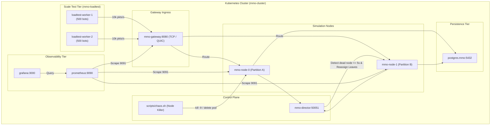

# Technical Design: Track 4 Kubernetes Scale & Chaos Testing

## Architecture & Workload Topology



---

## 1. Bot Swarm Enhancements (`crates/loadtest`)

### Behavior Profiles
In `crates/loadtest/src/trajectory.rs`:
```rust
#[derive(Debug, Clone, Copy, PartialEq, Eq)]
pub enum BehaviorProfile {
    RandomWalk,
    HotspotClustering,
    CombatInteraction,
}
```

- **`RandomWalk`**:
  Bot calculates velocity heading using Perlin/smooth directional changes bounded by `WorldBounds`.
- **`HotspotClustering`**:
  Given epicenter `(X_c, Y_c, Z_c)` and radius `R`:
  $\vec{v}_{\text{desired}} = \text{normalize}(\vec{P}_{\text{hotspot}} - \vec{P}_{\text{bot}}) \cdot v_{\text{max}}$.
  When bot enters radius $R$, it circles or moves inside the hotspot, generating high spatial clustering density to benchmark AoI broadcasting and partition split triggers.
- **`CombatInteraction`**:
  Bot periodically emits `ClientPacket::Interaction` (with action type `Attack` or `Interact`) to exercise inter-entity combat and state mutators under load.

### Jitter-Tolerant Movement Validation
Under dense load testing and network jitter, client packets may arrive in rapid bursts (e.g. 2-5ms apart). In `crates/node/src/sim.rs`:
- Rather than strictly dividing distance by instantaneous wall-clock arrival interval $\Delta t = \text{now} - \text{last\_arrival}$, `compute_server_dt` accounts for client packet sequence increments $\Delta_{\text{seq}}$:
  When packets arrive in a compressed jitter burst ($\Delta t < \text{TICK\_DT\_SEC}$), $\Delta t$ is floored to $\text{TICK\_DT\_SEC} \times \min(1, \Delta_{\text{seq}})$, preventing spurious speed-hack snapbacks while preserving strict ceiling caps against actual speed-hack exploits.

### Load Generator Scaling
Instead of running 10,000 bots in a single process (which can exhaust OS ephemeral ports and socket file descriptors `RLIMIT_NOFILE`), the load test is designed to scale horizontally across multiple pods:
- `k8s/base/loadtest.yaml`: Configured as a Kubernetes Deployment or Job with `replicas: N` (e.g. 2 pods $\times$ 500 bots = 1,000 CCU, or 10 pods $\times$ 1,000 bots = 10,000 CCU).

---

## 2. Chaos Resilience & Failover (`scripts/chaos.sh`)

### Automated Failover Protocol
1. **Pre-flight Check**: Queries `/ready` on `mmo-director`, `mmo-gateway`, `mmo-node-0`, and `mmo-node-1`.
2. **Active Load**: Confirms bot swarm is actively streaming packets to the gateway.
3. **Chaos Injection**: Executes `kubectl delete pod mmo-node-0 -n mmo --now` (simulating abrupt node crash / kernel panic).
4. **Heartbeat Blackout**: The Director detects that `mmo-node-0`'s heartbeat has expired ($\ge 5\text{s}$).
5. **Orphaned Leaf Reassignment & Route Propagation**:
   - `DirectorService::check_and_recover_dead_nodes` identifies `mmo-node-0` as dead.
   - Spatial octree leaves assigned to `mmo-node-0` are reassigned to `mmo-node-1`.
   - Cluster epoch is incremented.
   - Director notifies Gateway via gRPC (`GatewayService`) or Gateway reassigns orphaned node routes (`SessionRouter::reassign_node_routes(dead_node, new_node)`) preventing traffic blackholing.
6. **Resurrection & Reconnection**:
   - Kubernetes StatefulSet controller detects missing pod and starts a new `mmo-node-0`.
   - The new node connects to PostgreSQL, loads snapshot state, registers with the Director, and joins the cluster.
7. **Verification**: Asserts zero gateway crashes, zero lost socket connections, and seamless route continuity.

---

## 3. Grafana Dashboard Provisioning

In `k8s/overlays/local/grafana.yaml`:
- Provision a Grafana dashboard provider ConfigMap (`/etc/grafana/provisioning/dashboards/dashboards.yaml`) pointing to a dashboard JSON ConfigMap (`mmo-cluster-dashboard`).
- Dashboard JSON defines panels for:
  - **Tick Duration Percentiles**: `histogram_quantile(0.99, sum(rate(mmo_sim_tick_duration_seconds_bucket[1m])) by (le, pod))`
  - **Active CCU & Entities**: `mmo_gateway_active_sessions`, `mmo_sim_entities_active`
  - **Gateway Ingestion Rates**: `sum(rate(mmo_gateway_packets_received_total[1m]))`, `sum(rate(mmo_gateway_packets_sent_total[1m]))`
  - **Packet Drops**: `sum(rate(mmo_gateway_packets_dropped_total[1m]))`
