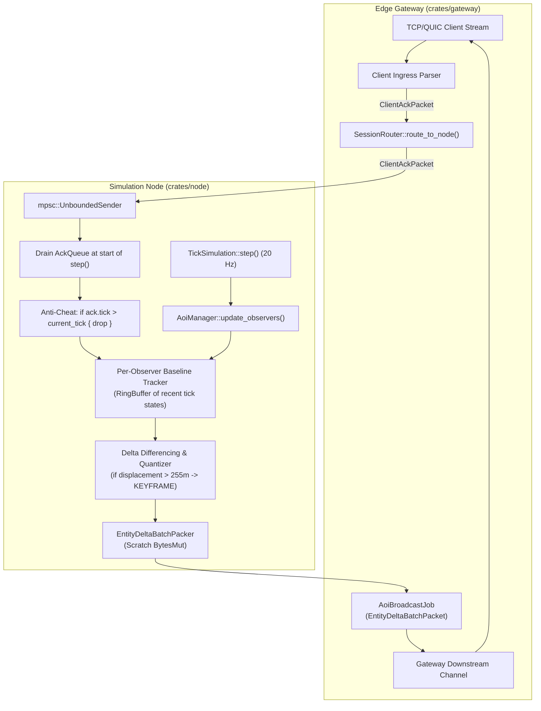

# Technical Design: Track 6 - Network Delta Compression & Bandwidth Bit-Packing

## 1. Architectural Overview



---

## 2. Wire Protocol & Bit-Packing Format

### 2.1 Opcode Additions
In `crates/schema/src/client.rs`:
- `Opcode::EntityDeltaBatch = 0x0009`: Server-to-client broadcast containing batched entity delta states.
- `Opcode::ClientAck = 0x000A`: Client-to-server baseline confirmation.

### 2.2 `DeltaFieldMask` Bitflags
A 16-bit bitfield where each bit flags presence of a quantized field:
```rust
pub const MASK_KEYFRAME: u16    = 1 << 0;  // Full absolute coordinates (entrant / resync / teleport)
pub const MASK_DELTA_POS_X: u16 = 1 << 1;  // Signed 16-bit delta X
pub const MASK_DELTA_POS_Y: u16 = 1 << 2;  // Signed 16-bit delta Y
pub const MASK_DELTA_POS_Z: u16 = 1 << 3;  // Signed 16-bit delta Z
pub const MASK_VELOCITY: u16    = 1 << 4;  // 3x signed 16-bit quantized velocity
pub const MASK_YAW: u16         = 1 << 5;  // 8-bit quantized yaw (0..255)
pub const MASK_PITCH: u16       = 1 << 6;  // 8-bit signed quantized pitch (-128..127)
pub const MASK_HEALTH: u16      = 1 << 7;  // Varint current health
pub const MASK_MAX_HEALTH: u16  = 1 << 8;  // Varint max health
pub const MASK_STATE_FLAGS: u16 = 1 << 9;  // Varint state flags
pub const MASK_ACTION_ID: u16   = 1 << 10; // Varint active action / animation ID
```

### 2.3 `EntityDeltaBatchPacket` Wire Layout
```
[Header: 8 Bytes]
  0x00-0x01: Magic 0x4D4D
  0x02-0x03: Opcode 0x0009 (EntityDeltaBatch)
  0x04-0x07: Payload Length (u32 LE)

[Payload: Variable Length]
  - server_tick: u64 (Varint LEB128)
  - baseline_tick: u64 (Varint LEB128, 0 if no baseline / pure keyframes)
  - entity_count: u16 (Varint LEB128)
  - despawn_count: u16 (Varint LEB128)
  
  [Despawn Section: despawn_count entries]
    - entity_id: u64 (Varint LEB128)

  [Entity Delta Section: entity_count entries]
    - entity_id: u64 (Varint LEB128)
    - field_mask: u16 (LE)
    
    If MASK_KEYFRAME is set:
      - abs_pos_x: f32 (4 bytes LE)
      - abs_pos_y: f32 (4 bytes LE)
      - abs_pos_z: f32 (4 bytes LE)
    Else:
      - if MASK_DELTA_POS_X: delta_x: i16 (2 bytes LE, scale 128.0)
      - if MASK_DELTA_POS_Y: delta_y: i16 (2 bytes LE, scale 128.0)
      - if MASK_DELTA_POS_Z: delta_z: i16 (2 bytes LE, scale 128.0)
      
    - if MASK_VELOCITY: vel_x: i16, vel_y: i16, vel_z: i16 (6 bytes LE, scale 100.0)
    - if MASK_YAW: yaw: u8 (1 byte, [0, 2*PI] -> [0, 255])
    - if MASK_PITCH: pitch: i8 (1 byte, [-PI/2, PI/2] -> [-128, 127])
    - if MASK_HEALTH: health: u32 (Varint LEB128)
    - if MASK_MAX_HEALTH: max_health: u32 (Varint LEB128)
    - if MASK_STATE_FLAGS: state_flags: u32 (Varint LEB128)
    - if MASK_ACTION_ID: action_id: u32 (Varint LEB128)
```

---

## 3. Kinematic Quantization Mathematics & Range Protection

### 3.1 Delta Coordinates ($1/128\text{m}$ resolution)
- **Scale Factor**: $S_{pos} = 128.0$
- **Quantization**:
  $$\text{quantized} = \text{clamp}\left(\text{round}\left(\Delta x \times 128.0\right), -32768, 32767\right) \text{ as } i16$$
- **Dequantization**:
  $$\Delta x_{\text{reconstructed}} = \frac{\text{quantized}}{128.0}$$
- **Precision**: $\frac{1}{128}\text{m} \approx 0.0078125\text{m} = 7.81\text{mm}$.
- **Teleportation & Range Guard**:
  If $|\Delta x| > 255.0$ or $|\Delta y| > 255.0$ or $|\Delta z| > 255.0$:
  The diff engine automatically bypasses quantization and sets `MASK_KEYFRAME` with exact `f32` coordinates. This completely eliminates saturation distortion and overflow during respawns, teleports, or extreme knockbacks.

### 3.2 Rotations
- **Yaw ($[0, 2\pi]$ radians)**:
  $$\text{yaw}_{u8} = \left(\text{rem\_euclid}(\text{yaw}, 2\pi) \times \frac{256.0}{2\pi}\right) \text{ as } u8$$
  $$\text{yaw}_{\text{rec}} = \text{yaw}_{u8} \times \frac{2\pi}{256.0} \quad (\text{Max error } \approx 0.70^\circ)$$
- **Pitch ($[-\pi/2, \pi/2]$ radians)**:
  $$\text{pitch}_{i8} = \text{clamp}\left(\text{pitch} \times \frac{128.0}{\pi/2}, -128, 127\right) \text{ as } i8$$

---

## 4. Baseline Acknowledgement & History Tracking

### 4.1 Client Acknowledgement Packet (`ClientAckPacket`)
```rust
#[derive(Debug, Clone, Copy, PartialEq, Eq)]
pub struct ClientAckPacket {
    pub session_id: u64,
    pub observed_tick: u64,
    pub ack_mask: u32,
}
```

### 4.2 Non-Blocking Ingress & Anti-Cheat Validation
- Gateway dispatches `ClientAckPacket`s to `TickSimulation` via an asynchronous unbounded MPSC channel (`ack_sender`). No write lock on `TickSimulation` is taken during packet receipt.
- At the beginning of each simulation tick:
  1. `TickSimulation::step()` drains all pending ACKs from `ack_receiver`.
  2. **Anti-Cheat Future-Tick Guard**:
     ```rust
     if ack.observed_tick > self.tick_counter {
         metrics::counter!("mmo_anticheat_future_ack_rejected").increment(1);
         continue; // Drop malicious ACK attempting history purge DoS
     }
     ```
  3. `AoiManager::process_ack(ack.session_id, ack.observed_tick, ack.ack_mask)` updates the observer's confirmed baseline tick and prunes snapshots where `tick < ack.observed_tick`.

### 4.3 Observer Memory Bounds & Lifecycle
- **History Depth Hard Cap**: Each `ObserverState` stores a `VecDeque<TickSnapshot>` with a hard maximum of 60 ticks (3 seconds). If unacknowledged beyond 60 ticks, oldest snapshots are dropped.
- **Keyframe Fallback**: If `current_tick - confirmed_baseline_tick > 40` (2 seconds), server automatically falls back to `MASK_KEYFRAME` updates.
- **Session Drop Cleanup**: Gateway connection teardown notifies `TickSimulation` to call `unregister_aoi_observer(session_id)`, instantly deallocating all observer history buffers.

---

## 5. Concurrency, Memory & Allocation Strategy

1. **Zero Contention on Ingress**: Decoupled MPSC queue allows Edge Gateway threads to forward ACKs without contending with the 20 Hz simulation tick loop.
2. **Scratch Buffer Reuse**: `AoiManager` reuses pre-allocated `BytesMut` for encoding batch deltas, eliminating per-tick heap allocations.
3. **Worst-Case Memory Analysis**:
   - Typical (50ms RTT): 1–2 snapshots per observer ($< 15\text{ KB}$ per observer, $\approx 15\text{ MB}$ for 1,000 bots).
   - Worst-case lag (3.0s loss): 60 snapshots capped ($384\text{ KB}$ per observer, $\approx 384\text{ MB}$ for 1,000 bots, safely within server memory limits).
