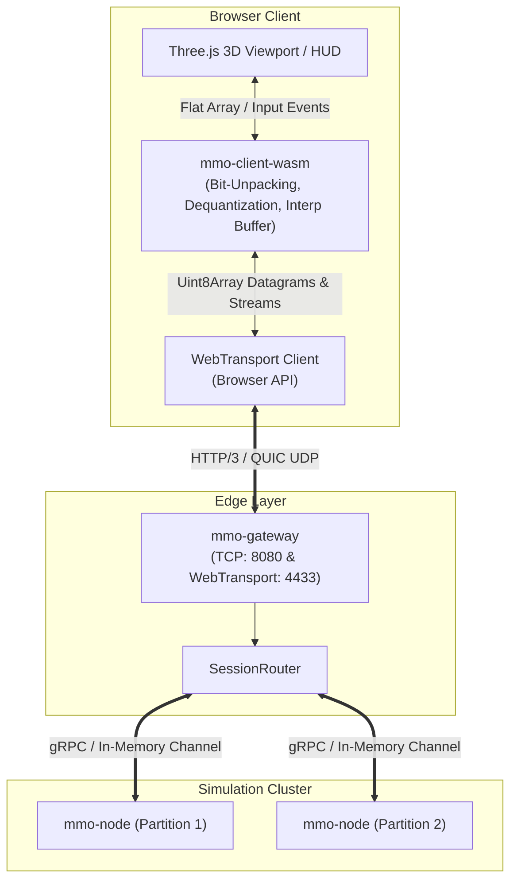

# Design Document: Track 8 - Visual Client Frontend & WebTransport Gateway Ingress

## 1. High-Level Architecture Overview



---

## 2. Zero-Copy & Low-Overhead Memory Boundary

Passing complex nested JSON objects across the WebAssembly JavaScript boundary at 60–144 Hz introduces garbage collection spikes.

### Memory Strategy:
1. **Render Buffer**:
   `WasmClientWorld::get_render_buffer(&self) -> Vec<f32>`
   Returns a contiguous, flat `Float32Array` encoding all visible entities:
   ```
   [
     guid_raw as f32,
     x, y, z,
     yaw,
     health_pct,
     cast_progress_pct,
     entity_type
   ] * N
   ```
   The JavaScript side reads directly from the WASM memory view without allocations.

2. **Network Datagram Ingress**:
   WebTransport incoming datagrams are passed as raw `Uint8Array` directly into `process_packet(&[u8])`, decoding Track 6 bit-packed frames with zero heap allocations in JavaScript.

---

## 3. WebTransport Gateway Lifecycle in `mmo-gateway`

1. **Dual Listener Startup**:
   - `GatewayServer::bind_tcp(addr)`: Spawns the standard TCP socket listener.
   - `GatewayServer::bind_webtransport(addr, cert_config)`: Spawns the UDP/QUIC listener using `wtransport`.
2. **Session Registration**:
   - WebTransport session establishes a cryptographic handshake.
   - A unique `session_id` is assigned and registered in `SessionRouter`.
   - Datagram writer channel is attached to the session state for outgoing AoI delta broadcasting.
3. **Session Termination**:
   - On disconnect or keep-alive timeout, `SessionRouter::unregister_session(session_id)` is invoked, notifying the simulation nodes to remove AoI observers.

---

## 4. Concurrency & Thread-Safety Invariants
1. **Gateway Tokio Tasks**:
   - Each WebTransport session runs two asynchronous background tasks: a datagram reader loop and a stream handler loop.
   - Lock contention is prevented by passing packets through unbounded MPSC channels directly into the existing router.
2. **No Mutex Locking in WASM**:
   - `WasmClientWorld` is single-threaded inside the browser's main thread / web worker, completely free of locks, condition variables, or atomic spins.
