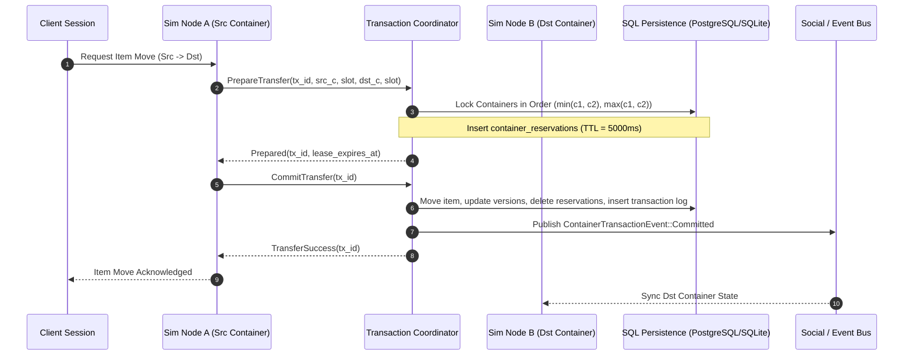

# Design: Distributed Transactional Containers & Generic Escrow

## 1. System Architecture & Component Interaction



---

## 2. Database Schema Design (`V3__containers_and_escrow.sql`)

### 2.1 Table: `containers`
```sql
CREATE TABLE IF NOT EXISTS containers (
    container_id BIGINT PRIMARY KEY,
    owner_type VARCHAR(32) NOT NULL, -- 'character', 'guild', 'world_entity', 'system'
    owner_id VARCHAR(64) NOT NULL,   -- character guid, guild guid, etc.
    name VARCHAR(64) NOT NULL,
    capacity INT NOT NULL,
    access_policy VARCHAR(32) NOT NULL, -- 'owner_only', 'public_read_write', 'role_restricted'
    version BIGINT NOT NULL DEFAULT 1,
    created_at BIGINT NOT NULL,
    updated_at BIGINT NOT NULL
);

CREATE INDEX IF NOT EXISTS idx_containers_owner ON containers (owner_type, owner_id);
```

### 2.2 Table: `container_items` (or evolving `items`)
To maintain zero-overhead backward compatibility while supporting arbitrary containers, `items` table gains a `container_id BIGINT` column where `container_id` defaults to `character_guid` for existing character inventory items:
```sql
ALTER TABLE items ADD COLUMN IF NOT EXISTS container_id BIGINT;
UPDATE items SET container_id = character_guid WHERE container_id IS NULL;
CREATE INDEX IF NOT EXISTS idx_items_container_slot ON items (container_id, slot);
```

### 2.3 Table: `container_reservations`
```sql
CREATE TABLE IF NOT EXISTS container_reservations (
    reservation_id VARCHAR(64) PRIMARY KEY,
    tx_id VARCHAR(64) NOT NULL,
    container_id BIGINT NOT NULL REFERENCES containers(container_id) ON DELETE CASCADE,
    slot INT NOT NULL,
    item_instance_id VARCHAR(64),
    reservation_type VARCHAR(16) NOT NULL, -- 'transfer_out', 'transfer_in'
    expires_at_epoch_ms BIGINT NOT NULL,
    created_at_epoch_ms BIGINT NOT NULL
);

CREATE INDEX IF NOT EXISTS idx_reservations_tx ON container_reservations (tx_id);
CREATE INDEX IF NOT EXISTS idx_reservations_expiry ON container_reservations (expires_at_epoch_ms);
CREATE UNIQUE INDEX IF NOT EXISTS uq_container_slot_active_reservation 
    ON container_reservations (container_id, slot);
```

### 2.4 Table: `escrows`
```sql
CREATE TABLE IF NOT EXISTS escrows (
    escrow_id VARCHAR(64) PRIMARY KEY,
    depositor_container_id BIGINT NOT NULL REFERENCES containers(container_id) ON DELETE CASCADE,
    beneficiary_container_id BIGINT NOT NULL REFERENCES containers(container_id) ON DELETE CASCADE,
    escrow_container_id BIGINT NOT NULL REFERENCES containers(container_id) ON DELETE CASCADE,
    status VARCHAR(32) NOT NULL, -- 'held', 'settled', 'refunded'
    secret_hash VARCHAR(128) NOT NULL,
    expires_at_epoch_ms BIGINT NOT NULL,
    created_at_epoch_ms BIGINT NOT NULL,
    updated_at_epoch_ms BIGINT NOT NULL
);

CREATE INDEX IF NOT EXISTS idx_escrows_status_expiry ON escrows (status, expires_at_epoch_ms);
```

### 2.5 Table: `container_transactions` (Audit Ledger)
```sql
CREATE TABLE IF NOT EXISTS container_transactions (
    tx_id VARCHAR(64) PRIMARY KEY,
    src_container_id BIGINT NOT NULL,
    dst_container_id BIGINT NOT NULL,
    item_instance_id VARCHAR(64) NOT NULL,
    status VARCHAR(16) NOT NULL, -- 'committed', 'aborted'
    timestamp_epoch_ms BIGINT NOT NULL
);
```

---

## 3. Concurrency, Deadlock Freedom & Failure Recovery

### 3.1 Strict Ordered Locking Invariant
To prevent deadlock cycles between concurrent competing transactions (e.g. Node 1 moving item from `C_A -> C_B` while Node 2 moves from `C_B -> C_A`):
```rust
let (first_id, second_id) = if src_container_id < dst_container_id {
    (src_container_id, dst_container_id)
} else {
    (dst_container_id, src_container_id)
};
```
In PostgreSQL:
```sql
SELECT container_id FROM containers WHERE container_id = $1 FOR UPDATE;
SELECT container_id FROM containers WHERE container_id = $2 FOR UPDATE;
```
In SQLite:
Serialized via `BEGIN IMMEDIATE` transaction execution.

### 3.2 Commit vs. Reaper Atomic Race Resolution
To eliminate race conditions between `CommitTransfer` and the background `ReservationReaper`:
`CommitTransfer` executes within a database transaction:
```sql
-- Atomically delete active non-expired reservations for this transaction
DELETE FROM container_reservations 
WHERE tx_id = $1 AND expires_at_epoch_ms > $now;
```
If the number of affected rows is strictly less than 2 (the expected source and destination reservations), the transaction MUST immediately rollback and return `TransactionError::ReservationExpiredOrAborted`.

### 3.3 Automated Lease Reaper & Compensation
A lightweight background loop (`ReservationReaper`) ticks every 1,000ms:
1. Queries expired leases: `SELECT DISTINCT tx_id FROM container_reservations WHERE expires_at_epoch_ms < current_epoch_ms`.
2. Triggers `AbortTransfer(tx_id)`:
   - Removes stale reservations.
   - Cleans up escrow state if expired.
   - Dispatches compensation event to `SocialBus`.

### 3.4 Escrow Secret Verification
Secret verification uses constant-time comparison (via the `subtle` crate or constant-time slice comparison) to prevent timing side-channel attacks on `ReleaseEscrow`.

---

## 4. Subsystem Integration

1. **`crates/core`**:
   - `ContainerId`, `ContainerOwner`, `ContainerAccessPolicy`, `ContainerSlot` in `crates/core/src/container.rs`.
2. **`crates/storage`**:
   - `ContainerRepository`: CRUD on containers and items.
   - `TransactionCoordinator`: `prepare_transfer`, `commit_transfer`, `abort_transfer`.
   - `EscrowCoordinator`: `create_escrow`, `release_escrow`, `refund_escrow`.
   - `V3__containers_and_escrow.sql` migrations for SQLite and PostgreSQL.
3. **`crates/schema`**:
   - Cluster protobuf RPCs for cross-node container reservation:
     - `ReserveContainerSlotRequest / Response`
     - `CommitContainerTransferRequest / Response`
     - `AbortContainerTransferRequest / Response`
4. **`crates/node`**:
   - Container access and transfer requests dispatched cleanly from simulation ticks without blocking the 20 Hz simulation thread.
