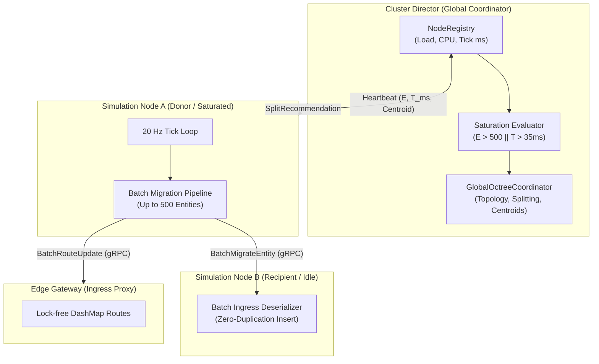

# Design: Dynamic Spatial Partition Rebalancing, Hotspot Mitigation & Zero-Disconnect Batch Handover

## 1. System Architecture Overview



---

## 2. Telemetry & Saturation Evaluation

### 2.1 Heartbeat Protocol Extension
Extend `HeartbeatRequest` in `proto/cluster.proto`:
```protobuf
message HeartbeatRequest {
  uint32 node_id = 1;
  float tick_rate = 2;
  uint32 entity_count = 3;
  float cpu_percent = 4;
  uint64 memory_bytes = 5;
  uint64 timestamp = 6;
  float tick_duration_ms = 7;
  Vector3 entity_centroid = 8;
}
```

### 2.2 Saturated Partition Detection
In `GlobalOctreeCoordinator`:
```rust
pub const DEFAULT_TICK_SATURATION_MS: f32 = 35.0;
pub const DEFAULT_SPLIT_THRESHOLD: u32 = 500;
pub const DEFAULT_SPLIT_COOLDOWN: std::time::Duration = std::time::Duration::from_secs(10);

pub fn should_split_node(&self, entity_count: u32, tick_duration_ms: f32, last_split: std::time::Instant) -> bool {
    let cooldown_elapsed = last_split.elapsed() >= self.split_cooldown;
    cooldown_elapsed && (entity_count >= self.split_threshold || tick_duration_ms >= self.tick_saturation_ms)
}
```

---

## 3. Dynamic Worker Node Provisioning & Load Balancing

When an octant splits, candidate nodes are scored using normalized weights:
```rust
pub fn compute_node_load_score(entity_count: u32, cpu_percent: f32, tick_duration_ms: f32) -> f32 {
    let w_entities = 0.5;
    let w_cpu = 0.25;
    let w_tick = 0.25;
    (entity_count as f32 * w_entities) + (cpu_percent * w_cpu) + (tick_duration_ms * w_tick)
}
```
Available worker nodes with lowest composite load scores receive child octant assignments. Child octant 0 stays with the original node to maintain local continuity.

---

## 4. Continuous Boundary Smoothing via Centroid Repulsion

### 4.1 Anti-Cheat & Coordinate Clamping
To prevent malicious coordinate spoofing from destabilizing global cluster topology:
- Nodes must mathematically clamp each entity's coordinate to their assigned `BoundingBox3D` before averaging into `entity_centroid`.
- The `GlobalOctreeCoordinator` verifies that any reported `entity_centroid` lies strictly within the node's assigned bounds, clamping the vector if an anomaly is detected.

### 4.2 Elastic Boundary Adjustment
For adjacent partitions, the boundary plane coordinate (e.g. $X_{\text{boundary}}$) is adjusted proportionally to the entity imbalance:
$$\Delta X = \operatorname{clamp}\left(\alpha \cdot \frac{N_A - N_B}{N_A + N_B} \cdot \Delta X_{\text{max}}, \; -X_{\text{limit}}, \; X_{\text{limit}}\right)$$
- If $|\Delta X| < \delta_{\text{hysteresis}}$ ($1.0\text{m}$), the shift is suppressed to prevent boundary oscillation.
- Max displacement per adjustment cycle is clamped to $25.0\text{m}$.
- Boundary adjustments update the `topology_epoch` and notify both adjacent nodes.

---

## 5. Zero-Disconnect Batch Migration Protocol

### 5.1 Protobuf Definitions
```protobuf
message BatchMigrateEntityRequest {
  uint32 source_node_id = 1;
  uint32 target_node_id = 2;
  uint64 topology_epoch = 3;
  repeated MigrateEntityRequest entities = 4;
}

message BatchMigrateEntityResponse {
  bool success = 1;
  uint32 migrated_count = 2;
  string error_message = 3;
}

message BatchRouteUpdateRequest {
  repeated RouteUpdateRequest updates = 1;
}

message BatchRouteUpdateResponse {
  bool success = 1;
  uint32 updated_count = 2;
  string error_message = 3;
}
```

### 5.2 Two-Phase Batch Lock Ordering & Invariants
1. **Phase 1 (Donor Write Lock)**:
   - Acquire `migrating_leases` for all $K$ target GUIDs. If any lease cannot be acquired, abort immediately with zero partial leases held.
   - Snapshot positions, kinematics, and serialize components into a single `BatchMigrateEntityRequest`.
   - Release the simulation write lock.
2. **Network I/O & Ingestion**:
   - Issue `client.migrate_batch_entities(req)` with a $500\text{ms}$ timeout.
   - Recipient executes an atomic all-or-nothing insertion. If any entity fails validation (e.g. out of bounds), the recipient rejects the entire batch (`success = false`).
3. **Commit Point of No Return (Donor Write Lock)**:
   - If Recipient returns `success = false` or the RPC times out/fails:
     - Donor acquires write lock, releases all $K$ leases immediately, and retains simulation authority (zero dropped entities). Increment `mmo_batch_migration_rollbacks_total`.
   - If Recipient returns `success = true`:
     - The Point of No Return is reached. Donor acquires write lock, cleans up leases, and despawns all $K$ entities locally without triggering death hooks.
4. **Gateway Route Commit (Post-Ingestion)**:
   - Dispatch `gateway.update_batch_routes(batch_update)` to update Edge Gateway routes in one request.
   - If Gateway RPC encounters transient network error, retry asynchronously or log; Donor does NOT roll back (preventing split-brain entity duplication).

---

## 6. Observability & Telemetry

Prometheus metrics:
- `mmo_hotspot_splits_total`: Counter for automated sub-domain divisions triggered by saturation.
- `mmo_boundary_adjustments_total`: Counter for boundary plane shifts.
- `mmo_batch_migrations_total`: Counter for completed batch transfers.
- `mmo_batch_migration_entities_total`: Counter for total individual entities migrated via batching.
- `mmo_batch_migration_rollbacks_total`: Counter for rolled-back batch transfers (prior to recipient commit).
- `mmo_tick_duration_ms`: Histogram tracking tick duration per node.
