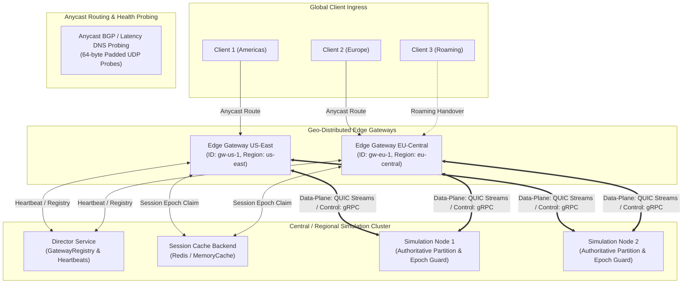
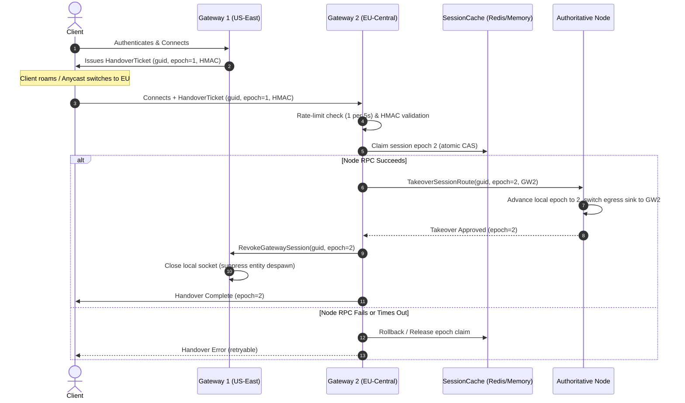

# Technical Design: Geo-Distributed Edge Gateways & Anycast Routing

## System Overview & Architecture

The Geo-Distributed Edge Gateway architecture decouples client ingress from regional simulation clusters. By terminating TLS 1.3 / QUIC and HTTP/3 WebTransport at edge PoPs globally, client RTT is drastically minimized, packet loss recovery occurs locally, and backend simulation nodes are shielded from WAN connection volatility.



---

## 1. Gateway Identity & Director Gateway Registry

### GatewayDescriptor
```rust
#[derive(Debug, Clone, PartialEq, Serialize, Deserialize)]
pub struct GatewayDescriptor {
    pub gateway_id: String,
    pub region: String,
    pub listen_addr: String,
    pub grpc_addr: String,
    pub probe_addr: String,
    pub capacity: u32,
    pub active_sessions: u32,
    pub last_heartbeat_ms: u64,
    pub status: GatewayStatus,
}

#[derive(Debug, Clone, Copy, PartialEq, Eq, Serialize, Deserialize)]
pub enum GatewayStatus {
    Healthy,
    Degraded,
    Draining,
    Offline,
}
```

### Director GatewayRegistry
The Director manages a concurrent registry of all active gateways:
* In-memory storage backed by `DashMap<String, GatewayDescriptor>` or `RwLock<HashMap<String, GatewayDescriptor>>`.
* Stale heartbeat reaper: Runs every 1,000ms. If `current_time - last_heartbeat > 3500ms`, transitions gateway to `Offline` and removes it from active routing pools.
* Multi-Gateway Route Broadcast: When a simulation node or director initiates an entity migration or node failover, it queries `GatewayRegistry.get_active_gateways()` to fan out route invalidations across all gateways in parallel.

---

## 2. Protobuf Extensions (`cluster.proto`)

Add gateway coordination RPCs to `DirectorService`, `NodeService`, and `GatewayService`:

```protobuf
// Gateway Registration & Heartbeat
message RegisterGatewayRequest {
  string gateway_id = 1;
  string region = 2;
  string listen_addr = 3;
  string grpc_addr = 4;
  string probe_addr = 5;
  uint32 capacity = 6;
}

message RegisterGatewayResponse {
  bool success = 1;
  string error_message = 2;
  uint64 heartbeat_interval_ms = 3;
}

message GatewayHeartbeatRequest {
  string gateway_id = 1;
  uint32 active_sessions = 2;
  float cpu_percent = 3;
  float memory_percent = 4;
  uint64 timestamp_ms = 5;
}

message GatewayHeartbeatResponse {
  bool acknowledged = 1;
  bool should_drain = 2;
}

// Session Takeover & Handover
message TakeoverSessionRouteRequest {
  uint64 guid = 1;
  uint64 new_session_id = 2;
  string new_gateway_id = 3;
  string new_gateway_grpc_addr = 4;
  uint64 session_epoch = 5;
  bytes handover_signature = 6;
}

message TakeoverSessionRouteResponse {
  bool success = 1;
  string error_message = 2;
  uint64 authoritative_epoch = 3;
}

message RevokeGatewaySessionRequest {
  uint64 guid = 1;
  uint64 session_id = 2;
  uint64 superseded_by_epoch = 3;
}

message RevokeGatewaySessionResponse {
  bool success = 1;
}

// Multi-Gateway Entity Route Invalidation Broadcast
message MultiGatewayRouteBroadcastRequest {
  uint64 guid = 1;
  uint64 session_id = 2;
  string new_node_address = 3;
  uint64 session_epoch = 4;
}

message MultiGatewayRouteBroadcastResponse {
  bool success = 1;
  uint32 acknowledged_gateways = 2;
}

service DirectorService {
  // Existing RPCs ...
  rpc RegisterGateway (RegisterGatewayRequest) returns (RegisterGatewayResponse);
  rpc GatewayHeartbeat (GatewayHeartbeatRequest) returns (GatewayHeartbeatResponse);
}

service GatewayService {
  // Existing RPCs ...
  rpc RevokeGatewaySession (RevokeGatewaySessionRequest) returns (RevokeGatewaySessionResponse);
}

service NodeService {
  // Existing RPCs ...
  rpc TakeoverSessionRoute (TakeoverSessionRouteRequest) returns (TakeoverSessionRouteResponse);
}
```

---

## 3. Anycast Latency & Health Probe with Reflection Defense

To eliminate Distributed Denial of Service (DDoS) UDP reflection amplification vectors, the UDP probe protocol enforces strict request-size padding:
* **Minimum Request Size**: 64 bytes. Probe requests smaller than 64 bytes are dropped immediately without a response, yielding a response-to-request ratio $\le 1.0$.
* **UDP Probe Layout**:
  - Request: `[u32 magic: 0x4D4D4F50, u64 client_timestamp_ms, u32 client_nonce, [u8; 48] padding]`.
  - Response: `[u32 magic: 0x4D4D4F50, u64 client_timestamp_ms, u32 client_nonce, u64 server_time_ms, u32 active_sessions, u32 capacity, u8 region_len, [u8; region_len], padding...]` (exactly 64 bytes).
* **Zero Allocation & Lock-Free**: Probe handlers read atomic counters (`AtomicU32`) without touching or contending on session routing tables.

---

## 4. Persistent Backhaul Connection Pool (`BackhaulPool`)

To avoid TCP Head-of-Line (HoL) blocking on high-latency WAN links, the backhaul protocol strictly decouples control-plane and data-plane traffic:
1. **Control-Plane**: gRPC over HTTP/2 for cluster management, route invalidations, and handover handshakes where reliable delivery is required.
2. **Data-Plane**: Native QUIC multiplexed streams or unreliable datagram channels (`BackhaulPool`) for kinematic movement frames and entity delta broadcasts. Loss on one client's stream cannot delay frames for another client.
3. **Health Checking & RTT Tracking**: Backhaul channels transmit periodic keepalive pings, continuously measuring latency and packet loss. If a simulation node link degrades, the circuit breaker triggers and routes traffic to replica nodes or initiates graceful draining.

---

## 5. Seamless Cross-Gateway Session Handover Protocol

### The Handover Flow & Concurrency Model:


### Upstream Packet Epoch Validation:
* During a handover, delayed or buffered packets from Gateway 1 may still be in transit across the WAN.
* Every upstream client frame forwarded across the backhaul carries the client's `session_epoch: u64`.
* The authoritative simulation node validates incoming frames against its local `entity_session_epoch`:
  - If `packet.epoch == node.session_epoch`: Process frame normally.
  - If `packet.epoch < node.session_epoch`: Stale frame from previous gateway; silently drop and record telemetry metric `mmo_node_stale_epoch_packets_dropped_total`.
  - If `packet.epoch > node.session_epoch`: Future epoch without completed takeover; reject frame.

### Handover Rate Limiting & BGP Thrashing Defense:
* A token-bucket rate limiter per entity GUID is maintained in `SessionRouter`:
  - Replenishment rate: 1 token per 5.0 seconds.
  - Burst limit: 2 tokens.
* If Anycast route flapping occurs and exceeds this threshold, the gateway rejects the handover with a rate-limit error, preventing cache lock storms.

### Node RPC Failure & Cache CAS Rollback:
* If `TakeoverSessionRoute` fails, times out, or the destination simulation node is unreachable:
  - Gateway 2 executes a rollback on `SessionCacheBackend`, restoring the previous epoch or clearing the pending claim.
  - Gateway 2 surfaces a retryable error to the client, allowing the client to re-discover alternative nodes or retry through Anycast.

---

## 6. Concurrency, Lock Ordering & Thread Safety

* **Lock Hierarchy**:
  1. `SessionCacheBackend` / Distributed CAS (Remote State)
  2. `GatewayRegistry` (DashMap sharded reads/inserts)
  3. `SessionRouter` (DashMap sharded reads/inserts)
  4. Client Socket Mutex / Channel Sinks
  * Never acquire locks in reverse order.
* **Non-Blocking Ingress**:
  * Packet dispatch remains completely lock-free via `DashMap` lookups.
  * Probe handlers read atomic counters without touching session maps.

---

## 7. Failure Modes & Resilience

| Failure Scenario | Mitigation |
| :--- | :--- |
| **Director Crashes / Unreachable** | Edge Gateways continue routing to cached simulation node addresses. Heartbeats retry with exponential backoff. Local sessions are unaffected. |
| **Gateway 1 Hard Crashes During Handover** | Client connects to Gateway 2; Gateway 2 claims session in cache and informs Node. The failed Gateway 1's socket was already dead, so cleanup is clean. |
| **Simulation Node Crash During Handover** | Gateway 2 detects RPC timeout, rolls back the CAS claim in `SessionCacheBackend`, and returns a recoverable error to the client. |
| **Backhaul Network Partition** | Edge Gateway detects backhaul failure via ping timeouts, marks node `Degraded`, and directs clients to alternative Anycast gateways via probe status `Degraded`. |
| **Ticket Replay / Theft Attempt** | Monotonic epoch verification in distributed cache and simulation node guarantees only the latest incremented epoch succeeds; older or duplicate tickets are denied. |
| **UDP Reflection Attempt** | Mandatory 64-byte request padding prevents amplification by guaranteeing response-to-request size ratio $\le 1.0$. |
