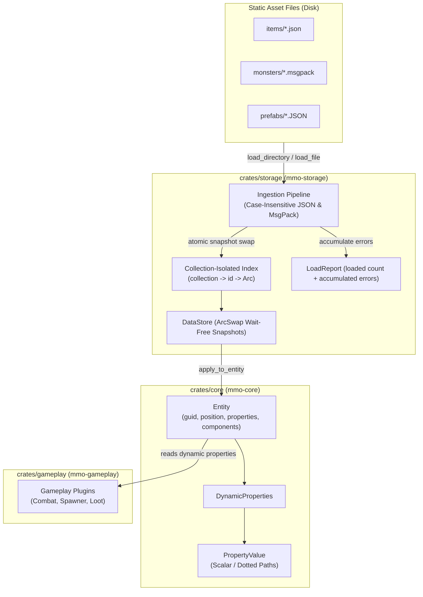

# Design: Schemaless Document Store for Data-Driven Assets

## Architecture Overview



---

## 1. Core Primitives (`crates/core`)

### `PropertyValue`
A lightweight, flexible dynamic value enum supporting all JSON/MessagePack scalar and composite types, designed for minimal allocations:
```rust
#[derive(Debug, Clone, PartialEq, Serialize, Deserialize)]
#[serde(untagged)]
pub enum PropertyValue {
    Null,
    Bool(bool),
    Int(i64),
    Float(f64),
    String(String),
    Array(Vec<PropertyValue>),
    Object(HashMap<String, PropertyValue>),
}
```

Key features:
- Conversions: `From<T>` for `i8..i64, u8..u32, f32, f64, bool, String, &str, serde_json::Value`.
- Accessors: `as_str()`, `as_i64()`, `as_f64()`, `as_bool()`, `as_array()`, `as_object()`.
- Numeric tolerance: `as_f64()` automatically coerces `Int(x)` to float `x as f64`.

### `DynamicProperties`
A thread-safe key-value store mapping strings to `PropertyValue`:
```rust
#[derive(Debug, Clone, PartialEq, Default, Serialize, Deserialize)]
pub struct DynamicProperties {
    fields: HashMap<String, PropertyValue>,
}
```
Methods:
- `get(&self, key: &str) -> Option<&PropertyValue>`
- `get_path(&self, dot_path: &str) -> Option<&PropertyValue>`: defensively navigates nested objects (e.g. `"combat.element.fire"`). If any intermediate segment is not an `Object` or is missing, gracefully returns `None` without panic.
- `get_str(&self, key: &str) -> Option<&str>`
- `get_i64(&self, key: &str) -> Option<i64>`
- `get_f64(&self, key: &str) -> Option<f64>`
- `get_bool(&self, key: &str) -> Option<bool>`
- `set(&mut self, key: impl Into<String>, value: impl Into<PropertyValue>)`
- `remove(&mut self, key: &str) -> Option<PropertyValue>`
- `merge(&mut self, other: &DynamicProperties)`
- `merge_json(&mut self, value: &serde_json::Value)`

### `Entity` Integration
In `crates/core/src/entity.rs`:
```rust
pub struct Entity {
    pub guid: Guid,
    pub position: (f32, f32, f32),
    pub rotation: f32,
    pub properties: DynamicProperties,
    pub components: ComponentStore,
}
```
Helpers on `Entity`:
- `entity.get_property(key)`
- `entity.set_property(key, val)`
- `entity.get_property_str(key)`
- `entity.get_property_f64(key)`
- `entity.get_property_i64(key)`
- `entity.get_property_bool(key)`

Preserves generational `SlotMap` mechanics, zero-cost component retrieval, and backwards compatibility.

---

## 2. Ingestion Pipeline & Storage (`crates/storage`)

### `DataDocument`
Represents an ingested asset document:
```rust
#[derive(Debug, Clone, PartialEq, Serialize, Deserialize)]
pub struct DataDocument {
    pub id: String,
    pub collection: String,
    pub properties: DynamicProperties,
}
```

### Wait-Free Concurrency via `ArcSwap`
To avoid cache line bouncing and lock contention across the 20 Hz multithreaded simulation tick, `DataStore` utilizes `arc-swap::ArcSwap`:
```rust
pub struct DataStore {
    snapshot: ArcSwap<DataStoreSnapshot>,
}

#[derive(Default, Clone)]
pub struct DataStoreSnapshot {
    collections: HashMap<String, HashMap<String, Arc<DataDocument>>>,
}
```

During simulation ticks, reading via `data_store.get(collection, id)` is wait-free and lock-free (dereferencing an atomic `Arc` pointer). Writes (startup ingestion or runtime content reload) clone the snapshot map, insert the new documents, and atomically replace the pointer with `store.snapshot.swap(new_snapshot)`.

### Collection Isolation (Preventing ID Clashes)
To prevent cross-collection ID collisions (e.g. item `"101"` vs monster `"101"`), documents are partitioned strictly by collection:
- `get(&self, collection: &str, id: &str) -> Option<Arc<DataDocument>>`
- `get_collection(&self, collection: &str) -> Vec<Arc<DataDocument>>`
- `list_collections(&self) -> Vec<String>`
- `count(&self) -> usize`
- `apply_to_entity(&self, collection: &str, id: &str, entity: &mut mmo_core::Entity) -> Result<(), DataStoreError>`

### Multi-Format & Multi-Layout Ingestion Logic
1. **Case-Insensitive File Matching**:
   - Compares lowercased extension: `.json` -> `serde_json`, `.mpk` / `.msgpack` -> `rmp_serde`.
2. **Collection Inference**:
   - If document contains `"collection": "name"`, uses that.
   - Else, uses immediate parent folder name (e.g., `assets/items/sword.json` -> collection `"items"`).
3. **Document Layout Detection**:
   - *Single Document*: JSON object with `"id"` or file stem as fallback ID.
   - *Array of Documents*: Array of JSON objects, each with `"id"` field.
   - *Dictionary of Documents*: Object where keys are IDs and values are document properties.
4. **Error Accumulation & Diagnostic Reporting**:
   `load_directory` returns `LoadReport`:
   ```rust
   pub struct LoadReport {
       pub loaded: usize,
       pub errors: Vec<DataStoreError>,
   }
   ```
   A malformed file will append to `errors` without aborting other valid assets in the directory tree.

---

## 3. Concurrency, Performance & Memory

1. **Lock-Free Reads**:
   - `ArcSwap` provides wait-free, O(1) concurrent reads without mutex locks or atomic contention overhead during the 20 Hz tick.
2. **Memory Efficiency**:
   - Shared references via `Arc<DataDocument>`.
   - Small property keys share capacity in `HashMap`.
3. **Failure Isolation**:
   - Ingestion errors are non-fatal to existing loaded collections. Corrupted files are reported with exact file paths and error messages.

---

## 4. Gameplay Integration (`crates/gameplay`)

1. **Dynamic Combat Modifiers**:
   - `StatsComponent` or combat damage calculations can check `entity.get_property_f64("elemental_damage")` or `entity.get_property_f64("crit_chance")`.
2. **Dynamic Spawner Archetypes**:
   - Spawners can reference a document ID in `DataStore` (e.g. `"monsters"`, `"goblin_scout"`).
   - Upon spawning, `data_store.apply_to_entity("monsters", template_id, &mut entity)` populates the entity's properties without modifying Rust source code.
3. **Content Patching Without Recompilation**:
   - Modifying `data/monsters/goblin.json` from `hp: 50` to `hp: 75` and reloading instantly changes newly spawned or updated entities.
