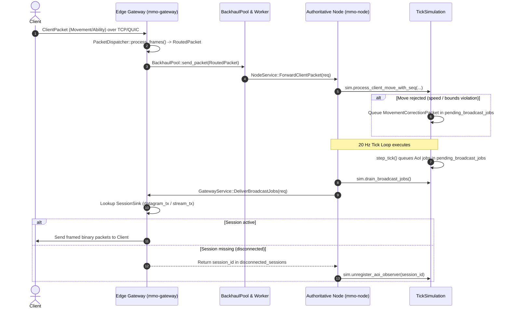

# Design: Drain & Dispatch AoI Broadcast Jobs & Wire Gateway Backhaul

## Architecture Overview



## Detailed Component Design

### 1. Protobuf Interface Additions (`crates/schema/proto/cluster.proto`)

#### GatewayService Additions:
```protobuf
message SessionPacketBatch {
  uint64 session_id = 1;
  repeated bytes packets = 2;
}

message DeliverBroadcastJobsRequest {
  repeated SessionPacketBatch jobs = 1;
}

message DeliverBroadcastJobsResponse {
  bool success = 1;
  uint32 delivered_count = 2;
  repeated uint64 disconnected_sessions = 3;
}

service GatewayService {
  ...
  rpc DeliverBroadcastJobs (DeliverBroadcastJobsRequest) returns (DeliverBroadcastJobsResponse);
}
```

#### NodeService Additions:
```protobuf
message ForwardClientPacketRequest {
  uint64 session_id = 1;
  uint64 guid = 2;
  bytes packet_data = 3;
}

message ForwardClientPacketResponse {
  bool success = 1;
  string error_message = 2;
}

service NodeService {
  ...
  rpc ForwardClientPacket (ForwardClientPacketRequest) returns (ForwardClientPacketResponse);
}
```

### 2. Node Daemon Tick Loop & Decoupled Dispatcher (`crates/node/src/main.rs`)

- A bounded `mpsc::channel::<Vec<AoiBroadcastJob>>(128)` channel decouples the tick loop from gRPC network I/O.
- In the 20 Hz loop:
  ```rust
  let mut sim_guard = sim.write().await;
  sim_guard.step_tick();
  let jobs = sim_guard.drain_broadcast_jobs();
  if !jobs.is_empty() {
      if let Err(mpsc::error::TrySendError::Full(_)) = broadcast_tx.try_send(jobs) {
          metrics::counter!("mmo_node_broadcast_jobs_dropped_backpressure").increment(1);
      }
  }
  ```
- Dedicated background task reads from `broadcast_rx`, connects to `GatewayServiceClient` (using `GATEWAY_GRPC_ADDR`, defaulting to `"http://127.0.0.1:50050"`), and calls `deliver_broadcast_jobs(req).await`.
- **Zombie Observer Cleanup**: If the gateway response contains `disconnected_sessions`, the dispatcher task unregisters them on the simulation state:
  ```rust
  if !resp.disconnected_sessions.is_empty() {
      let mut sim_guard = sim_clone.write().await;
      for sid in resp.disconnected_sessions {
          if let Some(obs) = sim_guard.unregister_aoi_observer(sid) {
              sim_guard.entity_store.despawn_by_guid(obs.player_guid);
              sim_guard.octree.remove_by_guid(obs.player_guid);
          }
      }
  }
  ```

### 3. Gateway Egress Delivery (`crates/gateway/src/server.rs`)

- In `GatewayServiceImpl`:
  ```rust
  async fn deliver_broadcast_jobs(
      &self,
      request: tonic::Request<DeliverBroadcastJobsRequest>,
  ) -> Result<tonic::Response<DeliverBroadcastJobsResponse>, tonic::Status> {
      let req = request.into_inner();
      let mut delivered = 0;
      let mut disconnected = Vec::new();
      if let Some(ref sinks) = self.session_sinks {
          for batch in req.jobs {
              if let Some(sink_entry) = sinks.get(&batch.session_id) {
                  let sink = sink_entry.value();
                  for pkt_bytes in batch.packets {
                      let bytes = Bytes::from(pkt_bytes);
                      let is_ephemeral = is_ephemeral_packet(&bytes);
                      let sent = if is_ephemeral {
                          sink.datagram_tx.try_send(bytes).is_ok()
                      } else {
                          sink.stream_tx.try_send(bytes).is_ok()
                      };
                      if sent {
                          delivered += 1;
                      }
                  }
              } else {
                  disconnected.push(batch.session_id);
              }
          }
      }
      Ok(tonic::Response::new(DeliverBroadcastJobsResponse {
          success: true,
          delivered_count: delivered,
          disconnected_sessions: disconnected,
      }))
  }
  ```

### 4. Gateway Ingress Backhaul Forwarder (`crates/gateway/src/main.rs`)

- Capture `Arc<BackhaulChannel>` inside the forwarder worker to properly drive circuit breaker states (`record_success()` / `record_failure()`).
- Drain ready packets from the backhaul queue in batches (up to 32 ready items using `rx.try_recv()`) or dispatch without unbounded sequential head-of-line blocking.
  ```rust
  let backhaul = server.backhaul_pool().clone();
  tokio::spawn(async move {
      while let Some(pkt) = packet_rx.recv().await {
          let (ch, rx_opt) = backhaul.get_or_create(&pkt.node_address);
          if let Some(mut rx) = rx_opt {
              let node_addr = pkt.node_address.clone();
              let channel_ref = Arc::clone(&ch);
              tokio::spawn(async move {
                  let endpoint = if node_addr.starts_with("http") {
                      node_addr
                  } else {
                      format!("http://{}", node_addr)
                  };
                  let mut client_opt = None;
                  while let Some(packet) = rx.recv().await {
                      if client_opt.is_none() {
                          client_opt = NodeServiceClient::connect(endpoint.clone()).await.ok();
                      }
                      if let Some(ref mut client) = client_opt {
                          let req = ForwardClientPacketRequest {
                              session_id: packet.session_id,
                              guid: packet.guid.map(|g| g.raw()).unwrap_or(0),
                              packet_data: packet.packet.encode(),
                          };
                          match client.forward_client_packet(req).await {
                              Ok(_) => channel_ref.record_success(),
                              Err(e) => {
                                  channel_ref.record_failure();
                                  client_opt = None;
                              }
                          }
                      } else {
                          channel_ref.record_failure();
                      }
                  }
              });
          }
          let _ = backhaul.send_packet(pkt);
      }
  });
  ```

### 5. Node Ingress Handling & Movement Correction Snapback (`crates/node/src/network.rs`)

- In `NodeServiceImpl::forward_client_packet`:
  - Validate packet size does not exceed `MAX_PACKET_PAYLOAD_SIZE + HEADER_SIZE`.
  - Validate that `req.guid` matches the acting entity GUID inside the packet.
  - On `ClientPacket::Movement(m)`:
    ```rust
    let mut sim = self.sim.write().await;
    let guid = Guid::from_raw(req.guid);
    match sim.process_client_move_with_seq(guid, (m.position.x, m.position.y, m.position.z), m.sequence) {
        Ok(_) => Ok(tonic::Response::new(ForwardClientPacketResponse { success: true, error_message: String::new() })),
        Err(snap_back) => {
            // Anti-Cheat / Collision violation: queue immediate MovementCorrection snapback
            let correction = mmo_schema::client::MovementCorrectionPacket {
                entity_id: guid.raw(),
                sequence: m.sequence,
                position: mmo_schema::client::Vec3::new(snap_back.0, snap_back.1, snap_back.2),
                velocity: mmo_schema::client::Vec3::new(0.0, 0.0, 0.0),
                timestamp: std::time::SystemTime::now()
                    .duration_since(std::time::UNIX_EPOCH)
                    .unwrap_or_default()
                    .as_millis() as u64,
            };
            sim.pending_broadcast_jobs.push(crate::aoi::AoiBroadcastJob {
                session_id: req.session_id,
                player_guid: guid,
                packets: vec![mmo_schema::client::ClientPacket::MovementCorrection(correction)],
            });
            metrics::counter!("mmo_node_movement_corrections_total").increment(1);
            Ok(tonic::Response::new(ForwardClientPacketResponse {
                success: false,
                error_message: "Movement corrected".to_string(),
            }))
        }
    }
    ```
