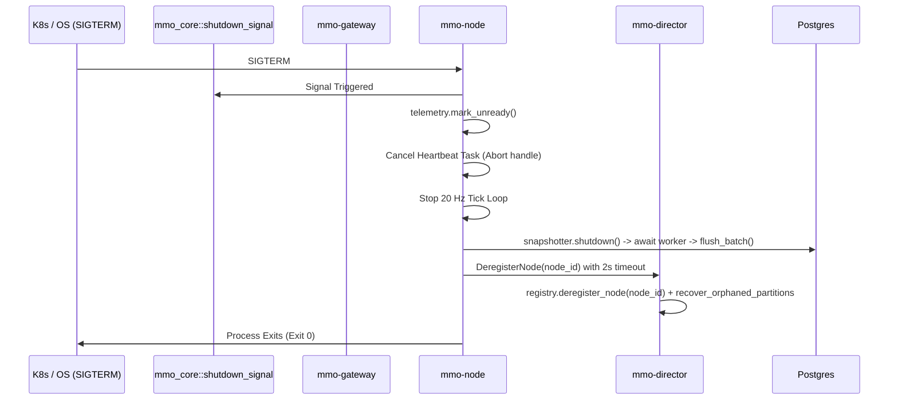

# Graceful Shutdown, Gateway Discovery & Operations Technical Design

## Architectural Context
The MMO cluster operates as a distributed system across three primary server roles:
1. `mmo-gateway`: Edge connection termination, session routing, authentication.
2. `mmo-node`: Authoritative spatial simulation, AoI culling, write-behind snapshotting.
3. `mmo-director`: Spatial partition topology, node registry, and failover orchestrator.

When running in Kubernetes or container runtimes, pods undergo rolling deployments and preemptive node evictions. Without coordinated shutdown hooks and dynamic topology discovery, pods terminate abruptly, risking write-behind snapshot data loss, client connection resets, and routing table desynchronization.

---

## Technical Architecture



---

## Technical Components

### 1. Cross-Platform Signal Listener (`mmo_core::shutdown_signal`)
Located in `crates/core/src/lib.rs`:
```rust
/// Awaits either Ctrl+C (SIGINT) or Unix SIGTERM.
pub async fn shutdown_signal() {
    let ctrl_c = async {
        tokio::signal::ctrl_c()
            .await
            .expect("failed to install Ctrl+C handler");
    };

    #[cfg(unix)]
    let terminate = async {
        match tokio::signal::unix::signal(tokio::signal::unix::SignalKind::terminate()) {
            Ok(mut signal) => {
                signal.recv().await;
            }
            Err(e) => {
                eprintln!("[Core] Failed to install SIGTERM handler: {e}");
                std::future::pending::<()>().await;
            }
        }
    };

    #[cfg(not(unix))]
    let terminate = std::future::pending::<()>();

    tokio::select! {
        _ = ctrl_c => {
            eprintln!("[Core] Received SIGINT (Ctrl+C), starting graceful shutdown");
        },
        _ = terminate => {
            eprintln!("[Core] Received SIGTERM, starting graceful shutdown");
        },
    }
}
```

### 2. Schema Deregistration RPCs & Validation
Added to `crates/schema/proto/cluster.proto`:
```protobuf
message DeregisterNodeRequest {
  uint32 node_id = 1;
}

message DeregisterNodeResponse {
  bool success = 1;
}

message DeregisterGatewayRequest {
  string gateway_id = 1;
}

message DeregisterGatewayResponse {
  bool success = 1;
}
```
In `service DirectorService`:
```protobuf
rpc DeregisterNode (DeregisterNodeRequest) returns (DeregisterNodeResponse);
rpc DeregisterGateway (DeregisterGatewayRequest) returns (DeregisterGatewayResponse);
```
- **Validation**:
  - `DeregisterNodeRequest`: Validate `node_id > 0`. If `0`, return `Status::invalid_argument("node_id must be greater than zero")`.
  - `DeregisterGatewayRequest`: Validate `!gateway_id.trim().is_empty()`. If empty, return `Status::invalid_argument("gateway_id cannot be empty")`.
  - Idempotency: Deregistering an already-removed node or gateway returns `Ok(Response::new(DeregisterNodeResponse { success: false }))`.

### 3. Director Deregistration & Partition Recovery
- In `GatewayRegistry` (`crates/director/src/registry.rs`):
  Implement `pub fn deregister_gateway(&mut self, gateway_id: &str) -> Option<GatewayDescriptor>`.
- In `DirectorServiceImpl::deregister_node`:
  When a node cleanly deregisters, Director evicts the node from `registry` and immediately executes orphaned partition recovery and dynamic instance eviction under lock order `instance_registry` -> `registry` -> `coordinator`.
  This prevents bounding boxes or instances from becoming permanently orphaned when a node shuts down cleanly.

### 4. Dynamic Gateway Discovery in Director Recovery Loop
In `crates/director/src/main.rs`:
The recovery loop queries `svc_clone.gateway_registry.read().await.get_active_gateways()`.
- If dynamic gateways are present, URLs are resolved:
  `let targets: Vec<String> = active_gateways.iter().map(|g| if g.grpc_addr.starts_with("http") { g.grpc_addr.clone() } else { format!("http://{}", g.grpc_addr) }).collect();`
- If no active gateways are registered, fallback to `GATEWAY_GRPC_ADDR`.
- Broadcast `ReassignNodeRoutesRequest` concurrently across all targets with a 2-second timeout per gateway (`tokio::spawn` or `join_all`) so a slow or partitioned gateway cannot block recovery across the cluster.

### 5. Simulation Node Draining Sequence (`mmo-node`)
1. Create `CancellationToken` or watch channel for internal cancellation.
2. Retain heartbeat task handle: `let heartbeat_handle = tokio::spawn(...);`
3. Retain snapshot worker handle: `let snapshot_worker_handle = snapshotter.clone().start_worker();`
4. Run simulation tick loop until shutdown signal or cancellation:
   ```rust
   tokio::select! {
       _ = mmo_core::shutdown_signal() => {
           println!("[Node {node_id}] Shutdown signal received, initiating drain...");
       }
   }
   ```
5. Step A: `telemetry.mark_unready();` (signal Kubernetes readiness probe to failover traffic).
6. Step B: Abort heartbeat task (`heartbeat_handle.abort()`) to prevent heartbeat re-registration race conditions.
7. Step C: If `snapshotter` is present:
   - Call `snapshotter.shutdown();`
   - Await `snapshot_worker_handle` with a 5-second bounded timeout (`tokio::time::timeout(Duration::from_secs(5), snapshot_worker_handle)`).
   - Execute `let flushed = snapshotter.flush_batch().await;` to guarantee dirty entities are written to DB. Log any error without entering an infinite loop.
8. Step D: With a 2-second timeout, connect to Director and call `deregister_node(DeregisterNodeRequest { node_id: node_id as u32 })`. If Director is unreachable or times out, log a warning and proceed with local shutdown.
9. Step E: Signal gRPC server shutdown via `serve_with_shutdown`.
10. Step F: Clean exit with status 0.

### 6. Edge Gateway Draining Sequence (`mmo-gateway`)
1. Retain gateway heartbeat task handle: `let heartbeat_handle = tokio::spawn(...);`
2. Main accept loop wraps `listener.accept()` with cancellation token:
   ```rust
   tokio::select! {
       _ = shutdown_token.cancelled() => {
           println!("[Gateway] Stopping TCP accept loop...");
           break;
       }
       accept_res = listener.accept() => {
           // normal accept
       }
   }
   ```
3. Upon shutdown signal:
   - Step A: `telemetry.mark_unready();`
   - Step B: Cancel `shutdown_token` to terminate TCP accept loop immediately.
   - Step C: Abort heartbeat task (`heartbeat_handle.abort()`) to prevent heartbeat re-registration race.
   - Step D: With a 2-second timeout, connect to Director and call `deregister_gateway(DeregisterGatewayRequest { gateway_id })`. Log and proceed if Director is unreachable.
   - Step E: Drain sessions with a 3-second grace period for in-flight packet writes, then close session sinks.

### 7. Distributed Tracing Spans
- Instrument client packet decoding and forwarding with `tracing::info_span!("client_packet_forward", session_id, opcode)`.
- Instrument node packet intake with `tracing::info_span!("node_packet_process", node_id, opcode)`.
- Enforce log hygiene: ensure raw payloads and authentication credentials (JWT tokens) are never stored in span attributes.
