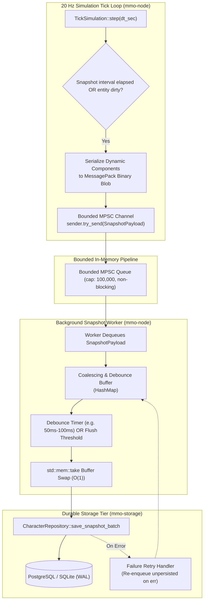

# Technical Design: Asynchronous Write-Behind Entity State Snapshots

## 1. Architectural Overview



---

## 2. Data Structures & Encoding

### 2.1 `EntitySnapshot` Model (`mmo-storage`)
```rust
#[derive(Debug, Clone, PartialEq, Serialize, Deserialize)]
pub struct EntitySnapshot {
    pub guid: u64,
    pub position: (f32, f32, f32),
    pub rotation: f32,
    pub attributes: serde_json::Value,
    #[serde(default)]
    pub state_blob: Option<Vec<u8>>,
    pub version: u64,
    pub timestamp: u64,
}
```

### 2.2 `SnapshotPayload` (`mmo-node`)
```rust
#[derive(Debug, Clone)]
pub struct SnapshotPayload {
    pub guid: Guid,
    pub position: (f32, f32, f32),
    pub rotation: f32,
    pub state_blob: Vec<u8>,
    pub attributes: serde_json::Value,
    pub version: u64,
    pub timestamp: u64,
}
```

### 2.3 Binary Encoding Format
Dynamic components in `ComponentStore` are serialized through `ComponentCodecRegistry`. In addition to JSON values, `ComponentCodecRegistry` provides MessagePack binary serialization via `rmp_serde` creating an opaque binary blob:
```rust
pub fn serialize_all_binary(&self, store: &ComponentStore) -> Result<Vec<u8>, CodecError>
pub fn deserialize_binary_into(&self, blob: &[u8], store: &mut ComponentStore) -> Result<usize, CodecError>
```
Deserialization validates size bounds to prevent malicious or malformed blob memory exhaustion attacks. This ensures zero game-specific assumptions in core crates.

---

## 3. Concurrency, Queue Bounding & Lock-Freedom

1. **Simulation Tick Thread**:
   - Executes at 50ms intervals.
   - Pushes `SnapshotPayload` into a bounded `tokio::sync::mpsc::Sender<SnapshotPayload>` (capacity 100,000) using non-blocking `try_send()`.
   - If `try_send()` fails due to full queue, it increments `mmo_node_snapshot_dropped_channel_full` without stalling the 50ms tick.
   - Sending takes $< 20\text{ns}$ and never acquires a lock against disk or network I/O.
2. **Background Snapshot Worker**:
   - Dedicated Tokio task spawned via `tokio::spawn`.
   - Listens on `mpsc::Receiver<SnapshotPayload>`.
   - Accumulates incoming payloads in an internal `coalesce_map: HashMap<Guid, EntitySnapshot>`.
   - **Monotonic Version Coalescing**: When an update arrives for an existing GUID, it only replaces the entry if `incoming.version >= existing.version`, discarding out-of-order stale payloads.
   - **Debouncing**: Debounce timer (e.g., 50ms-100ms) coalesces rapid ticks from the same entity. Rapid movement across consecutive ticks yields a single coalesced database write.
3. **Flusher Buffer Drain**:
   - The flusher takes the buffer using `std::mem::take(&mut coalesce_map)` in $O(1)$ time, releasing the lock in nanoseconds.
   - Chunked batch size: default 500 rows per transaction.

---

## 4. Failure Modes, Blackout Resilience & Cross-Node Migration

1. **Database Downtime / Network Hiccups**:
   - If `save_snapshot_batch` fails, uncommitted records are merged back into `coalesce_map` preserving the latest version (`failed.version >= existing.version`).
   - The worker logs the error, records a metric failure, and retries on the next flush cycle without panicking or dropping data.
2. **Capacity Bounds & Eviction Policy**:
   - When `coalesce_map` reaches `max_dirty_capacity` (e.g., 50,000 items), new entities (version = 1) are preserved while intermediate updates for existing entities are dropped (resulting in small rollbacks rather than permanent data loss for new players).
3. **Cross-Node Migration Handoff (Read-After-Write Safety)**:
   - Entity migration across nodes transfers the serialized state directly via inter-node RPC / Redis session cache or explicit snapshot transfer rather than querying the asynchronous database. This completely avoids read-after-write hazards on slow DB writes.
4. **Graceful Shutdown**:
   - On shutdown signal, the worker drains all remaining items in the MPSC channel into the coalescing map and performs a final synchronous batch flush to durable storage before terminating.

---

## 5. Observability & Telemetry

- `mmo_node_snapshot_dirty_queue`: Gauge tracking current queued snapshots in worker buffer.
- `mmo_node_snapshot_flush_duration_seconds`: Histogram tracking duration of SQL write transactions.
- `mmo_node_snapshot_flushed_total`: Counter tracking total successfully persisted entity snapshots.
- `mmo_node_snapshot_flush_errors_total`: Counter tracking failed flush attempts.
- `mmo_node_snapshot_dropped_channel_full`: Counter tracking payloads dropped due to full bounded MPSC channel.
