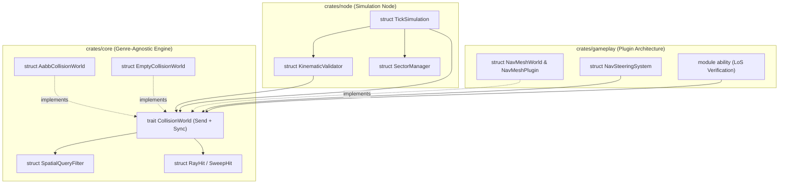

# Technical Design: Abstract CollisionWorld Trait & Server-Authoritative Spatial Raycasting

## Architectural Overview

This design introduces an abstract, unopinionated collision and spatial query substrate into `crates/core`, decoupling server-side authoritative movement validation, line-of-sight verification, and pathfinding from concrete geometry representations. Concrete implementations live in decoupled layers (`crates/core` reference AABB substrate, `crates/gameplay` NavMesh plugin).



---

## 1. Abstract `CollisionWorld` Trait (`crates/core/src/spatial.rs` & `collision.rs`)

### 1.1 Types and Interface

```rust
/// Query filter to prevent self-intersection and selectively mask collision layers.
#[derive(Debug, Clone, Copy, PartialEq, Eq)]
pub struct SpatialQueryFilter {
    /// Optional entity to ignore during query (e.g. self / shooter / mover).
    pub ignore_id: Option<Guid>,
    /// Bitmask of collision layers to test against.
    pub collision_layers: u32,
}

impl Default for SpatialQueryFilter {
    fn default() -> Self {
        Self {
            ignore_id: None,
            collision_layers: u32::MAX,
        }
    }
}

/// Detailed hit information resulting from a raycast against collision geometry.
#[derive(Debug, Clone, PartialEq)]
pub struct RayHit {
    pub point: Vec3,
    pub normal: Vec3,
    pub distance: f32,
    pub entity_id: Option<Guid>,
    pub surface_flags: u32,
}

/// Detailed collision information resulting from an AABB sweep test.
#[derive(Debug, Clone, PartialEq)]
pub struct SweepHit {
    /// Normalized fraction along the sweep trajectory `[0.0, 1.0]` at impact.
    pub hit_fraction: f32,
    pub point: Vec3,
    pub normal: Vec3,
    pub entity_id: Option<Guid>,
}

/// Generalized, unopinionated 3D collision and spatial traversal trait.
pub trait CollisionWorld: Send + Sync {
    /// Casts an authoritative ray from `origin` in `direction` up to `max_distance`.
    fn raycast(
        &self,
        origin: Vec3,
        direction: Vec3,
        max_distance: f32,
        filter: SpatialQueryFilter,
    ) -> Option<RayHit>;

    /// Sweeps an Axis-Aligned Bounding Box along `translation`, testing for earliest collision.
    fn sweep_test(
        &self,
        aabb: &BoundingBox3D,
        translation: Vec3,
        filter: SpatialQueryFilter,
    ) -> Option<SweepHit>;

    /// Tests whether a discrete 3D position is free of collision and traversable.
    fn is_point_traversable(&self, point: Vec3) -> bool;

    /// Dynamically registers or updates an obstacle bounding box (e.g. placed prefab).
    fn register_obstacle(&mut self, id: Guid, bounds: BoundingBox3D);

    /// Dynamically unregisters an obstacle (e.g. destroyed prefab or unloaded sector).
    fn unregister_obstacle(&mut self, id: Guid);

    /// Finds a collision-free path between two coordinates, returning ordered waypoints.
    fn find_path(&self, start: Vec3, end: Vec3) -> Option<Vec<Vec3>>;
}
```

### 1.2 Reference Substrates in Core
- **`EmptyCollisionWorld`**: Unobstructed vacuum space (all points traversable, raycasts miss, find_path returns direct path `[start, end]`). Useful for tests, void sectors, or open space modes.
- **`AabbCollisionWorld`**: High-performance AABB obstacle index. Provides exact analytical ray-box intersection with surface normal extraction, swept-AABB continuous collision detection (CCD), and grid/AABB connectivity pathfinding.

---

## 2. Server-Authoritative Kinematics & Anti-Cheat (`crates/node`)

### 2.1 Kinematic Violation Extension
```rust
#[derive(Debug, Clone, PartialEq)]
pub enum KinematicViolationReason {
    SpeedCapExceeded { speed: f32, max_speed: f32 },
    TeleportDetected { distance: f32, max_distance: f32 },
    InvalidDeltaTime { dt: f32 },
    NonFiniteCoordinates,
    NonMonotonicSequence { seq: u32, last_seq: u32 },
    /// Trajectory intersected solid collision geometry.
    ObstacleCollision {
        hit_point: (f32, f32, f32),
        entity_id: Option<Guid>,
    },
}
```

### 2.2 Validation in `KinematicValidator`
- Provide `validate_move_with_collision(&self, current_pos, new_pos, dt_sec, collision_world: &dyn CollisionWorld, mover_guid: Option<Guid>)`:
  1. Performs existing finite coordinate, delta time, teleport threshold, and speed cap checks.
  2. Guards against zero-length translation early (returns `Ok(())`).
  3. Executes `collision_world.raycast` and `collision_world.sweep_test` with `SpatialQueryFilter { ignore_id: mover_guid, .. }`.
  4. If a solid obstacle is struck before reaching `new_pos` (with a small penetration epsilon to prevent skimming false-positives), returns `Err(KinematicViolation::new(current_pos, KinematicViolationReason::ObstacleCollision { ... }))`.
- Preserve existing `validate_move(current_pos, new_pos, dt_sec)` for backward compatibility.

### 2.3 Integration in `TickSimulation`
- `TickSimulation` maintains a thread-safe `collision_world: Arc<parking_lot::RwLock<dyn CollisionWorld>>`.
- Strict Lock Ordering Hierarchy:
  1. `entity_store`
  2. `sector_manager`
  3. `collision_world`
  4. `octree`
- Never acquire `sector_manager` or `entity_store` while holding `collision_world` write locks.
- Movement validation acquires `collision_world.read()`.
- On prefab placement (`handle_place_world_object`), acquires `collision_world.write()` and registers the obstacle bounds.
- On prefab destruction (`handle_destroy_world_object`), acquires `collision_world.write()` and unregisters the obstacle bounds.
- On sector loading/unloading, synchronizes sector obstacles into `collision_world`.

---

## 3. Decoupled Polygonal Navigation Mesh Plugin (`crates/gameplay/src/navmesh.rs`)

### 3.1 Polygonal Representation & Carving
- **`NavMeshPolygon`**: Convex polygon with vertices in 3D, centroid, adjacency edge portals, and traversal flags.
- **`NavMeshWorld`**:
  - Maintains static polygon geometry and dynamic obstacle registration.
  - Dynamic Carving: When an obstacle AABB is registered, overlapping polygon surfaces/portals are dynamically carved (marked blocked or sliced), recalculating walkable connectivity without crashing on collinear edges.
  - Implements `CollisionWorld`:
    - `raycast`: Tests intersection with polygon boundary walls and registered obstacle bounds, respecting `SpatialQueryFilter`.
    - `sweep_test`: Performs continuous swept-AABB test against polygon edge walls and obstacle boxes.
    - `is_point_traversable`: Tests point-in-polygon containment against active uncarved walkable polygons.
    - `find_path`: Implements A* search across polygon adjacency dual graph with Funnel algorithm string-pulling to produce optimal waypoint paths around obstacles.

### 3.2 Navigation System Integration (`crates/gameplay/src/navigation.rs`)
- `NavAgentComponent` gains `path_waypoints: Vec<(f32, f32, f32)>`.
- When an entity has obstacles between its position and goal, `NavMeshWorld::find_path()` populates `path_waypoints`, guiding steering around static geometry and player-placed prefabs.

---

## 4. Line-of-Sight Ability Verification (`crates/gameplay/src/ability.rs`)

### 4.1 Authoritative Check Hook
```rust
pub fn validate_ability_line_of_sight(
    caster_pos: Vec3,
    target_pos: Vec3,
    collision_world: &dyn CollisionWorld,
    caster_guid: Option<Guid>,
) -> Result<(), &'static str> {
    if !caster_pos.x.is_finite() || !caster_pos.y.is_finite() || !caster_pos.z.is_finite()
        || !target_pos.x.is_finite() || !target_pos.y.is_finite() || !target_pos.z.is_finite() {
        return Err("Non-finite coordinates provided for line of sight");
    }

    let dir = Vec3::new(target_pos.x - caster_pos.x, target_pos.y - caster_pos.y, target_pos.z - caster_pos.z);
    let dist = dir.length();
    if dist < 1e-4 {
        return Ok(());
    }
    let norm_dir = match dir.normalized() {
        Some(d) => d,
        None => return Ok(()),
    };
    let max_check_dist = (dist - 0.1).max(0.0);
    if max_check_dist > 0.0 {
        let filter = SpatialQueryFilter {
            ignore_id: caster_guid,
            collision_layers: u32::MAX,
        };
        if let Some(hit) = collision_world.raycast(caster_pos, norm_dir, max_check_dist, filter) {
            if hit.distance < max_check_dist {
                return Err("Line of sight blocked by obstacle");
            }
        }
    }
    Ok(())
}
```
- Integrated into ability execution to enforce server-authoritative spellcasting validation.
