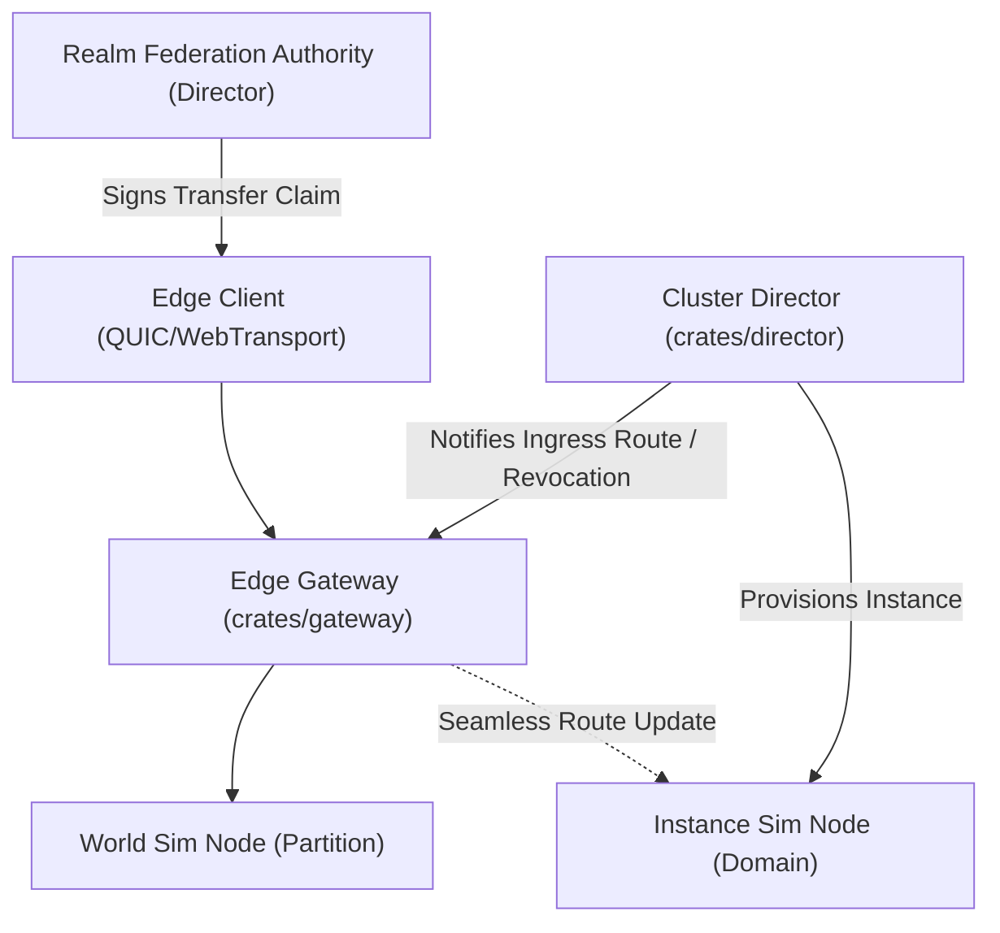

# Architecture & Design: Dynamic Instancing, Transient Dungeons & Realm Federation

## 1. Architectural Overview

## 2. Component Design

### 2.1 Instance Domain Lifecycle (`crates/director`, `crates/schema`)
- **Instance Descriptor**:
  - `instance_id`: `u64` (globally unique instance identifier).
  - `template_id`: `u32` (genre-agnostic template ID, e.g. dungeon/arena definition index).
  - `node_id`: `u32` (assigned simulation node).
  - `bounds`: `BoundingBox3D` (instance local spatial bounding box).
  - `created_at`: `Instant` / timestamp epoch ms.
  - `idle_timeout_seconds`: `u32` (idle timeout duration).
  - `last_heartbeat`: `Instant`.
  - `last_occupied_at`: `Instant`.
  - `player_count`: `u32`.
- **Instance Registry in Director**:
  - Stores `instances: HashMap<u64, InstanceDescriptor>`.
  - Tracks node assignments and load scores.
  - Provides `allocate_instance`, `terminate_instance`, `heartbeat_instance`, and `reap_idle_instances`.
  - Bounding box sanitation: rejects `NaN`, `Infinity`, or invalid bounding boxes where `min >= max`.
- **Proto RPCs**:
  - `CreateInstanceRequest` / `CreateInstanceResponse`
  - `TerminateInstanceRequest` / `TerminateInstanceResponse`
  - `InstanceHeartbeatRequest` / `InstanceHeartbeatResponse`
  - `IssueRealmTransferClaimRequest` / `IssueRealmTransferClaimResponse`
  - `VerifyRealmTransferClaimRequest` / `VerifyRealmTransferClaimResponse`

### 2.2 Instance Domain Management in `crates/node`
- `InstanceDomain`:
  - Contains instance `instance_id`, `template_id`, `bounds`, local entity tracking, idle timer.
  - Tracks entities residing in the instance domain versus persistent open-world space.
  - Provides clean teardown callback and entity eviction.

### 2.3 Cross-Cluster Realm Federation (`crates/director`, `crates/gateway`)
- `RealmTransferClaim`:
  - Cryptographic token authorizing player session cross-realm movement.
  - Cryptographic payload: `claim_id` / `nonce: u64`, `guid: u64`, `source_realm_id: string`, `target_realm_id: string`, `session_epoch: u64`, `issued_at_ms: u64`, `expires_at_ms: u64`.
  - Constant-time verification using `ring::hmac::verify`.
  - Replay cache tracking redeemed `nonce` values within validity TTL, preventing replay attacks.

## 3. Concurrency, Race Conditions & Deadlocks
- **Global Lock Ordering Rule**:
  - To prevent deadlocks, the Director enforces a strict global acquisition hierarchy:
    `instance_registry` write lock -> `node_registry` write lock -> `coordinator` write lock.
  - In `DirectorServiceImpl::check_and_recover_dead_nodes`, the lock acquisition must be updated to acquire `instance_registry` *first*, then `node_registry`, then `coordinator`.
  - During node eviction: all instances allocated on the crashed node are evicted from `instance_registry`, and affected route notifications/revocations are issued to avoid blackholing client traffic.

## 4. Security & Anti-Cheat
- Transfer claims require secret HMAC key known only to cluster realm authorities.
- Unique 64-bit cryptographic nonce checked against an in-memory replay cache with time-bounded eviction.
- Expired claims (> TTL, e.g. 60s) or tampered signatures rejected immediately.
- Strict floating point coordinate validation on bounding boxes (`is_finite()`, `min.x < max.x`, etc.) prevents spatial index poisoning.
- Rate-limiting on instance creation to prevent resource exhaustion attacks (DDoS via infinite instance creation).
