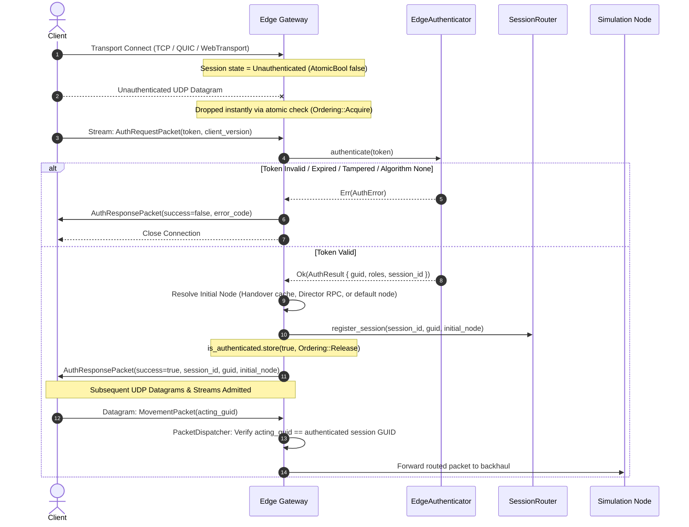

# Design Document: Edge Authentication, JWT/OIDC, & Session Handoff

## 1. Architectural Overview

The Edge Gateway serves as the untrusted-to-trusted boundary for all client connections. To prevent denial-of-service, GUID spoofing, and unauthorized cluster ingress, the gateway implements a strict zero-trust connection admission pipeline.



---

## 2. Protocol Packets (`crates/schema`)

Two new opcodes and packet structs are introduced into `crates/schema/src/client.rs`:

```rust
pub const OPCODE_AUTH_REQUEST: u16 = 0x0011;
pub const OPCODE_AUTH_RESPONSE: u16 = 0x0012;

#[derive(Debug, Clone, PartialEq, Eq)]
pub struct AuthRequestPacket {
    pub token: String,
    pub client_version: u32,
}

#[derive(Debug, Clone, PartialEq, Eq)]
pub struct AuthResponsePacket {
    pub success: bool,
    pub error_code: u32,
    pub session_id: u64,
    pub player_guid: u64,
    pub assigned_node: String,
    pub error_message: String,
}
```

### Binary Framing
- `AuthRequestPacket`:
  - `token_len: u16` (LE)
  - `token: [u8; token_len]` (UTF-8)
  - `client_version: u32` (LE)
- `AuthResponsePacket`:
  - `success: u8` (0 or 1)
  - `error_code: u32` (LE)
  - `session_id: u64` (LE)
  - `player_guid: u64` (LE)
  - `assigned_node_len: u16` (LE)
  - `assigned_node: [u8; assigned_node_len]` (UTF-8)
  - `error_message_len: u16` (LE)
  - `error_message: [u8; error_message_len]` (UTF-8)

### Standard Auth Error Codes
```rust
pub mod auth_error_codes {
    pub const SUCCESS: u32 = 0;
    pub const INVALID_TOKEN: u32 = 1;
    pub const EXPIRED_TOKEN: u32 = 2;
    pub const INVALID_SIGNATURE: u32 = 3;
    pub const INVALID_CLAIMS: u32 = 4;
    pub const VERSION_MISMATCH: u32 = 5;
    pub const TIMEOUT: u32 = 6;
    pub const RATE_LIMITED: u32 = 7;
    pub const CLUSTER_UNAVAILABLE: u32 = 8;
    pub const IDENTITY_MISMATCH: u32 = 9;
}
```

---

## 3. Cryptographic Verification & Authenticator (`crates/gateway`)

A new module `crates/gateway/src/auth.rs` provides `EdgeAuthenticator` and `JwtValidator`.

### JWT Claims Schema
```rust
#[derive(Debug, Clone, Serialize, Deserialize)]
pub struct JwtClaims {
    pub sub: String,              // Subject identifier (player GUID string or account ID)
    pub iss: Option<String>,      // Issuer URL / name
    pub aud: Option<String>,      // Audience
    pub exp: u64,                 // Expiration Unix timestamp (seconds)
    pub nbf: Option<u64>,         // Not before Unix timestamp
    pub iat: Option<u64>,         // Issued at Unix timestamp
    pub guid: Option<u64>,        // Explicit entity GUID numeric override
    pub roles: Option<Vec<String>>,
}
```

### Verification Rules & Algorithm Enforcement
1. **Explicit Algorithm Whitelist**:
   - `jsonwebtoken::Validation::new(Algorithm::HS256)` (or `RS256`, `EdDSA`).
   - The insecure `none` algorithm is explicitly denied and causes validation failure.
2. **HMAC-SHA256 (HS256)**: Configured via shared secret bytes for development, testing, and private gateway clusters.
3. **Ed25519 (EdDSA) & RSA**: Configured via public key bytes/PEM for asymmetric OIDC identity providers.
4. **Handover Ticket Support**: If a token matches the binary or base64 format of a `HandoverTicket`, the authenticator falls back to verifying the ticket HMAC and reusing existing cluster session state.

---

## 4. Initial Node Resolution Flow

When a client authenticates:
1. **Cross-Gateway Handover**: If a valid `HandoverTicket` is provided, the gateway queries `router.get_route_by_guid(guid)` or distributed cache to find the player's existing node.
2. **Fresh JWT Login**: The gateway checks:
   - Configured `default_node_address` on `GatewayServer` (used in test/local setups or single-region clusters).
   - Or queries Director via `DirectorServiceClient` or router fallback.
   - If no node can be resolved, authentication fails with `CLUSTER_UNAVAILABLE`.
3. The resolved node is written into `SessionRouter::register_session(session_id, guid, node_address.clone())` and returned in `AuthResponsePacket.assigned_node`.

---

## 5. Strict Identity-to-Session Binding (Anti-Spoofing)

In `PacketDispatcher::dispatch_with_router`:
```rust
pub fn dispatch_with_router(
    router: &SessionRouter,
    session_id: u64,
    packet: ClientPacket,
) -> Result<RoutedPacket, GatewayError> {
    let acting_guid = extract_acting_guid(&packet);

    // Anti-Spoofing Identity Verification:
    // If the packet specifies an acting GUID, it MUST strictly match the authenticated GUID for this session.
    if let Some(guid) = acting_guid {
        if let Some(session_guid) = router.get_guid_by_session(session_id) {
            if guid != session_guid {
                metrics::counter!("mmo_gateway_spoofed_packets_dropped_total").increment(1);
                return Err(GatewayError::IdentityMismatch {
                    session_id,
                    expected: session_guid,
                    actual: guid,
                });
            }
        }
    }

    let node_address = acting_guid
        .and_then(|g| router.get_route_by_guid(g))
        .or_else(|| router.get_route_by_session(session_id));

    match node_address {
        Some(addr) => Ok(RoutedPacket {
            session_id,
            guid: acting_guid,
            node_address: addr,
            packet,
        }),
        None => Err(GatewayError::NoRouteFound {
            session_id,
            guid: acting_guid,
        }),
    }
}
```

---

## 6. Concurrency Model & Memory Ordering

Each client transport session maintains an `Arc<AtomicBool>` named `is_authenticated`.

### Lock Ordering & Visibility Rules
1. **Registration precedes state transition**:
   - `router.register_session(session_id, guid, node_address)` is executed FIRST.
   - ONLY AFTER successful routing table insertion: `is_authenticated.store(true, Ordering::Release)`.
2. **Datagram Ingress Synchronization**:
   - Datagram ingress threads read `is_authenticated.load(Ordering::Acquire)`.
   - The Acquire-Release synchronization ensures that any routing entries written prior to `store(true, Release)` are immediately visible to the datagram ingress thread when `load(Acquire)` returns true.
   - If false, the datagram is dropped immediately with zero allocations or routing table lookups.
3. **Session Teardown**:
   - `SessionDropGuard` ensures session routes, sinks, and authentication states are wiped cleanly on disconnect.

---

## 7. Observability & Telemetry

Prometheus metrics:
- `mmo_gateway_auth_attempts_total` (counter)
- `mmo_gateway_auth_success_total` (counter)
- `mmo_gateway_auth_failures_total{reason="expired|signature|claims|malformed|timeout|algorithm"}` (counter)
- `mmo_gateway_unauthenticated_packets_dropped_total` (counter)
- `mmo_gateway_spoofed_packets_dropped_total` (counter)
