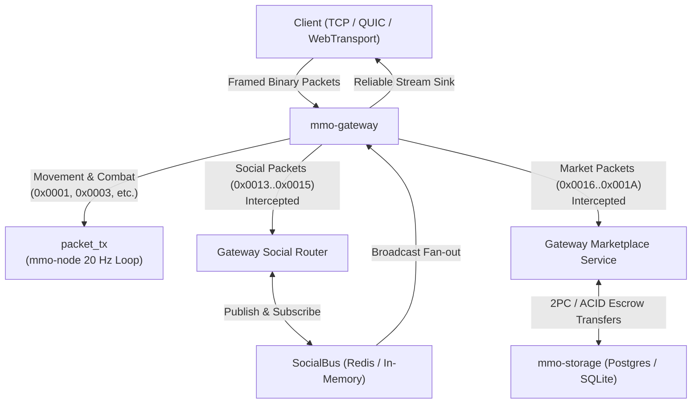

# Architectural Design: Decoupled Social Pub/Sub and Asynchronous Marketplace

## 1. Overview & High-Level Architecture

The MMO platform isolates high-frequency authoritative physics, movement, and combat within `mmo-node` running at 20 Hz. This design introduces two decoupled edge subsystems terminated directly at `mmo-gateway`:
1. **Decoupled Social Pub/Sub Event Bus**: Handles non-spatial broadcasts, guild channels, group coordination, and direct whispers using an unopinionated pub/sub bus (`SocialBus`).
2. **Asynchronous Global Marketplace Service**: Executes listing, escrow, purchasing, cancellation, and queries against `mmo-storage` without waking or locking spatial simulation nodes.



---

## 2. Global Social Pub/Sub Event Bus Architecture

### 2.1 Wire Protocol Definitions (`crates/schema/src/client.rs`)
New opcodes:
- `SocialMessage = 0x0013`
- `SocialSubscribe = 0x0014`
- `SocialUnsubscribe = 0x0015`

#### Wire Structures
- `SocialMessagePacket`:
  - `channel_type: u8` (0: Global, 1: Area, 2: Guild, 3: Party, 4: Whisper, 5: Custom)
  - `target_id: u64` (e.g. guild ID, party ID, target player GUID, or custom channel ID)
  - `sender_guid: u64`
  - `sender_name: String` (max 64 bytes)
  - `content: String` (max 1024 bytes)
  - `timestamp: u64`
- `SocialSubscribePacket`:
  - `channel_type: u8`
  - `target_id: u64`
  - `channel_name: String`
- `SocialUnsubscribePacket`:
  - `channel_type: u8`
  - `target_id: u64`
  - `channel_name: String`

All strings are bounded to prevent buffer exhaustion attacks.

### 2.2 Gateway Packet Interception
In `GatewayServer`:
- In `process_frames` / packet intake pipelines (`handle_client`, `handle_quic_connection`, `WebTransportServer`):
  - When a packet is `SocialMessage`, `SocialSubscribe`, or `SocialUnsubscribe`:
    - Intercept immediately before `self.packet_tx.send(routed)`.
    - Validate identity: If the session has an authenticated player GUID, verify `sender_guid == authenticated_guid`. If mismatched, drop or correct and increment telemetry counter.
    - Route `SocialMessage` to `self.social_bus.publish(topic, envelope)`.
    - Route `SocialSubscribe` / `SocialUnsubscribe` to `GatewaySubscriptionManager`.
    - Never forward to `mmo-node`!

### 2.3 Subscription Management & Downstream Fan-Out
`GatewaySubscriptionManager`:
- Maintains mappings:
  - `topic_subscribers: DashMap<String, HashSet<u64>>` (topic -> set of `session_id`s)
  - `session_topics: DashMap<u64, HashSet<String>>` (session -> set of topics)
- Listens to active topics on `SocialBus`.
- When an envelope is received on topic `T`:
  - For each `session_id` in `topic_subscribers.get(T)`:
    - Look up `SessionSink` from `session_sinks`.
    - Encode `SocialMessagePacket` and push to `SessionSink.stream_tx` (unbounded reliable channel).
- When a session disconnects, `SessionDropGuard` removes all topics for `session_id` in `GatewaySubscriptionManager`.

---

## 3. Asynchronous Global Marketplace Service Architecture

### 3.1 Wire Protocol & RPC Definitions (`crates/schema`)
New opcodes:
- `MarketListRequest = 0x0016`
- `MarketBuyRequest = 0x0017`
- `MarketCancelRequest = 0x0018`
- `MarketQueryRequest = 0x0019`
- `MarketResponse = 0x001A`

#### Data Envelopes:
- `MarketListRequestPacket`: `item_instance_id: String`, `src_container_id: u64`, `src_slot: u32`, `price: u64`, `duration_secs: u64`.
- `MarketBuyRequestPacket`: `listing_id: String`, `buyer_container_id: u64`, `payment_container_id: u64`, `price: u64`.
- `MarketCancelRequestPacket`: `listing_id: String`, `dst_container_id: u64`.
- `MarketQueryRequestPacket`: `item_def_id: Option<u32>`, `min_price: Option<u64>`, `max_price: Option<u64>`, `offset: u32`, `limit: u32`.
- `MarketResponsePacket`: `request_type: u8`, `success: bool`, `error_code: u32`, `error_message: String`, `listings: Vec<MarketListingWire>`.

### 3.2 Storage Data Model (`crates/storage/src/marketplace.rs`)
New table `market_listings`:
```sql
CREATE TABLE IF NOT EXISTS market_listings (
    listing_id TEXT PRIMARY KEY,
    seller_guid BIGINT NOT NULL,
    item_instance_id TEXT NOT NULL,
    item_def_id INTEGER NOT NULL,
    price BIGINT NOT NULL,
    escrow_container_id BIGINT NOT NULL,
    escrow_slot INTEGER NOT NULL,
    status TEXT NOT NULL, -- 'Active', 'Sold', 'Cancelled', 'Expired'
    created_at_epoch_ms BIGINT NOT NULL,
    expires_at_epoch_ms BIGINT NOT NULL,
    updated_at_epoch_ms BIGINT NOT NULL
);
CREATE INDEX IF NOT EXISTS idx_market_status_expiry ON market_listings(status, expires_at_epoch_ms);
CREATE INDEX IF NOT EXISTS idx_market_item_def ON market_listings(item_def_id, status);
CREATE INDEX IF NOT EXISTS idx_market_seller ON market_listings(seller_guid, status);
```

### 3.3 Transactional Safety & Invariant Guarantees
1. **Atomicity & Row Ordering**:
   - Creating a listing: Begins DB transaction, transfers item from seller's container to dedicated market escrow container (holding inventory), inserts active listing row.
   - Purchasing: Begins DB transaction with strict row ordering to eliminate deadlocks (lock buyer payment container and seller reward container in ascending ID order), transfers currency/items, releases escrowed item to buyer container, marks listing `Sold`.
   - Cancellation: Seller requests cancel; verifies seller ownership and `Active` status; returns item from escrow to seller container; marks `Cancelled`.
2. **Double-Spend Prevention**:
   - Because the listed item is physically moved into the marketplace escrow container during creation, the seller cannot trade, equip, or drop the item while listed.
3. **No Game-Specific Assumptions**:
   - `price` is an integer quantity in a designated generic container/slot or currency ledger. No currency names or class restrictions are hardcoded in core or storage crates.

---

## 4. Concurrency, Security & Deadlock Freedom (Post-Review Refinements)

1. **Lock Hierarchies & DashMap Isolation**:
   - `GatewaySubscriptionManager` strictly forbids holding any reference or lock on `session_topics` while accessing or modifying `topic_subscribers`.
   - On session disconnect / cleanup: First, remove and retrieve the cloned topic set from `session_topics`. Once that lock is completely released, iterate the extracted topics and remove the session ID from `topic_subscribers`.
   - In container transfers and marketplace ACID transactions, always sort involved `container_id`s ascending before locking rows to guarantee deadlock-freedom.

2. **DoS Protection & Bounded Streaming Channels**:
   - Client streaming channels are strictly bounded (e.g., `mpsc::channel(10240)`).
   - If a client experiences excessive backpressure and fills its queue (`TrySendError::Full`), the gateway closes the connection rather than accumulating unbounded memory (OOM prevention).

3. **Strict Container Ownership Validation**:
   - `MarketplaceRepository` must explicitly query `containers.owner_id` and ensure it matches the authenticated session's `Guid` before initiating any listing or buying transaction. Forged container IDs are immediately rejected with an authorization error.

4. **Atomic Listing & Late-Binding Escrow**:
   - Rather than relying on a 2-step escrow creation, `MarketplaceRepository::create_listing` executes a single monolithic ACID transaction (`BEGIN IMMEDIATE` in SQLite, row locks in Postgres):
     1. Validates seller ownership of `src_container_id`.
     2. Transfers item from `src_container_id` to market inventory container.
     3. Inserts `market_listings` row with status `Active`.
   - If anything fails, the entire transaction rolls back—preventing orphaned items or phantom listings.

5. **Automated Expiration Reaper Loop**:
   - `MarketplaceService` runs a periodic background sweeper task (e.g. every 10–30 seconds) that finds expired active listings (`expires_at_epoch_ms <= now`), marks them `Expired`, and atomically returns the escrowed item back to the seller's container.

