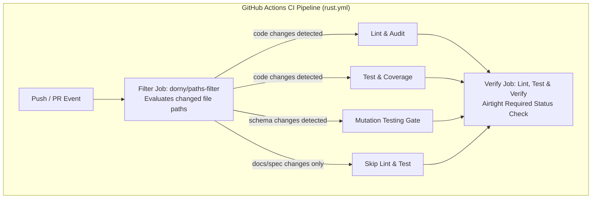

# Design Document: CI Paths Filter & Mutation Test Suite Hardening

## Architecture Overview



### 1. CI Workflow Refinement with `dorny/paths-filter`

#### Trigger Modernization
In `.github/workflows/rust.yml`:
- Remove top-level `paths-ignore` from `on.push` and `on.pull_request`.
- Add an initial lightweight job `filter`:
  ```yaml
  filter:
    name: Check Changed Paths
    runs-on: ubuntu-latest
    outputs:
      code: ${{ steps.filter.outputs.code }}
      schema: ${{ steps.filter.outputs.schema }}
    steps:
      - name: Checkout repository
        uses: actions/checkout@v4
      - name: Check for path filters
        uses: dorny/paths-filter@v3
        id: filter
        with:
          filters: |
            code:
              - '!**.md'
              - '!openspec/**'
              - '!docs/**'
              - '!.github/dependabot.yml'
            schema:
              - 'crates/schema/**'
  ```
- Make `lint`, `test`, and `mutants` depend on `filter`:
  - `lint`: `if: needs.filter.outputs.code == 'true'`
  - `test`: `if: needs.filter.outputs.code == 'true'`
  - `mutants`: `if: needs.filter.outputs.code == 'true' && (github.event_name == 'push' || needs.filter.outputs.schema == 'true')`

#### Airtight Verification Script in `verify` Job
To prevent false-green bypasses (e.g., cancelled jobs or failed filter steps), `verify` (`Lint, Test & Verify`) enforces strict invariant validation:
```bash
# 1. Reject if filter job did not succeed
if [ "${{ needs.filter.result }}" != "success" ]; then
  echo "Filter job failed or was cancelled (status: ${{ needs.filter.result }})"
  exit 1
fi

# 2. Reject any failure or cancellation across all downstream jobs
for res in "${{ needs.lint.result }}" "${{ needs.test.result }}" "${{ needs.mutants.result }}"; do
  if [ "$res" == "failure" ] || [ "$res" == "cancelled" ]; then
    echo "A downstream CI job failed or was cancelled (status: $res)"
    exit 1
  fi
done

# 3. If code changed, lint and test MUST have executed and succeeded
if [ "${{ needs.filter.outputs.code }}" == "true" ]; then
  if [ "${{ needs.lint.result }}" != "success" ]; then
    echo "Code modified, but Lint job did not succeed (status: ${{ needs.lint.result }})"
    exit 1
  fi
  if [ "${{ needs.test.result }}" != "success" ]; then
    echo "Code modified, but Test job did not succeed (status: ${{ needs.test.result }})"
    exit 1
  fi
fi

# 4. If schema changed (or push to main with code), mutants job MUST have executed and succeeded
if [ "${{ needs.filter.outputs.code }}" == "true" ] && { [ "${{ github.event_name }}" == "push" ] || [ "${{ needs.filter.outputs.schema }}" == "true" ]; }; then
  if [ "${{ needs.mutants.result }}" != "success" ]; then
    echo "Schema modified, but Mutation testing job did not succeed (status: ${{ needs.mutants.result }})"
    exit 1
  fi
fi

echo "All required pipeline checks completed successfully!"
```

### 2. Eliminating Surviving Mutants in `mmo-schema`

The 6 surviving mutants in `mmo-schema` are:
1. `<impl From<MovementCorrectionReason> for u8>::from`: Add exhaustive unit test assertions for all enum variants (`KinematicViolation` -> 0, `Reconciliation` -> 1, `Veto` -> 2, `OutOfBounds` -> 3, `Custom(42)` -> 42).
2. `WorldObjectSpawnPacket::decode` boundary check: `src.remaining() < 1`. Add test where buffer has exact byte count required for reading each field (`remaining() == 1`).
3. `WorldObjectDeltaPacket::decode` boundary check: `src.remaining() < 1`. Add exact boundary test (`remaining() == 1`).
4. `PlaceObjectPacket::decode` boundary check: `src.remaining() < 10 * 4`. Add boundary test with exactly 40 bytes remaining.
5. `AuthResponsePacket::decode` boundary check: `src.remaining() < node_len`. Add boundary test where buffer has exactly `node_len` bytes.

### 3. Eliminating Surviving Mutants in `mmo-storage`

#### Postgres Isolation via `*_postgres` Helpers
Because `cargo-mutants` regexes match on function names rather than internal AST branch tokens, inlined match arms `DbBackend::Postgres(pool)` in methods like `prepare_transfer` cannot be safely excluded without excluding the SQLite implementation.
We extract the unreachable PostgreSQL match arms into dedicated private methods:
- `transaction_coord.rs`: `prepare_transfer_postgres`, `reserve_slot_postgres`, `commit_transfer_postgres`, `abort_transfer_postgres`, `reap_expired_reservations_postgres`
- `escrow_coord.rs`: `create_escrow_postgres`, `release_escrow_postgres`, `refund_escrow_postgres`, `get_escrow_postgres`
- `marketplace.rs`: `create_listing_postgres`, `purchase_listing_postgres`, `cancel_listing_postgres`, `reap_expired_listings_postgres`
- `repository.rs`: `execute_trade_postgres`

Then, `.cargo/mutants.toml` configures:
```toml
# Exclude unreachable external-service PostgreSQL match arms
'.*_postgres\b',
'Database::ping',
```
This isolates PostgreSQL logic cleanly while ensuring that all SQLite paths remain under 100% mutation testing coverage.

#### Datastore & Storage Coordination Unit Test Hardening
- Add unit tests in `crates/storage/src/datastore.rs` for:
  - `DataDocument::get`
  - `DataDocument::get_path`
  - `LoadReport::is_ok()` (both empty and non-empty error vectors)
  - `DataStore::load_directory` file extension filtering (verifying non-json/mpk/msgpack files are skipped)
- Add boundary tests in `transaction_coord.rs` and `escrow_coord.rs` for:
  - Lease duration validation (`lease_duration_ms < 100`)
  - Slot capacity validation (`slot >= capacity`)
  - Container transfer status checks (`status != "active"`)
  - Multi-item transfer counts and reaper return values
