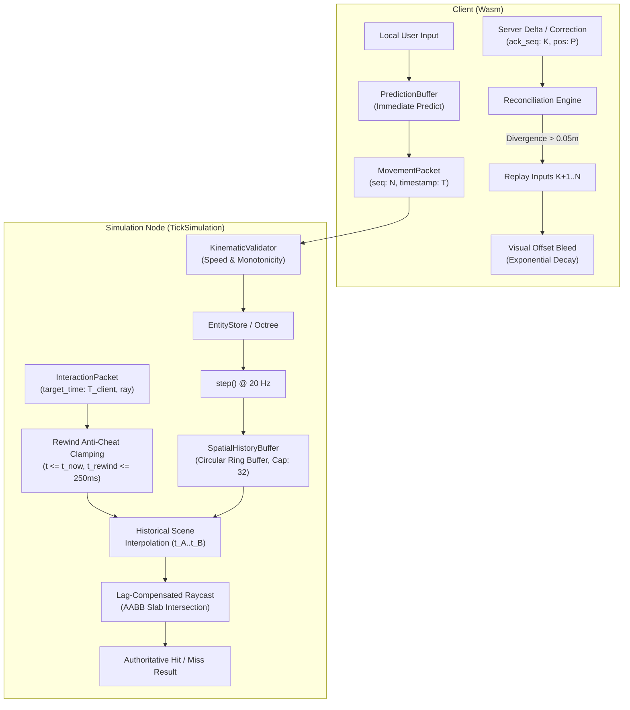

# Design: Lag Compensation, Server-Authoritative History Buffers & Client Prediction Reconciliation

## 1. Architectural Overview



---

## 2. Server-Side Data Structures & Zero-Allocation Ring Buffer

### 2.1 `HistoricalEntityRecord`
Represents the spatial snapshot of an active entity at a single simulation tick:
```rust
#[derive(Debug, Clone, PartialEq)]
pub struct HistoricalEntityRecord {
    pub guid: Guid,
    pub position: (f32, f32, f32),
    pub bounds: BoundingBox3D,
    pub velocity: (f32, f32, f32),
    pub yaw: f32,
    pub pitch: f32,
}
```

### 2.2 `HistoricalTickFrame`
A contiguous container holding all entity snapshots recorded during a tick:
```rust
#[derive(Debug, Clone)]
pub struct HistoricalTickFrame {
    pub tick: u64,
    pub timestamp: std::time::Instant,
    pub timestamp_ms: u64,
    pub entities: Vec<HistoricalEntityRecord>,
}

impl HistoricalTickFrame {
    pub fn new(capacity: usize) -> Self {
        Self {
            tick: 0,
            timestamp: std::time::Instant::now(),
            timestamp_ms: 0,
            entities: Vec::with_capacity(capacity),
        }
    }

    pub fn clear(&mut self) {
        self.tick = 0;
        self.timestamp_ms = 0;
        self.entities.clear();
    }
}
```

### 2.3 `SpatialHistoryBuffer`
Fixed-capacity circular ring buffer with slab reuse:
```rust
pub struct SpatialHistoryBuffer {
    /// Ring buffer of preallocated frames (e.g. 32 frames = 1.6s at 20 Hz).
    frames: Vec<HistoricalTickFrame>,
    /// Preallocated capacity per frame for entity records.
    entity_capacity: usize,
    /// Ring buffer capacity (number of frames).
    capacity: usize,
    /// Head index pointing to the newest recorded frame.
    head: usize,
    /// Number of valid frames currently stored in the buffer.
    count: usize,
    /// Maximum allowed rewind window duration (250ms anti-cheat ceiling).
    max_rewind_window: std::time::Duration,
}
```

#### Zero-Allocation Ingestion:
1. `head` increments circularly: `next_index = (head + 1) % capacity`.
2. Retrieve the existing frame at `next_index`.
3. Call `frame.clear()`—this resets `entities.len()` to 0 while keeping allocated capacity in the `Vec`.
4. Iterate active entities in `EntityStore` (filtering out migrating entities), pushing records into `frame.entities`.
5. Update `frame.tick`, `frame.timestamp`, `frame.timestamp_ms`.
6. Update `head = next_index` and `count = (count + 1).min(capacity)`.
This guarantees **zero heap reallocations** after the initial pre-allocation phase.

---

## 3. Authoritative Lag Compensation & Anti-Cheat Validation

### 3.1 Clamping & Bounds Protection
Given a client request with target timestamp $t_{\text{client}}$ (server-synchronized via ping/pong RTT estimation and clock offset, or explicit target monotonic timestamp/tick) at server current time $t_{\text{now}}$:
1. **Future Timestamp Defense**:
   If $t_{\text{client}} > t_{\text{now}}$, clamp:
   $$t_{\text{effective}} = t_{\text{now}}$$
2. **Maximum Rewind Duration Defense**:
   The maximum rewind limit is $T_{\text{max\_rewind}} = 250\text{ms}$.
   If $t_{\text{now}} - t_{\text{client}} > T_{\text{max\_rewind}}$, clamp:
   $$t_{\text{effective}} = t_{\text{now}} - T_{\text{max\_rewind}}$$
3. **Oldest Frame Boundary Defense**:
   If the oldest recorded frame in the buffer has timestamp $t_{\text{oldest}}$, and $t_{\text{effective}} < t_{\text{oldest}}$, clamp:
   $$t_{\text{effective}} = t_{\text{oldest}}$$

### 3.2 Historical Interpolation Math
Find two adjacent frames $F_A$ and $F_B$ such that:
$$t(F_A) \le t_{\text{effective}} \le t(F_B)$$
If $t(F_A) == t(F_B)$, return $F_A$.
Otherwise, calculate normalized interpolation weight:
$$\alpha = \frac{t_{\text{effective}} - t(F_A)}{t(F_B) - t(F_A)}, \quad \alpha \in [0.0, 1.0]$$

For each target entity present in both frames:
- Position:
  $$P(t) = (1 - \alpha) P(F_A) + \alpha P(F_B)$$
- Bounding Box:
  $$\text{min}(t) = (1 - \alpha) \text{min}(F_A) + \alpha \text{min}(F_B)$$
  $$\text{max}(t) = (1 - \alpha) \text{max}(F_A) + \alpha \text{max}(F_B)$$

### 3.3 Historical Raycast Algorithm
Given ray origin $O$, direction $D$, and max range $R_{\text{max}}$:
```rust
#[derive(Debug, Clone, PartialEq)]
pub struct HistoricalHitResult {
    pub target_guid: Guid,
    pub hit_point: (f32, f32, f32),
    pub distance: f32,
    pub tick_bracket: (u64, u64),
}
```
1. **Vector Normalization & Sanity Guard**:
   - Check that all components of $O$ and $D$ are finite (`is_finite()`).
   - If $\|D\| < 1e-6$, reject immediately with `None` (prevent division-by-zero or NaN in slab method).
   - Authoritatively re-normalize $D \leftarrow D / \|D\|$ to ensure accurate distance calculation.
2. **Historical Scene Reconstruction**: Reconstruct historical entity bounds at $t_{\text{effective}}$.
3. **Slab Intersection Testing**: For each reconstructed entity (excluding attacker GUID):
   - Perform ray-AABB intersection test against the entity's interpolated bounding box using the slab method.
   - If intersection occurs at distance $t \in [0, R_{\text{max}}]$, record candidate hit.
4. **Distance Sorting**: Select candidate with minimum distance $t$.
5. **Despawn Handling**: If a target was present at $t_{\text{effective}}$ but was despawned in later ticks, `raycast_historical` accurately reports the geometric hit with `target_guid`. Subsequent ability/interaction handlers must check `entity_store.get_by_guid(target_guid)` and gracefully handle `None` without panicking.
6. Return `Option<HistoricalHitResult>`.

---

## 4. Schema Codecs & Wire Protocol (`crates/schema`)

### 4.1 `LagCompensationPayload`
Encodes raycast interaction parameters for embedding into `InteractionPacket.payload`:
```rust
#[derive(Debug, Clone, PartialEq)]
pub struct LagCompensationPayload {
    pub client_timestamp: u64,
    pub origin: Vec3,
    pub direction: Vec3,
    pub max_distance: f32,
    pub sequence: u32,
}
```
Binary layout (36 bytes):
- `client_timestamp`: `u64_le` (8 bytes)
- `origin`: 3x `f32_le` (12 bytes)
- `direction`: 3x `f32_le` (12 bytes)
- `max_distance`: `f32_le` (4 bytes)
- `sequence`: `u32_le` (4 bytes)
Total = 40 bytes. Guard against non-finite floats and zero-length direction vectors during decode.

### 4.2 `MovementCorrectionReason`
Enumerates reasons for movement correction packets:
```rust
#[derive(Debug, Clone, Copy, PartialEq, Eq)]
#[repr(u8)]
pub enum MovementCorrectionReason {
    KinematicViolation = 0,
    Reconciliation = 1,
    Veto = 2,
    OutOfBounds = 3,
}
```

---

## 5. Client Prediction & Reconciliation (`crates/client-wasm`)

### 5.1 `PredictionBuffer`
Maintains unacknowledged inputs and predicts position:
```rust
#[derive(Debug, Clone, PartialEq)]
pub struct ClientInput {
    pub sequence: u32,
    pub dt_sec: f32,
    pub input_displacement: (f32, f32, f32),
    pub predicted_position: (f32, f32, f32),
    pub timestamp_sec: f64,
}

pub struct PredictionBuffer {
    /// FIFO queue of unacknowledged movement inputs.
    pub unacknowledged_inputs: VecDeque<ClientInput>,
    /// Error convergence offset currently being smoothed visually.
    pub visual_error_offset: (f32, f32, f32),
    /// Current predicted simulation position (authoritative base + unacknowledged inputs).
    pub current_sim_pos: (f32, f32, f32),
    /// Convergence decay rate (half-life decay factor, e.g. 15.0/sec).
    pub convergence_speed: f32,
    /// Distance threshold for hard snapback (e.g. 20.0m).
    pub hard_snap_threshold: f32,
    /// Positional error tolerance threshold (0.05m = 5cm).
    pub tolerance: f32,
}
```

### 5.2 Reconciliation Algorithm
When an authoritative server update arrives for sequence $S_{\text{ack}}$ with position $P_{\text{server}}$:
1. Find corresponding input in `unacknowledged_inputs` where `input.sequence == S_ack`.
2. If found, let $P_{\text{predicted\_at\_seq}} = \text{input.predicted\_position}$.
3. Discard all inputs with `input.sequence <= S_ack`.
4. Calculate error magnitude:
   $$\Delta = \|P_{\text{server}} - P_{\text{predicted\_at\_seq}}\|$$
5. If $\Delta \le \text{tolerance}$ ($0.05\text{m}$):
   - Server confirmed our prediction within tolerance; no replay needed.
6. If $\Delta > \text{hard\_snap\_threshold}$ ($20.0\text{m}$):
   - Hard teleport or massive anti-cheat rollback:
   - Clear all unacknowledged inputs.
   - Set `current_sim_pos = P_server`, `visual_error_offset = (0, 0, 0)`.
7. If $\Delta > \text{tolerance}$:
   - Soft divergence:
   - Save previous visual position: $P_{\text{visual\_prior}} = P_{\text{sim\_prior}} + \vec{E}_{\text{prior}}$.
   - Replay remaining inputs from $P_{\text{server}}$:
     $$P_{\text{sim}} = P_{\text{server}}$$
     For each remaining unacknowledged input $i$:
     $$P_{\text{sim}} = P_{\text{sim}} + i.\text{input\_displacement}$$
     $$i.\text{predicted\_position} = P_{\text{sim}}$$
   - Update `current_sim_pos = P_sim`.
   - Update error offset: $\vec{E} = P_{\text{visual\_prior}} - P_{\text{sim}}$.
8. On every client frame render step (`update(dt)`):
   - Decay error offset: $\vec{E} \leftarrow \vec{E} \cdot \exp(-\lambda \cdot dt)$.
   - Output visual position: $P_{\text{render}} = P_{\text{sim}} + \vec{E}$.

---

## 6. Concurrency, Lock Ordering & Verification

- **Lock Free within Sim Tick**: `SpatialHistoryBuffer` is owned directly by `TickSimulation`, accessed during sequential single-threaded tick updates. No cross-thread lock contention or deadlocks exist within the tick loop.
- **Async Read Safety & Lock Contention Budgeting**: When read across async tasks via `Arc<RwLock<TickSimulation>>`, read locks permit lag-compensated raycasts. However, since `TickSimulation::step()` requires a mutable reference (`&mut self`, write lock), high volumes of concurrent read locks could delay the tick loop and cause overruns. To prevent write starvation:
  - `raycast_historical` executes strictly in-memory over reconstructed entity bounds in bounded $O(K)$ time without any blocking I/O, async awaits, or memory allocations.
  - Caller tasks must acquire the read lock, perform the raycast calculation, and immediately drop the lock guard before performing subsequent event dispatches or network sends.
- **Metric Probes**:
  - `mmo_lag_compensation_rewind_clamped_total` (counter)
  - `mmo_lag_compensation_queries_total` (counter)
  - `mmo_lag_compensation_hits_total` (counter)
  - `mmo_client_prediction_reconciliations_total` (counter)
  - `mmo_client_prediction_hard_snaps_total` (counter)
