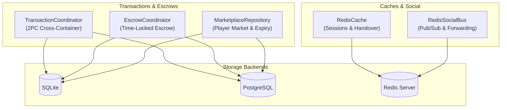

# Storage Data Loss, Concurrency, and Transaction Bugfixes Technical Design

## 1. Architecture Overview & Component Boundaries

The storage layer (`crates/storage`) is responsible for persistent entities, containers, inventories, 2PC cross-container transactions, escrows, marketplace listings, and cross-node pub/sub messaging.



## 2. Detailed Technical Fixes & Review Refinements

### 2.1 Positional Parameter in PostgreSQL 2PC Transfer
- **File**: `crates/storage/src/transaction_coord.rs:571`
- **Root Cause**:
  ```rust
  let c2 = sqlx::query(
      "SELECT container_id, capacity FROM containers WHERE container_id = $2 FOR UPDATE",
  )
  .bind(second_id as i64)
  .fetch_optional(&mut *tx)
  .await?;
  ```
  PostgreSQL prepared statements require index `$1` when 1 argument is provided. Referencing `$2` triggers `sqlx::Error::Database` on every PostgreSQL prepare attempt.
- **Fix**: Update statement to `SELECT container_id, capacity FROM containers WHERE container_id = $1 FOR UPDATE`.

### 2.2 Precise Pairwise Reservation Cleanup
- **File**: `crates/storage/src/transaction_coord.rs:135-142` (SQLite) and `652-659` (PostgreSQL)
- **Root Cause**:
  Using `container_id IN (?, ?) AND slot IN (?, ?)` forms a Cartesian product:
  `{(src, src_slot), (src, dst_slot), (dst, src_slot), (dst, dst_slot)}`.
  If an orthogonal transaction had an expired reservation on `(src, dst_slot)` or `(dst, src_slot)`, it was prematurely deleted without going through normal abort logging.
- **Fix**:
  Replace with explicit disjunctive conjunction:
  ```sql
  DELETE FROM container_reservations
  WHERE ((container_id = ? AND slot = ?) OR (container_id = ? AND slot = ?))
    AND expires_at_epoch_ms <= ?
  ```
  Bound parameters: `src_container_id`, `src_slot`, `dst_container_id`, `dst_slot`, `now_ms`.

### 2.3 Atomic Redis Handover Claiming
- **File**: `crates/storage/src/cache.rs:155-165`
- **Root Cause**:
  `conn.get(&key)` followed by `conn.del(&key)` allows two concurrent requests (e.g. from rapid retries or oscillation) to read the same serialized payload before either deletion occurs.
- **Fix**:
  Execute an atomic Redis Lua script:
  ```lua
  local val = redis.call('GET', KEYS[1])
  if val then
      redis.call('DEL', KEYS[1])
  end
  return val
  ```
  This is executed via `redis::Script::new(...)` which guarantees serial execution and zero possibility of duplicate entity claims.

### 2.4 Pre-Check Capacity in Escrow Refunds & Non-Blocking Sweep
- **File**: `crates/storage/src/escrow_coord.rs:365-374` (SQLite), `776-787` (PostgreSQL), and `428-438` (reap loop)
- **Root Cause**:
  1. `refund_escrow` queries items in `esc_cid` and free slots in `dep_cid`. It immediately executed `for (item_row, target_slot) in escrow_items.iter().zip(free_slots.iter())`.
     If `free_slots.len() < escrow_items.len()`, only `free_slots.len()` items were moved, and the escrow status was updated to `'refunded'`. Unmoved items remained orphaned in `esc_cid` forever.
  2. In `reap_expired_escrows`, propagating errors via `res?` would immediately abort the whole reaper sweep if any single depositor had a full container, blocking all other players' expired refunds.
- **Fix**:
  1. Add validation prior to the refund item move loop in both SQLite and PostgreSQL:
     ```rust
     if free_slots.len() < escrow_items.len() {
         return Err(StorageError::ContainerFull(dep_cid as u64, dep_cap as u32));
     }
     ```
  2. In `reap_expired_escrows`, match on `res`: if `Ok(true)` increment `reaped`; if `Err(StorageError::ContainerFull(..))` log/trace and continue processing remaining escrows without failing the entire sweep.

### 2.5 Safe Marketplace Expiry Reaping & Payment Audit Settlement
- **File**: `crates/storage/src/marketplace.rs:736-764` (SQLite), `1300-1331` (Postgres), `360-415`, `920-1080`
- **Root Cause**:
  1. In `reap_expired_listings`, if the seller container has no free slot, the item is not moved, yet the listing was updated to `'Expired'` and committed.
  2. If a concurrent purchase occurs during reaping, an unconditional `UPDATE market_listings SET status = 'Expired'` could overwrite a `Sold` status and return an already-purchased item.
  3. In `purchase_listing_postgres`, `container_id IN (...) FOR UPDATE` does not guarantee ascending row locking order unless explicitly ordered.
  4. In `purchase_listing`, `payment_container_id` and `payment_price >= price` were checked, but no settlement entries were logged to `container_transactions`.
- **Fix**:
  1. In `reap_expired_listings`: If the seller container is missing, full, or item transfer fails, rollback the single listing transaction and continue to next listing without marking `'Expired'`.
  2. Enforce optimistic concurrency check:
     ```sql
     UPDATE market_listings SET status = 'Expired', updated_at_epoch_ms = ?
     WHERE listing_id = ? AND status = 'Active'
     ```
     Verify that `rows_affected == 1`. If `0`, rollback and skip.
  3. In `purchase_listing_postgres`, ensure lock ordering: `SELECT container_id, owner_id FROM containers WHERE container_id IN (...) ORDER BY container_id ASC FOR UPDATE`.
  4. In `purchase_listing`: Record settlement rows into `container_transactions`:
     - Item transfer: `tx_id: format!("mkt_item_{}", listing_id)`, `src: escrow_container_id`, `dst: buyer_container_id`, `item: item_instance_id`.
     - Payment settlement: `tx_id: format!("mkt_pay_{}", listing_id)`, `src: payment_container_id`, `dst: seller_container_id`, `item: format!("price:{}", price)`.

### 2.6 Active Redis PubSub Forwarding in `RedisSocialBus`
- **File**: `crates/storage/src/social.rs:186-207`
- **Root Cause**:
  `RedisSocialBus::subscribe` only returned `self.memory_fallback.subscribe(channel)`. There was no connection or task subscribing to Redis PubSub.
- **Fix**:
  - Add `node_id: String` to `RedisSocialBus` (unique instance identifier).
  - Wrap wire messages in `RedisBusWireMessage { origin_node_id, envelope }`.
  - Maintain a thread-safe set of active channel subscriptions `Arc<Mutex<HashSet<String>>>`.
  - On `subscribe(channel)`: If channel is not yet registered, register it and spawn an async subscriber task listening to Redis PubSub on that channel with reconnect handling on drop.
  - When a message arrives from Redis, if `wire.origin_node_id != self.node_id`, publish it to `self.memory_fallback`. If origin matches `self.node_id`, ignore it (already delivered locally).
  - Clean up channel from `subscribed_channels` if the listener task permanently terminates, or reconnect with backoff.

## 3. Concurrency, Security & Failure Invariants

1. **Deadlock Freedom**:
   - In PostgreSQL `prepare_transfer` and `purchase_listing`, containers and listings are locked in strict deterministic ascending ID order (`ORDER BY container_id ASC`).
2. **Crash Consistency**:
   - All DB operations use explicit transactions (`BEGIN IMMEDIATE` in SQLite, transaction blocks in PostgreSQL) with rollback on any intermediate failure.
3. **Double-Claim Prevention**:
   - Redis handover uses single-step atomic script execution.
4. **Reaper Resilience**:
   - Background sweeping loops never abort batch runs due to individual container capacity exhaustion.
