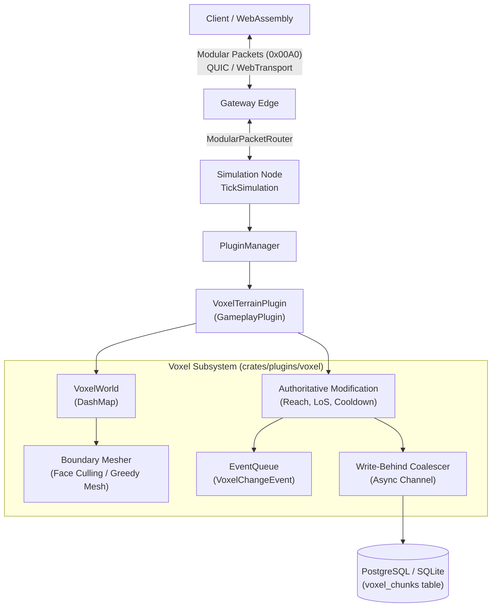
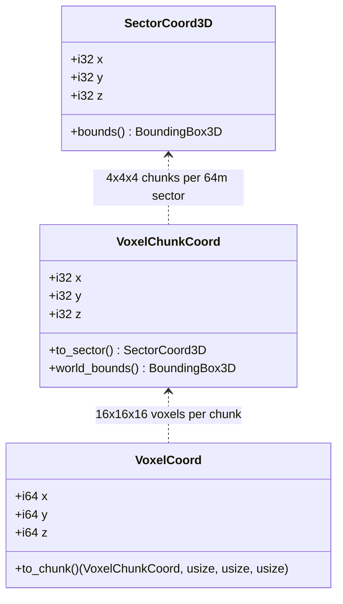

# Design Document: Volumetric Voxel & Deformable Terrain Plugin

## 1. Architectural Overview & Prime Directive Adherence

The Voxel Terrain Plugin is implemented as a standalone, modular extension crate:
`crates/plugins/voxel` (package name `mmo-plugin-voxel`).



Core engine crates (`crates/core`, `crates/schema`, `crates/storage`, `crates/node`, `crates/gateway`) contain zero voxel data structures. The plugin hooks cleanly into:
- `mmo_core::plugin::GameplayPlugin` via `PluginContext`
- `mmo_core::plugin::ModularPacketRouter` with assigned module ID `0x00A0`
- `mmo_core::plugin::TickSystem` for per-tick dirty chunk mesh rebuilds and delta broadcast
- `mmo_core::plugin::EventQueue` for decoupled domain event dispatching

---

## 2. Coordinate Hierarchy & Sector Indexing



- **Sector Size**: 64 meters (`SECTOR_SIZE = 64.0`).
- **Chunk Size**: 16×16×16 voxels (`CHUNK_SIZE = 16`).
- **Voxel Scale**: 1.0 meter per voxel.
- Exactly $4 \times 4 \times 4 = 64$ chunks occupy a 64m sector:
  - `sector.x = chunk.x.div_euclid(4)`, `sector.y = chunk.y.div_euclid(4)`, `sector.z = chunk.z.div_euclid(4)`.
- **Negative Coordinate Mathematical Safety**:
  - `chunk.x = voxel.x.div_euclid(16) as i32`, `chunk.y = voxel.y.div_euclid(16) as i32`, `chunk.z = voxel.z.div_euclid(16) as i32`.
  - Local voxel within chunk: `local_x = voxel.x.rem_euclid(16) as usize`, `local_y = voxel.y.rem_euclid(16) as usize`, `local_z = voxel.z.rem_euclid(16) as usize`.
  - Local index: `idx = local_x + (local_y * 16) + (local_z * 256)` ($0 \le \text{idx} < 4096$). Guaranteed positive across all negative world coordinates!

---

## 3. Data Structures & Memory Optimization

### `PaletteChunk`
Volumetric voxel data in open-world MMOs is predominantly homogeneous (vast underground rock, air above ground). A flat array of 4,096 16-bit IDs would require 8 KB per chunk.

`PaletteChunk` implements dynamic palette bit-packing:
- `palette: Vec<u16>`: unique voxel IDs present in the chunk.
- `bits_per_entry: u8`: $0, 1, 2, 4, 8, 16$.
  - 0 bits: homogeneous chunk (palette size 1, e.g. all air). Allocated memory: 0 bits in data buffer!
  - 1 bit: 2 unique types (e.g. air + stone). 4,096 bits = 512 bytes (64 `u64`s).
  - 2 bits: 3–4 unique types. 8,192 bits = 1 KB.
  - 4 bits: 5–16 unique types. 16,384 bits = 2 KB.
  - 8 bits: 17–256 unique types. 32,768 bits = 4 KB.
  - 16 bits: >256 unique types. 65,536 bits = 8 KB.
- `data: Vec<u64>`: packed bits.
- `dirty: bool`: modified since last mesh/persistence sync.
- `revision: u64`: monotonically increasing mutation counter.

### Run-Length Encoding (RLE) Serialization & Bomb Defense
For disk storage and network payload streaming, chunks serialize via compact RLE:
`[count: u16, voxel_id: u16]`. Homogeneous chunks serialize in only 4 bytes!
**Decompression Bomb Defense**: The RLE decoder strictly checks that $\sum \text{count} == 4096$. If the sum underflows or exceeds 4,096, decoding aborts with an error and drops the packet.

---

## 4. Boundary Mesh Generation & Deadlock-Free Neighbor Query

To completely eliminate lock-inversion deadlocks between adjacent chunks (e.g., Thread 1 locking A then reading B, while Thread 2 locks B then reading A):
1. **Isolated Boundary Snapshots**: The mesher acquires a read lock on Chunk A, extracts a snapshot of its voxels (or reads from an immutable snapshot), and drops the lock immediately.
2. If checking adjacent neighbors along boundaries ($x, y, z \in \{0, 15\}$):
   - The mesher requests a snapshot of only the adjacent slice from the neighbor chunk using a short-lived read lock.
   - Locks are NEVER held across multiple chunks simultaneously.
3. **Unloaded Neighbor Policy**:
   - If a neighbor chunk is unloaded, boundary faces are treated as solid (culling faces) to prevent phantom external geometry.
   - When that neighbor chunk is loaded later, it flags adjacent chunks dirty to regenerate their border quads.
4. **Vertex Layout**:
   - Position: `(x, y, z)`
   - Normal: `(nx, ny, nz)`
   - Material / Voxel Type: `u32`
   - Flat float buffer layout: 7 floats per vertex `[x, y, z, nx, ny, nz, voxel_type_f32]`.

---

## 5. Authoritative Digging, Mining & Deformation

Clients send a `VoxelModifyPacket` specifying:
- `voxel_x, voxel_y, voxel_z: i64`
- `new_voxel_id: u16`
- `tool_id: u32`

### Server Verification Pipeline:
1. **Entity Position & Range Check**:
   - Retrieve player entity transform from `EntityStore`.
   - Calculate Euclidean distance to voxel center $(vx + 0.5, vy + 0.5, vz + 0.5)$.
   - Reject if $\text{distance} > \text{max\_reach}$ (default 6.0 meters).
2. **Rate Limiting**:
   - Per-entity excavation cooldown tracking (e.g. 100ms per excavation).
   - Reject if invoked faster than the rate limit.
3. **Execution**:
   - Update chunk voxel value via `set(idx, new_voxel_id)`.
   - Increment chunk `revision`.
   - Mark chunk `dirty`.
   - Emit `VoxelChangeEvent { entity_guid, chunk_coord, local_coord, old_voxel, new_voxel }`.
   - Enqueue chunk into write-behind persistence channel.
   - Return success response.

---

## 6. Modular Network Protocol (`0x00A0`)

Routed via `ModularPacketRouter` under module ID `0x00A0`:
- `0x01` - `VoxelChunkRequest`: `[chunk_x: i32, chunk_y: i32, chunk_z: i32]`
- `0x02` - `VoxelChunkData`: `[chunk_x: i32, chunk_y: i32, chunk_z: i32, revision: u64, rle_length: u32, rle_payload: ...]`
- `0x03` - `VoxelDeltaBatch`: `[chunk_x: i32, chunk_y: i32, chunk_z: i32, revision: u64, count: u16, (lx: u8, ly: u8, lz: u8, new_id: u16)...]`
- `0x04` - `VoxelModifyRequest`: `[target_x: i64, target_y: i64, target_z: i64, new_voxel_id: u16]`
- `0x05` - `VoxelModifyResponse`: `[status: u8, target_x: i64, target_y: i64, target_z: i64, new_voxel_id: u16]`

---

## 7. Asynchronous Write-Behind Persistence & Bounded Coalescing
- Database Table: `voxel_chunks`
  ```sql
  CREATE TABLE IF NOT EXISTS voxel_chunks (
      world_id BIGINT NOT NULL,
      chunk_x INT NOT NULL,
      chunk_y INT NOT NULL,
      chunk_z INT NOT NULL,
      revision BIGINT NOT NULL,
      data_blob BYTEA NOT NULL,
      updated_at BIGINT NOT NULL,
      PRIMARY KEY (world_id, chunk_x, chunk_y, chunk_z)
  );
  ```
- **Bounded Coalescing Queue**: To prevent memory bloat or OOM during DB latency spikes, modified chunks are deduplicated in an in-memory `Arc<DashMap<VoxelChunkCoord, SerializedChunkSnapshot>>`.
- The background writer periodically drains this map via a bounded channel or batch iterator, ensuring that rapid modifications to the same chunk overwrite in-place before hitting disk I/O.

---

## 8. Client-Side WebAssembly Decoding (`crates/client-wasm`)

- Client WASM module exposes:
  - `decode_voxel_chunk(rle_bytes: &[u8]) -> VoxelChunkMesh`
  - Flat `Float32Array` buffer for direct WebGL VBO uploads without JS serialization overhead.
