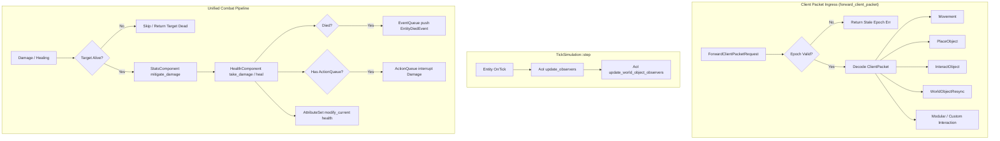

# Design: Wire Missing Packet Handlers, World Object AoI Replication, and Observer Cleanup

## 1. Overview & Architecture

This design addresses 5 architectural defects in `crates/node`:
1. Discarded packet results and unwired modular routing in `NodeServiceImpl::forward_client_packet`.
2. Missing `update_world_object_observers` in `TickSimulation::step`.
3. Orphaned observer leak during session takeover in `AoiManager::register_observer`.
4. Entity cleanup leaks across despawn and migration (`aoi`, `session_epochs`, `last_migration_ticks`, `rate_limits`).
5. Combat damage/mitigation pipeline divergence between local execution (`ability_dispatcher.rs`) and remote execution (`network.rs`).



---

## 2. Granular Technical Details

### 2.1 Upstream Session Epoch Fencing, Lock Efficiency & Packet Routing in `network.rs`

In `ForwardClientPacketRequest`, add field `uint64 session_epoch = 4;`:
```protobuf
message ForwardClientPacketRequest {
  uint64 session_id = 1;
  uint64 guid = 2;
  bytes packet_data = 3;
  uint64 session_epoch = 4;
}
```

In `NodeServiceImpl::forward_client_packet`:
To avoid lock bouncing, acquire the appropriate lock once:
- Movement, PlaceObject, InteractObject, WorldObjectResync, and Interaction require write access (`self.sim.write().await`).
- Under the write lock:
  1. Validate epoch: `if !sim.is_valid_upstream_epoch(guid, req.session_epoch) { return StaleEpochErr; }`
     *(Note: when authoritative epoch is 0, `req.session_epoch >= 0` evaluates to true. Once an epoch > 0 is established, any packet with an older epoch or 0 is rejected).*
  2. Validate entity existence and migration lease:
     ```rust
     if !sim.entity_store.contains_guid(guid) {
         return Ok(tonic::Response::new(ForwardClientPacketResponse {
             success: false,
             error_message: format!("Entity {} not found on node", guid),
         }));
     }
     if sim.is_migrating(guid) {
         return Ok(tonic::Response::new(ForwardClientPacketResponse {
             success: false,
             error_message: format!("Entity {} is migrating", guid),
         }));
     }
     ```

#### Handling `PlaceObject`:
```rust
mmo_schema::client::ClientPacket::PlaceObject(po) => {
    match sim.handle_place_object(guid, &po) {
        Ok(_) => {
            metrics::counter!("mmo_node_place_object_success_total").increment(1);
            Ok(tonic::Response::new(ForwardClientPacketResponse {
                success: true,
                error_message: String::new(),
            }))
        }
        Err(e) => {
            metrics::counter!("mmo_node_place_object_failed_total").increment(1);
            Ok(tonic::Response::new(ForwardClientPacketResponse {
                success: false,
                error_message: e.to_string(),
            }))
        }
    }
}
```

#### Handling `InteractObject`:
Refactor `TickSimulation::handle_interact_object` to take `&mut self` and dispatch `Event::BeforeInteract` (checking `ctx.is_canceled()`) and `Event::OnInteract` with mutable entity access.
In `network.rs`:
```rust
mmo_schema::client::ClientPacket::InteractObject(io) => {
    if sim.handle_interact_object(guid, &io) {
        metrics::counter!("mmo_node_interact_object_success_total").increment(1);
        Ok(tonic::Response::new(ForwardClientPacketResponse {
            success: true,
            error_message: String::new(),
        }))
    } else {
        metrics::counter!("mmo_node_interact_object_failed_total").increment(1);
        Ok(tonic::Response::new(ForwardClientPacketResponse {
            success: false,
            error_message: "Interaction failed or vetoed".to_string(),
        }))
    }
}
```

#### Handling `WorldObjectResync`:
```rust
mmo_schema::client::ClientPacket::WorldObjectResync(resync) => {
    if let Some(spawn) = sim.handle_world_object_resync(guid, &resync) {
        sim.pending_broadcast_jobs.push(crate::aoi::AoiBroadcastJob {
            session_id: req.session_id,
            player_guid: guid,
            packets: vec![mmo_schema::client::ClientPacket::WorldObjectSpawn(spawn)],
        });
        metrics::counter!("mmo_node_world_object_resync_success_total").increment(1);
        Ok(tonic::Response::new(ForwardClientPacketResponse {
            success: true,
            error_message: String::new(),
        }))
    } else {
        metrics::counter!("mmo_node_world_object_resync_dropped_total").increment(1);
        Ok(tonic::Response::new(ForwardClientPacketResponse {
            success: false,
            error_message: "World object not found or rate limited".to_string(),
        }))
    }
}
```

#### Modular Packet Router Dispatch with Anti-Spoofing:
When receiving `ClientPacket::Interaction(interact)`:
1. Anti-spoofing check:
   ```rust
   if req.guid != 0 && interact.source_guid != 0 && interact.source_guid != req.guid {
       return Ok(tonic::Response::new(ForwardClientPacketResponse {
           success: false,
           error_message: "Spoofed source_guid in interaction packet".to_string(),
       }));
   }
   ```
2. Extract module/sub-opcode:
   ```rust
   let (module_id, sub_opcode) = if interact.action_id > 0xFFFF {
       ((interact.action_id >> 16) as u16, (interact.action_id & 0xFFFF) as u16)
   } else {
       (interact.action_id as u16, match interact.interaction_type {
           InteractionType::Custom(sub) => sub as u16,
           _ => 0,
       })
   };
   ```
3. If `sim.packets.has_module(module_id)`, dispatch:
   ```rust
   match sim.packets.dispatch(
       module_id,
       sub_opcode,
       guid,
       &interact.payload,
       &mut sim.entity_store,
   ) {
       Ok(response_bytes) => {
           if let Some(resp) = response_bytes {
               sim.pending_broadcast_jobs.push(crate::aoi::AoiBroadcastJob {
                   session_id: req.session_id,
                   player_guid: guid,
                   packets: vec![mmo_schema::client::ClientPacket::InteractionResult(
                       mmo_schema::client::InteractionResultPacket {
                           action_id: interact.action_id,
                           success: true,
                           error_code: 0,
                           payload: resp,
                       },
                   )],
               });
           }
           Ok(tonic::Response::new(ForwardClientPacketResponse {
               success: true,
               error_message: String::new(),
           }))
       }
       Err(e) => Ok(tonic::Response::new(ForwardClientPacketResponse {
           success: false,
           error_message: e.to_string(),
       })),
   }
   ```

---

### 2.2 World Object AoI Replication in `sim.rs`

In `TickSimulation::step`:
```rust
let mut world_obj_jobs =
    self.aoi
        .update_world_object_observers(&self.entity_store, &self.sectors);
self.pending_broadcast_jobs.append(&mut world_obj_jobs);
```
*(Note: Per architectural review, `SectorManager` does not maintain sector-level dirty flags; each observer tracks object revisions individually in `known_world_objects`)*.

---

### 2.3 Observer Session Replacement in `aoi.rs`

In `AoiManager::register_observer`:
```rust
pub fn register_observer(
    &mut self,
    session_id: u64,
    player_guid: Guid,
    config: ObserverConfig,
) {
    if let Some(old_session_id) = self.guid_to_session.get(&player_guid).copied() {
        if old_session_id != session_id {
            self.observers.remove(&old_session_id);
        }
    }
    // Bidirectional cleanup if session_id previously pointed to another guid
    if let Some(old_obs) = self.observers.remove(&session_id) {
        if old_obs.player_guid != player_guid {
            self.guid_to_session.remove(&old_obs.player_guid);
        }
    }
    let observer = ObserverState::new(session_id, player_guid, config);
    self.observers.insert(session_id, observer);
    self.guid_to_session.insert(player_guid, session_id);
}
```

---

### 2.4 Entity Lifecycle & Despawn Cleanup in `sim.rs` and `sector.rs`

In `SectorManager`:
```rust
pub fn clear_rate_limit(&mut self, player_guid: Guid) -> bool {
    self.rate_limits.remove(&player_guid).is_some()
}
```

In `TickSimulation::despawn_entity`:
```rust
pub fn despawn_entity(&mut self, guid: Guid) -> bool {
    self.kinematic_states.remove(&guid);
    self.migrating_leases.remove(&guid);
    self.last_migration_ticks.remove(&guid);
    self.session_epochs.remove(&guid);
    self.aoi.unregister_by_guid(guid);
    self.sectors.clear_rate_limit(guid);
    self.instances.remove_entity(guid);
    if let Some(entity) = self.entity_store.despawn_by_guid(guid) {
        if !self.octree.remove(guid, entity.position) {
            self.octree.remove_by_guid(guid);
        }
        self.hooks.dispatch(&Event::OnDespawn { entity: guid });
        self.event_queue.push(EntityDespawnEvent { guid });
        true
    } else {
        false
    }
}
```

In outbound migration cleanup in `network.rs` (`execute_entity_migration` and `execute_batch_entity_migration`):
Clean up all 6 stores:
- `kinematic_states.remove(&guid)`
- `aoi.unregister_by_guid(guid)`
- `session_epochs.remove(&guid)`
- `last_migration_ticks.remove(&guid)`
- `sectors.clear_rate_limit(guid)`
- `instances.remove_entity(guid)`

---

### 2.5 Unified Combat Damage & Mitigation Function

Define in `crates/node/src/combat_pipeline.rs`:
```rust
pub struct CombatEffectOutcome {
    pub current_health: u32,
    pub effective_damage: f32,
    pub effective_healing: f32,
    pub died: bool,
}

pub fn apply_combat_effect(
    target_ent: &mut Entity,
    target_guid: Guid,
    caster_guid: Option<Guid>,
    damage: u32,
    healing: u32,
    event_queue: &mut EventQueue,
) -> Result<CombatEffectOutcome, &'static str>
```
Follows the pipeline:
1. Verify target is alive: if `health.is_dead`, return `Err("Target entity is dead")`.
2. If `damage > 0`:
   - Compute `effective_damage = StatsComponent::mitigate_damage(damage as f32)`.
   - Call `HealthComponent::take_damage(effective_damage)`.
   - If died, push `mmo_gameplay::combat::EntityDiedEvent { entity: target_guid, killer: caster_guid }`.
   - Check `ActionQueue`: if active action has `cancel_on_damage`, call `queue.interrupt(target_guid, InterruptReason::Damage, event_queue)`.
   - If `AttributeSet` present, update `modify_current("health", -effective_damage)`.
3. If `healing > 0`:
   - Heal `HealthComponent`.
   - Update `AttributeSet`.
4. Return `Ok(CombatEffectOutcome { current_health, effective_damage, effective_healing, died })`.

In single-target casts (`cast_cross_partition_ability`), check target is alive before deducting caster resources or starting cooldowns.
In AoE batch casts (`cast_cross_partition_batch_ability`), skip dead entities without aborting the entire batch.
In `execute_remote_ability`, invoke `apply_combat_effect`.
