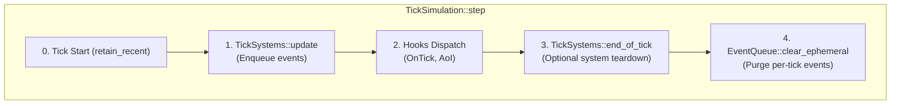
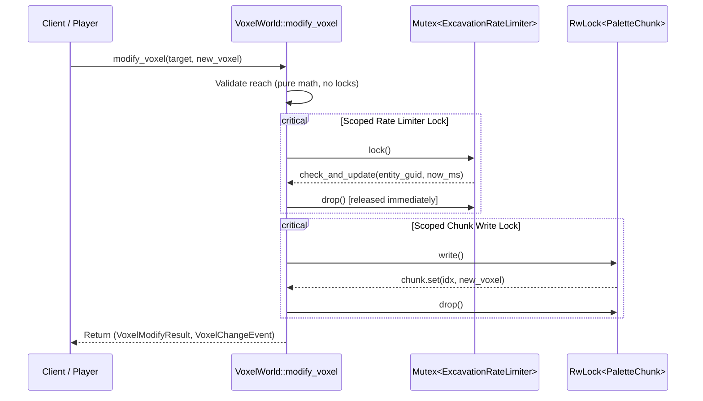

# Design: Core Primitives & Voxel Engine Audit Hardening

## Overview
This architectural change addresses critical resilience, memory safety, and concurrency issues identified during the audit of `crates/core`, `crates/node`, and `crates/plugins/voxel` (GitHub Issue #167).

---

## 1. EventQueue Ephemeral Lifecycle & End-of-Tick Cleanup

### Context & Root Cause
In `crates/core/src/action.rs:316-322`, `ActionTickSystem` produces an `ActionProgressEvent` every tick for every active action. In `crates/plugins/voxel/src/plugin.rs:154-157`, `VoxelTickSystem` emits `VoxelChangeEvent`s into `ctx.events`. Neither of these is consumed by default core systems, accumulating indefinitely unless pruned. While `retain_recent(1024)` prevents explosive infinite growth per type, 1024 boxed items per type across ticks represents an unnecessary memory footprint and leaks stale per-tick progress state.

### Design Architecture


### Components
1. **`EventQueue` Extension (`crates/core/src/plugin.rs`)**:
   ```rust
   pub struct EventQueue {
       queues: HashMap<TypeId, Vec<Box<dyn Any + Send + Sync>>>,
       ephemeral_types: HashSet<TypeId>,
   }

   impl EventQueue {
       pub fn register_ephemeral<E: DomainEvent>(&mut self) {
           self.ephemeral_types.insert(TypeId::of::<E>());
       }

       pub fn is_ephemeral<E: DomainEvent>(&self) -> bool {
           self.ephemeral_types.contains(&TypeId::of::<E>())
       }

       pub fn clear_ephemeral(&mut self) {
           for type_id in &self.ephemeral_types {
               if let Some(queue) = self.queues.get_mut(type_id) {
                   queue.clear();
               }
           }
       }

       pub fn clear_type<E: DomainEvent>(&mut self) {
           self.queues.remove(&TypeId::of::<E>());
       }
   }
   ```
2. **`TickSystem` Lifecycle Hook (`crates/core/src/plugin.rs`)**:
   ```rust
   pub trait TickSystem: Send + Sync {
       fn name(&self) -> &'static str;
       fn update(&mut self, ctx: &mut TickContext);
       fn end_of_tick(&mut self, _ctx: &mut TickContext) {}
   }
   ```
3. **Core & Plugin Registration**:
   - `ActionTickSystem::update` registers `ActionProgressEvent` as ephemeral in `EventQueue` (ensuring standalone and test simulations auto-register it), and `TickSimulation::with_kinematics` registers it at startup.
   - `VoxelTerrainPlugin::build` registers `VoxelChangeEvent` as ephemeral in `EventQueue`.
4. **`TickSimulation::step` Cleanup Execution (`crates/node/src/sim.rs`)**:
   - At the conclusion of each simulation tick:
     - Execute `system.end_of_tick(&mut tick_ctx)` for each registered `TickSystem`.
     - Invoke `self.event_queue.clear_ephemeral()`.
     - Non-ephemeral domain events (e.g. `DamageEvent`, `EntityIncapacitatedEvent`) remain in `EventQueue` for external or deferred draining, capped by `retain_recent`.

---

## 2. Multi-Sector Spatial Index Completeness (`SectorSpatialIndex`)

### Context & Root Cause
`WorldObject` is placed in a sector based on `transform.position`. When `query_aabb` runs:
```rust
let min_sector = SectorCoord3D::from_world_pos(aabb.min);
let max_sector = SectorCoord3D::from_world_pos(aabb.max);
```
If an object's position is in sector $(x-1, y, z)$ near the sector boundary, but its bounding box reaches into sector $(x, y, z)$, a query whose bounding box is strictly within sector $(x, y, z)$ will only inspect sector $(x, y, z)$, missing the overlapping object entirely.

### Mathematical Formulation & Fix
Let $P_i = (p_{x,i}, p_{y,i}, p_{z,i})$ be the position of object $i$, and $B_i = [\min_{i}, \max_{i}]$ be its axis-aligned bounding box.
The maximum spatial reach (extent) of object $i$ from its origin along any axis is:
$$E_i = \max \left( | \max_{x,i} - p_{x,i} |, | p_{x,i} - \min_{x,i} |, | \max_{y,i} - p_{y,i} |, | p_{y,i} - \min_{y,i} |, | \max_{z,i} - p_{z,i} |, | p_{z,i} - \min_{z,i} | \right)$$
The global maximum extent across all objects in the index is:
$$E_{\max} = \max_{i \in \text{Objects}} E_i$$
For any query box $Q = [Q_{\min}, Q_{\max}]$:
Any object $i$ whose bounding box intersects $Q$ must satisfy:
$$P_i \in [Q_{\min} - E_{\max}, Q_{\max} + E_{\max}]$$
Therefore, candidate sectors MUST span from:
$$\text{SectorCoord3D::from\_world\_pos}(Q_{\min} - E_{\max}) \quad \text{to} \quad \text{SectorCoord3D::from\_world\_pos}(Q_{\max} + E_{\max})$$
All objects in these sectors are then checked against the exact $Q$ with `object.bounds.intersects(aabb)`.

### State Management & Bounds Verification
- `SectorSpatialIndex` maintains:
  - `object_extents: HashMap<Guid, f32>`
  - `max_extent: f32`
- `WorldObject::max_extent(&self) -> f32`:
  - Computes max radial distance from `transform.position` to any bounding box edge.
  - Safely checks `.is_finite()`, returning `0.0` if any coordinate is non-finite or `NaN`.
- In `query_aabb`:
  - Returns an empty `Vec` if any query coordinate is non-finite.
- On `insert`:
  - Calculate $E_i = \text{object.max\_extent()}$.
  - Update `object_extents.insert(id, E_i)`.
  - If $E_i \ge \text{max\_extent}$, update $\text{max\_extent} = E_i$.
  - Else if previous extent was equal to `max_extent`, recompute $\text{max\_extent}$ across all values in `object_extents`.
- On `remove`:
  - Remove from `object_extents`.
  - If the removed extent was equal to `max_extent`, recompute `max_extent` across remaining values in $O(N)$ (infrequent operation).
- On `clear`:
  - Clear `object_extents` and set `max_extent = 0.0`.

---

## 3. Voxel World Concurrency Optimization

### Context & Root Cause
In `VoxelWorld::modify_voxel`, the global `self.rate_limiter` Mutex is acquired at line 127, and held during:
1. `chunk_arc.write()` (acquiring chunk write lock, possibly blocking if reader/writer is busy)
2. `chunk.set(idx, new_voxel)` (palette reallocation and bit-packing)
This serializes all voxel modifications across the entire world to a single thread!

### Lock Scoping Architecture


### Implementation Details
- Decompose modification checks in `crates/plugins/voxel/src/modify.rs`:
  - `pub fn validate_reach(...) -> Result<(), VoxelModifyResult>`
  - `pub fn validate_rate_limit(...) -> Result<(), VoxelModifyResult>`
  - `pub fn apply_modification(...) -> VoxelModifyResult`
- In `VoxelWorld::modify_voxel`:
  - Check reach first (lock-free).
  - Check rate limit under scoped lock, then immediately drop `rate_limiter`.
  - Acquire `chunk_arc.write()`.
  - Apply modification.

---

## 4. Defensive Bounds & Non-Panicking Clamping

1. **`PaletteChunk::get` and `PaletteChunk::set` (`crates/plugins/voxel/src/chunk.rs`)**:
   - Replace `assert!(idx < CHUNK_VOXELS, "Voxel index out of bounds");` with defensive checks.
   - Use `self.data.get(word_idx)` and `self.data.get_mut(word_idx)` instead of raw indexing `self.data[word_idx]`:
     ```rust
     #[inline]
     pub fn get(&self, idx: usize) -> u16 {
         if idx >= CHUNK_VOXELS {
             return 0;
         }
         ...
         let Some(&word) = self.data.get(word_idx) else {
             return 0;
         };
         let pal_idx = ((word >> bit_offset) & mask) as usize;
         self.palette.get(pal_idx).copied().unwrap_or(0)
     }

     #[inline]
     pub fn set(&mut self, idx: usize, voxel_type: u16) -> bool {
         if idx >= CHUNK_VOXELS {
             return false;
         }
         ...
     }
     ```
   - This provides defense-in-depth: even if corrupt data or internal calculations produce an out-of-bounds index or truncated buffer, the server process will never crash.

2. **Attribute and Action Clamping (`crates/core/src/attribute.rs`, `action.rs`)**:
   - In `AttributeSet::get_current_by_id`, replace `attr.current.clamp(...)` with `safe_clamp(attr.current, attr.min, effective_max)`.
   - In `TimedAction::progress`, guard against non-finite or non-positive durations before clamping:
     ```rust
     pub fn progress(&self) -> f32 {
         if self.duration_sec <= 0.0 || !self.duration_sec.is_finite() {
             1.0
         } else {
             safe_clamp(self.elapsed_sec / self.duration_sec, 0.0, 1.0)
         }
     }

     #[inline]
     pub fn progress_fraction(&self) -> f32 {
         self.progress()
     }
     ```
