# Technical Design: Director Node Fencing and Storage Engine Hardening

## Overview
This design implements remedies for Partition 4 findings (Issue #170) covering split-brain simulation prevention, 2PC transfer idempotency, SQLite foreign key enforcement, marketplace reaper starvation prevention, and deadlock avoidance.

## Architecture & Data Flow

```mermaid
flowchart TD
    subgraph Director & Node Fencing
        N[Node Runner] -->|Heartbeat| D[Director Service]
        D -->|Lookup Node| R{Registered?}
        R -->|Yes| Ack[HeartbeatResponse ack=true]
        R -->|No / Evicted| Err[Status::failed_precondition Fenced]
        Err -->|Received| Signal[Signal via fence_tx channel]
        Signal --> NS[Break Main 20Hz Simulation Loop Immediately]
    end

    subgraph 2PC Commit Idempotency
        C[Client Retry commit_transfer] --> Q1[Query container_transactions by tx_id]
        Q1 -->|Committed| RetOk[Return Existing ContainerTransactionRecord]
        Q1 -->|Aborted| RetErr[Return ReservationExpiredOrAborted]
        Q1 -->|Not Found| Del[Delete container_reservations]
        Del -->|deleted < 2 or rows != 2| Q2[Re-query container_transactions for race]
        Q2 -->|Committed| RetOk
        Q2 -->|Not Found / Aborted| RetErr
        Del -->|deleted == 2| Norm[Execute Normal 2PC Commit Protocol]
    end

    subgraph Marketplace Reaper
        Reaper[Reaper Sweep] --> ListQ[SELECT WHERE status='Active' ORDER BY expires_at_epoch_ms ASC]
        ListQ --> CanRefund{Seller Container Space?}
        CanRefund -->|Yes| Refund[Refund Item & status='Expired']
        CanRefund -->|No / Full / Missing| Pending[status='ExpiredPendingClaim' & update timestamp]
        Cancel[Seller cancel_listing] -->|Active or ExpiredPendingClaim| ReturnItem[Return item to seller]
    end
```



## Detailed Changes

### 1. Director Node Fencing (`crates/director`, `crates/node`)
- In `crates/director/src/service.rs`:
  ```rust
  if acknowledged {
      let should_split =
          coord.evaluate_heartbeat(req.node_id, req.entity_count, req.tick_duration_ms);
      Ok(Response::new(HeartbeatResponse {
          acknowledged: true,
          should_split,
          topology_epoch,
      }))
  } else {
      metrics::counter!("mmo_director_node_fenced_total").increment(1);
      Err(Status::failed_precondition(format!(
          "Node {} is evicted/unregistered in director topology (node fenced to prevent split-brain simulation)",
          req.node_id
      )))
  }
  ```
- In `crates/node/src/runner.rs`:
  - Introduce an inter-task cancellation/shutdown channel between `heartbeat_handle` and the main 20 Hz simulation loop (`tokio::sync::mpsc::channel(1)` or `tokio::sync::watch`).
  - When heartbeat returns `Err(e)` and `e.code() == tonic::Code::FailedPrecondition`:
    - Log error: `[Node {node_id}] Fenced by Director (split-brain prevention): {e}. Terminating node simulation.`
    - Send fence signal to simulation loop.
    - Remove obsolete `if !inner.acknowledged` background re-registration logic.
  - In the 20 Hz simulation loop:
    - Select on `fence_rx.recv()` alongside `shutdown_fut`.
    - If fenced, break immediately and proceed to `drain_and_shutdown_node`.

### 2. Idempotent 2PC `commit_transfer` (`crates/storage/src/transaction_coord.rs`)
- In `commit_transfer(tx_id)`:
  - Query `container_transactions` by `tx_id`.
  - If a row exists:
    - If `status == "committed"`, return `Ok(ContainerTransactionRecord { tx_id, src_container_id, dst_container_id, item_instance_id, status, timestamp_epoch_ms })`.
    - If `status == "aborted"`, return `Err(StorageError::ReservationExpiredOrAborted(tx_id))`.
  - If no row exists in `container_transactions`, query `container_reservations`:
    - If `rows.len() != 2`:
      - Re-query `container_transactions` by `tx_id` to handle concurrent duplicate commit races. If committed, return `Ok(...)`, else return `Err(ReservationExpiredOrAborted)`.
    - Execute `DELETE FROM container_reservations WHERE tx_id = ? AND expires_at_epoch_ms > ?`.
    - If `deleted < 2`:
      - Re-query `container_transactions` by `tx_id` for concurrent commit race. If committed, return `Ok(...)`, else return `Err(ReservationExpiredOrAborted)`.
  - Proceed with moving item, updating container versions, and inserting `container_transactions` record.

### 3. SQLite Foreign Key Enforcement (`crates/storage/src/db.rs`)
- Verify `.pragma("foreign_keys", "ON")` in `connect` and `connect_memory`.
- Add unit test verifying that foreign key constraint violations fail when inserting into dependent tables (e.g., `items` referencing non-existent `container_id`) and verifying relational integrity.

### 4. Marketplace Reaper Starvation Elimination (`crates/storage/src/models.rs`, `crates/storage/src/marketplace.rs`)
- In `crates/storage/src/models.rs`:
  - Add `ExpiredPendingClaim` variant to `ListingStatus`.
  - Implement `Display` ("ExpiredPendingClaim") and `FromStr` ("ExpiredPendingClaim").
  - Update unit tests for `ListingStatus`.
- In `crates/storage/src/marketplace.rs`:
  - In `reap_expired_listings`:
    - Query candidate listings with `ORDER BY expires_at_epoch_ms ASC LIMIT ?`.
    - If `c_seller` is `None` or `find_first_free_slot` is `None` (full inventory):
      - `UPDATE market_listings SET status = 'ExpiredPendingClaim', updated_at_epoch_ms = ? WHERE listing_id = ? AND status = 'Active'`.
  - In `cancel_listing`:
    - Allow cancellation/reclaim if `status_str == "Active" || status_str == "ExpiredPendingClaim"`.
  - Update existing test `test_marketplace_reap_expired_listings_seller_inventory_full_safety` to expect `ListingStatus::ExpiredPendingClaim`.
  - Add unit test verifying unblocking of reaper queue and subsequent reclaim by seller.

### 5. PostgreSQL Deadlock Prevention in 2PC Version Increment (`crates/storage/src/transaction_coord.rs`)
- Canonical ascending GUID ordering `(min(src, dst), max(src, dst))` for version increment is enforced.
- Concurrent bidirectional transfer unit test verifies deadlock absence.
