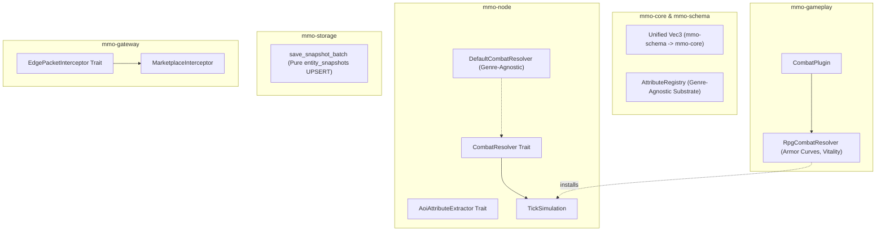

# Technical Design: Decouple Remaining Genre-Specific RPG Mechanics

## Context & Motivation
Under [`AGENTS.md`](AGENTS.md), the core MMO engine must serve as an unopinionated substrate capable of powering fantasy RPGs, space simulators, modern tactical simulations, and voxel worlds without embedding genre assumptions in core primitives.

This design decouples remaining RPG mechanics across four architectural boundaries:
1. Simulation Combat & AoI (`mmo-node`)
2. Entity Snapshot Storage (`mmo-storage`)
3. Mathematical Primitives & Attributes (`mmo-core`, `mmo-schema`)
4. Edge Packet Interception (`mmo-gateway`)



---

## 1. Unified 3D Vector Substrate (`mmo-schema` & `mmo-core`)

### Design
- In `crates/schema/src/client.rs`, `Vec3` derives `Serialize, Deserialize, Default, Copy, Clone, Debug, PartialEq`.
- Implement vector operations on `mmo_schema::client::Vec3`:
  - `dot(&self, other: &Self) -> f32`
  - `From<(f32, f32, f32)>` and `From<Vec3> for (f32, f32, f32)`
  - `distance`, `distance_squared`, `length`, `length_squared`, `normalized`, `is_finite`, `encode`, `decode`.
- Add `mmo-schema = { path = "../schema", default-features = false }` to `crates/core/Cargo.toml`.
- In `crates/core/src/spatial.rs`, replace duplicate struct definition with:
  ```rust
  pub use mmo_schema::client::Vec3;
  ```
- This unifies coordinates across the entire workspace with zero conversion boilerplate and zero allocation overhead.

---

## 2. Pluggable Attribute Aliases (`mmo-core`)

### Design
- `AttributeId` constants define standard mathematical roles:
  - `AttributeId::PRIMARY_VITALITY = 1`
  - `AttributeId::MAX_PRIMARY_VITALITY = 2`
  - `AttributeId::SECONDARY_RESOURCE = 3`
  - `AttributeId::MAX_SECONDARY_RESOURCE = 4`
  - `AttributeId::MOVE_SPEED_SCALE = 5`
  - `AttributeId::MITIGATION = 6`
- Provide `AttributeRegistry` storing dynamic string mappings:
  - Default registry contains mathematically neutral canonical mappings (`"vitality"`, `"max_vitality"`, `"secondary_resource"`, `"move_speed_scale"`, `"mitigation"`).
  - Maintains backward compatibility for existing names (`"health"`, `"mana"`, `"armor"`, `"hull"`, `"stamina"`) via pre-populated alias table or plugin registration.
  - `canonical_id_for_name(name: &str) -> Option<AttributeId>` queries the registry.

---

## 3. Pluggable Combat Resolution (`mmo-core`, `mmo-node` & `mmo-gameplay`)

### Design
- Define `CombatEffectOutcome` and `CombatResolver` trait in `crates/core/src/combat.rs` (re-exported in `crates/core/src/lib.rs` and `crates/core/src/plugin.rs`):
  ```rust
  #[derive(Debug, Clone, Copy, PartialEq)]
  pub struct CombatEffectOutcome {
      pub current_health: u32,
      pub effective_damage: f32,
      pub effective_healing: f32,
      pub died: bool,
  }

  pub trait CombatResolver: Send + Sync {
      fn resolve_combat_effect(
          &self,
          target_ent: &mut Entity,
          target_guid: Guid,
          caster_guid: Option<Guid>,
          damage: u32,
          healing: u32,
          event_queue: &mut EventQueue,
      ) -> Result<CombatEffectOutcome, &'static str>;
  }
  ```
- Add `pub combat_resolver: Option<Arc<dyn CombatResolver>>` to `PluginContext` in `crates/core/src/plugin.rs`.
- Implement `DefaultCombatResolver` in `crates/node/src/combat_pipeline.rs`:
  - Directly applies damage/healing to `AttributeId::PRIMARY_VITALITY` or dynamic property `"vitality"`.
  - Zero assumptions about fantasy armor formulas.
  - Emits `EntityIncapacitatedEvent` when vitality reaches zero.
- Implement `RpgCombatResolver` in `crates/gameplay/src/combat.rs`:
  - Reads `AttributeId::MITIGATION` / `"armor"`.
  - Applies RPG mitigation curve: `armor / (armor + 100.0)` clamped to `0.90`.
  - Deducts mitigated damage from `"health"` / `AttributeId::PRIMARY_VITALITY`.
  - In `CombatPlugin::build`, sets `ctx.combat_resolver = Some(Arc::new(RpgCombatResolver));`.
- In `TickSimulation`:
  - Holds `pub combat_resolver: Arc<dyn CombatResolver>`.
  - Default initialized with `DefaultCombatResolver`.
  - `sim.set_combat_resolver(resolver)` allows direct override.
  - When plugins are initialized, if `ctx.combat_resolver` was set by any plugin, `TickSimulation` adopts it.
  - `crates/node/src/combat_pipeline::apply_combat_effect` and `execute_remote_ability` delegate to the active `combat_resolver`.

---

## 4. Configurable AoI Attribute Extraction (`mmo-node`)

### Design
- Define `AoiAttributeExtractor` trait in `crates/node/src/aoi.rs`:
  ```rust
  pub trait AoiAttributeExtractor: Send + Sync {
      fn extract(&self, ent: &mmo_core::Entity) -> (u32, u32, u32, Vec<ScalarAttributeDelta>);
  }
  ```
- Provide `DefaultAoiAttributeExtractor`:
  - Inspects `AttributeSet` for `PRIMARY_VITALITY` and `MAX_PRIMARY_VITALITY`.
  - Inspects `DynamicProperties` for vitality and state flags.
  - Appends indexed scalar attributes generically.
- `AoiManager` holds an `Arc<dyn AoiAttributeExtractor>` with a setter method `set_attribute_extractor`.

---

## 5. Decoupled Snapshot Batch Persistence (`mmo-storage`)

### Design
- In `crates/storage/src/repository.rs`:
  - In `save_snapshot_batch`:
    - Remove `char_query` (`UPDATE characters SET pos_x = ?, ... WHERE guid = ?`).
    - Only execute `snap_query` on `entity_snapshots`.
  - Rationale: `entity_snapshots` is the authoritative generalized substrate for spatial state, dynamic properties, and binary state blobs across all entity types. The `characters` table is an RPG-specific metadata table maintained via dedicated methods (e.g. `update_character_position` / `create_character`).

---

## 6. Generic Edge Packet Interception (`mmo-gateway`)

### Design
- Define `EdgePacketInterceptor` and `EdgePacketSink` in `crates/gateway/src/server/intercept.rs`:
  ```rust
  #[async_trait::async_trait]
  pub trait EdgePacketInterceptor: Send + Sync {
      async fn intercept_packet(
          &self,
          session_id: u64,
          player_guid: Option<u64>,
          packet: &ClientPacket,
          sender: &dyn EdgePacketSender,
      ) -> bool;
  }
  ```
- `GatewayServer` allows registering arbitrary interceptors:
  - `pub fn with_interceptor(mut self, interceptor: Arc<dyn EdgePacketInterceptor>) -> Self`
- `GatewayMarketplaceService` implements `EdgePacketInterceptor`, keeping edge packet routing fully decoupled and extensible.

---

## Concurrency & Safety Considerations
1. **Thread Safety**: All traits (`CombatResolver`, `AoiAttributeExtractor`, `EdgePacketInterceptor`) require `Send + Sync`.
2. **Zero Allocations in Simulation Hot-Path**:
   - `Vec3` operations remain purely value-typed on the stack.
   - Vector math operations are inlined (`#[inline]`).
3. **Graceful Fallbacks**:
   - If no specialized combat resolver is registered, `DefaultCombatResolver` safely resolves vitality changes without panic or deadlock.
