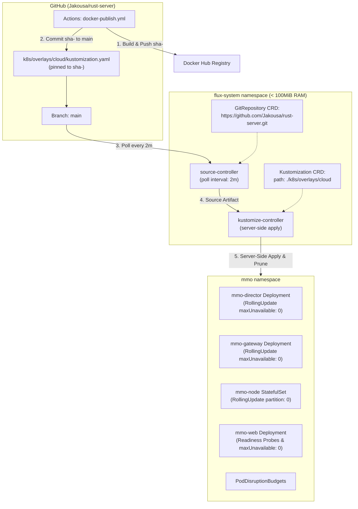

# Design: Minimal Flux v2 Architecture for Cloud Cluster

## Architectural Overview

## Component Architecture

### 1. Minimal Controller Suite
Instead of installing the full Flux toolkit (which includes Helm, Notifications, Image Reflector, and Image Automation controllers taking ~350MB RAM), we deploy only:
- `source-controller` (~35–40 MiB)
- `kustomize-controller` (~45–60 MiB)
Total memory: ~90 MiB (<2.5% of node capacity), CPU idle < 5m.

### 2. Automated GitOps Tag Propagation Pipeline
In `.github/workflows/docker-publish.yml`:
1. Sequential execution: Images are built and pushed to Docker Hub with tags `latest` and `sha-<short-sha>`.
2. Post-publish commit: Once images exist on Docker Hub, GitHub Actions updates `k8s/overlays/cloud/kustomization.yaml` with the exact `sha-<short-sha>` and commits to `main` with `[skip ci]`.
3. Concurrency safety: `docker-publish-${{ github.ref }}` concurrency group prevents write races.
4. Flux reconciliation: `source-controller` polls `main` every 2 minutes, detects the new commit, and triggers `kustomize-controller`.
5. Guarantee against `ImagePullBackOff`: Because Git is only updated *after* Docker Hub push succeeds, nodes will never encounter missing image tags.

### 3. Declarative Repository Source
The `GitRepository` CRD defines the upstream repository:
- URL: `https://github.com/Jakousa/rust-server.git`
- Branch: `main`
- Polling Interval: `2m` (conservative to avoid GitHub rate limits)
- Ignore pattern: ignores all non-k8s directories (`/*`, `!/k8s`) to minimize artifact tarball generation and network bandwidth on the cluster node.

### 4. Declarative Kustomization Reconciliation
The `Kustomization` CRD defines:
- SourceRef: `rust-server`
- Path: `./k8s/overlays/cloud`
- Prune: `true` (garbage collects removed resources)
- Validation: `client`
- Server-side apply: enabled with field ownership tracking.

### 5. Rolling Update Strategy & Zero-Downtime Guarantees
- Deployments (`mmo-director`, `mmo-gateway`, `mmo-web`) declare explicit `strategy.type: RollingUpdate` with `maxSurge: 1` and `maxUnavailable: 0`.
- `mmo-web` includes explicit `readinessProbe` and `livenessProbe` checking HTTP `/`. Old pods are terminated only after new pods report healthy.
- StatefulSet `mmo-node` operates in reverse ordinal rolling update with `minAvailable: 1` guarded by `mmo-node-pdb`.

### 6. Failure Modes & Edge Cases
1. **GitHub Rate Limiting / Outage**:
   - `source-controller` caches the last known good artifact tarball. If GitHub is unreachable, Flux enters retry backoff while the running workloads in `mmo` continue running uninterrupted.
2. **Invalid Manifest Pushed to Git**:
   - `kustomize-controller` validates manifests before applying. If a syntax or validation error occurs, reconciliation fails with a clear status condition, leaving existing running workloads untouched.
3. **Node OOM Protection**:
   - Flux controller deployments specify memory limits (`256Mi` max) and requests (`64Mi`) with low scheduling priority so simulation pods in `mmo` are never evicted.
