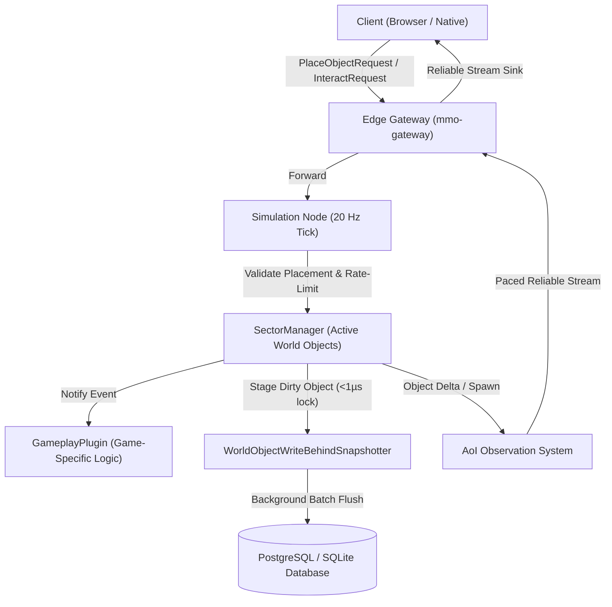

# Architecture Design: Persistent World Objects, Dynamic Prefabs & Spatial Sector Streaming

## 1. Architectural Overview & Component Interaction



---

## 2. Core Primitives & Data Structures (`mmo-core`)

### 2.1 Spatial Sectors
Continuous 3D space is divided into discrete cubic sectors:
```rust
#[derive(Debug, Clone, Copy, PartialEq, Eq, Hash, PartialOrd, Ord)]
pub struct SectorCoord3D {
    pub x: i32,
    pub y: i32,
    pub z: i32,
}

impl SectorCoord3D {
    pub const SECTOR_SIZE: f32 = 64.0;

    #[inline]
    pub fn from_world_pos(pos: (f32, f32, f32)) -> Self {
        Self {
            x: (pos.0 / Self_SECTOR_SIZE).floor() as i32,
            y: (pos.1 / Self_SECTOR_SIZE).floor() as i32,
            z: (pos.2 / Self_SECTOR_SIZE).floor() as i32,
        }
    }
}
```

### 2.2 Generalized Transform & Bounds
```rust
#[derive(Debug, Clone, Copy, PartialEq)]
pub struct Transform3D {
    pub position: (f32, f32, f32),
    pub rotation: (f32, f32, f32, f32), // Quaternion (x, y, z, w)
    pub scale: (f32, f32, f32),
}
```

### 2.3 WorldObject Representation
```rust
#[derive(Debug, Clone, PartialEq)]
pub struct WorldObject {
    pub object_id: Guid,
    pub prefab_id: u32,
    pub transform: Transform3D,
    pub bounds: BoundingBox3D,
    pub state_flags: u32,
    pub owner: ContainerOwner,
    pub health: Option<HealthComponent>,
    pub properties: HashMap<String, String>,
    pub dirty_revision: u64,
}
```

---

## 3. Authoritative Simulation & Anti-Cheat Validation (`mmo-node`)

### 3.1 Rate Limiting & Denial-of-Service Defense
- Each client connection maintains a token bucket in `mmo-node`:
  - Bucket capacity: 10 tokens.
  - Refill rate: 5 tokens/second.
- Any request exceeding available tokens is rejected immediately before triggering raycasting or spatial searches.

### 3.2 Server-Authoritative Position, Line-of-Sight & Range Check
- `PlaceObjectRequest` and `InteractObjectRequest` contain no authoritative player position from the client.
- The simulation node queries `EntityStore` for the player's true server-side position $P_{\text{player}}$.
- The distance $|P_{\text{player}} - P_{\text{target}}| \le 6.0\text{m}$ is strictly enforced.
- **Placement Line-of-Sight**: A raycast from the player's eye position to the target placement coordinate is evaluated against world geometry. If occluded, the placement is rejected to prevent placing structures through walls or inside closed structures.

### 3.3 Bounding Box Collision Verification
- Prospective placement bounding box $B_{\text{target}}$ is checked against:
  - Active character kinematic bounding boxes.
  - Existing `WorldObject` bounds within the containing sector and neighboring sectors.
- Placements overlapping solid geometry or trapping player capsules are rejected with a typed error response.

---

## 4. AoI Sector Paging & Reliable Streaming (`mmo-node`, `mmo-schema`)

### 4.1 Packet Definitions
- **`WorldObjectSpawnPacket` (Reliable Stream)**:
  - Header: `object_id: Guid`, `prefab_id: u32`, `revision: u64`.
  - Body: Quantized position, quaternion rotation, scale, state flags, owner, health, property map.
- **`WorldObjectDeltaPacket` (Reliable Stream)**:
  - Header: `object_id: Guid`, `revision: u64`.
  - Body: Bitmask indicating modified fields (state flags, health, properties).
- **`WorldObjectDespawnPacket` (Reliable Stream)**:
  - Header: `object_id: Guid`.
- **`WorldObjectResyncRequest` (Reliable Stream)**:
  - Header: `object_id: Guid`. Client triggers when detecting revision gaps ($R_{\text{received}} > R_{\text{expected}} + 1$).

### 4.2 Paced Egress Delivery & Queue Pruning
- Entering sectors schedule all contained world objects for replication.
- To prevent Head-of-Line blocking or stream buffer saturation:
  - Maximum 10 objects transmitted per tick per client.
  - Objects are prioritized by ascending Euclidean distance to observer.
- **Egress Queue Pruning**: If a client moves rapidly causing a sector to exit their observation sphere before queued objects in that sector have been sent, the observer's transmission queue is immediately pruned of those pending entries.

---

## 5. Storage Persistence & Non-Blocking Write-Behind (`mmo-storage`)

### 5.1 Tick Loop Isolation & Swap Buffer Architecture
- Simulation ticks **NEVER** perform database IO or synchronous serialization.
- When an object is modified, `SectorManager` marks it dirty by passing an object clone to `WorldObjectWriteBehindSnapshotter`.
- Staging takes $< 1\,\mu\text{s}$ under an in-memory `Mutex<HashMap<Guid, WorldObjectRecord>>`.
- **Lock-Free Flushing via Buffer Swap**:
  - The background worker acquires the mutex, invokes `std::mem::take(&mut *guard)` to immediately swap out the dirty map, and releases the mutex within nanoseconds.
  - The worker then serializes records to JSON and executes SQL batch upserts completely detached from the simulation tick mutex.

### 5.2 Relational Schema (`V4__world_objects.sql`)
```sql
CREATE TABLE IF NOT EXISTS world_objects (
    world_id BIGINT NOT NULL,
    object_id BIGINT NOT NULL,
    sector_x INT NOT NULL,
    sector_y INT NOT NULL,
    sector_z INT NOT NULL,
    prefab_id INT NOT NULL,
    pos_x REAL NOT NULL,
    pos_y REAL NOT NULL,
    pos_z REAL NOT NULL,
    rot_x REAL NOT NULL,
    rot_y REAL NOT NULL,
    rot_z REAL NOT NULL,
    rot_w REAL NOT NULL,
    scale_x REAL NOT NULL DEFAULT 1.0,
    scale_y REAL NOT NULL DEFAULT 1.0,
    scale_z REAL NOT NULL DEFAULT 1.0,
    bounds_min_x REAL NOT NULL,
    bounds_min_y REAL NOT NULL,
    bounds_min_z REAL NOT NULL,
    bounds_max_x REAL NOT NULL,
    bounds_max_y REAL NOT NULL,
    bounds_max_z REAL NOT NULL,
    state_flags INT NOT NULL DEFAULT 0,
    owner_type VARCHAR(32) NOT NULL,
    owner_id VARCHAR(64) NOT NULL,
    health INT,
    max_health INT,
    properties_json TEXT,
    dirty_revision BIGINT NOT NULL,
    updated_at BIGINT NOT NULL,
    PRIMARY KEY (world_id, object_id)
);

CREATE INDEX IF NOT EXISTS idx_world_objects_sector 
ON world_objects (world_id, sector_x, sector_y, sector_z);

CREATE INDEX IF NOT EXISTS idx_world_objects_updated_at 
ON world_objects (world_id, updated_at);
```

---

## 6. Decoupled GameplayPlugin Extensibility
Games implement specific mechanics using open event hooks without touching core engine crates:
- **Doors & Levers**: Interacting triggers an event in `GameplayPlugin`, which toggles `state_flags` (e.g. `STATE_OPEN`).
- **Resource Mining**: Attack/interact actions deplete object health; reaching 0 drops loot via `LootTablePlugin` and marks `STATE_DEPLETED` with a respawn timer.
- **Volumetric Voxel Extension**: A voxel sandbox plugin stores volumetric chunk blobs inside `properties` or links them to sector coordinates via custom plugin packets, keeping the core server completely unopinionated.

---

## 7. Delegation Strategy with Local Subagents
To preserve cloud tokens and maximize efficiency:
* Delegate to local subagents where available:
  - `SectorCoord3D` and `Transform3D` methods and math tests.
  - SQL repository queries and database migration bindings.
  - Packet serialization/deserialization codecs in `mmo-schema`.
  - Comprehensive unit and property test suites.
